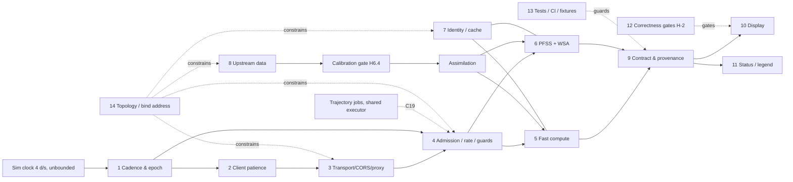
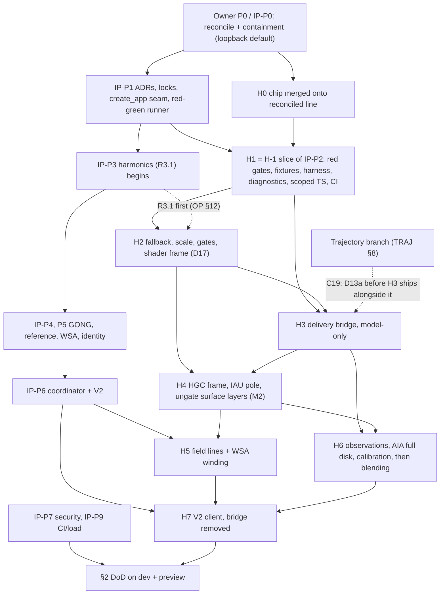

# H-1 remediation plan: getting the backend solar model onto the screen

**Status:** final synthesis, revised after the evidence and completeness critiques, 2026-09-25. Only Phase 0 (the status chip) is implemented, on its own unmerged branch; everything else is plan. The revision log is at the end.

**How this was produced:** six investigators read and ran the real code (digest in the evidence folder). Three independent designs (incremental, architecture, product-truth) were scored by two judges, who both chose product-truth as the skeleton (46 and 48, against 41/44 and 38/40). The merged plan was checked by an evidence critic (40+ claims) and a completeness critic, then revised. Before saving, five of its sharpest claims were re-checked by hand: the three Legendre copies; shader latitude taken from world normals while the spin axis is world +Z; the `dev-full` 0.0.0.0 default; Vite's proxy answering a dead backend with an empty 500; and no overlap between the chip's files and the reconcile's two-sided files.

**Baseline refs:**
- `main = d834dbe`, which is `bd48a7d` plus docs only.
- `sun-focus = 13ca9ec`.
- Merge base `ec7ad33`.
- Phase 0 chip branch `fix/solar-data-status-notice` = **9 commits, `d637501..56fa7a2`**, based on `bd48a7d`, 9 files, +1,277/−25. Not merged. Adversarially reviewed and browser-verified, and every finding from those reviews is fixed; see Phase 0.

**Governing documents** (they outrank the three designs):
- **OP** = `agent-notes/SUNFOCUS_REGRESSION_STATUS_AND_FIX_PLAN_2026-09-25.md`. Committed at `3b2eaf7`. Commit `3e8285f` adds a 4-line pointer to IP.
- **IP** = `agent-notes/R3R4_PFSS_IMPLEMENTATION_PROMPT_2026-09-25.md`, the owner's implementation-ready R3/R4 work order. **Committed at `3e8285f`** (2026-09-25 11:33) on `fix/trajectory-amplification-defense-in-depth`. Neither commit is in `main`; IP-P0.5 ports `e356422`, `3b2eaf7` and the prompt commit onto the reconcile branch. The first draft of this plan read IP while it was still untracked. §3a and the harness were re-checked against the committed text.
- **TRAJ** = `agent-notes/TRAJECTORY_AMPLIFICATION_DEFENSE_IN_DEPTH_PLAN_2026-09-25.md`.
- All three designs (incremental, architecture, product-truth) were written before OP and IP. Every step below is re-tagged to OP and IP phases, written `OP-P#` / `IP-P#`.

**Evidence tags:**
- **(F)** fact read in code or an artifact.
- **(I)** inference.
- **(U)** taken from the dead spike investigator's raw captures; unverified.
- **(N)** a finding a designer made while writing the plans. N items are verified in code where marked.

**Citation keys:**
- `[BR|UP|CD|FE|TC|BP-Fn]` = fact *n* in these areas of `$SP/h1/digest.md`: backend-route, realtime-upstream, config-deploy, frontend-consumers, tests-contracts, backend-profile.
- `M` = that area's Measurements list; `hidden` = its hidden_problems list.
- `[AUD …]` = `agent-notes/CODEBASE_AUDIT_2026-09-24.md`.
- `$SP` = this plan's evidence folder, `agent-notes/H1_SOLAR_DELIVERY_PLAN_2026-09-25_EVIDENCE/`: a curated copy of the session scratchpad (builds, caches, most screenshots and files over 300 KB omitted; see its README). `$SP/wt-notice` means the chip branch `fix/solar-data-status-notice`.

**Line anchors** are at `bd48a7d` unless stated:
- The reconcile changes `backend/server.py` and `backend/sim/pfss_magnetogram.py`. After OP-P0, find those anchors again by function name.
- The chip moves `sunController.ts` anchors by up to about 35 lines.

**Corrections applied to the designs:**
1. Dropped architecture's "make `has_wsa` false for None". It already is false for None (`solar_physics.py:910`). The fallback is dead code because a WSA result is always passed.
2. The "z-up scene" citation is now `main.ts:308-316` (spin axis built from z) plus `:978-992` (ecliptic xyz written straight to world). It is no longer `sceneSetup.ts:166`.
3. `xfwd:false` does **not** strip client X-Forwarded-For [CD-F16].
4. `test_compute_budget.py:47-49` stays unchanged (OP §11 closed finding).
5. Every server-side fuzzy key (activity to 0.01, day bucket, 0.001-d server snap, per-CR key) is rewritten into IP §4.3 form.
6. Ingest-only frame fixes are rejected because the shaders use world normals (N3).
7. A new per-request executor for the fast lane is rejected (IP §4.4).
8. Nearest-with-lag field serving is rejected unless it becomes a named, error-bounded policy (IP §4.4).
9. CI moves to the start (H1).
10. **A judge's claim that sun-focus "rewrote index.html/main.ts/style.css" is wrong.** Since `ec7ad33`, sun-focus changed only `server.py` and `pfss_magnetogram.py` among these files. The 481/470/1419-line deltas are on main's side (`git diff --stat ec7ad33 13ca9ec` vs `ec7ad33 d834dbe`). The chip was written on top of main's side, so it applies without conflict (§3, Phase 0).

---

## 0. Summary for the owner

**What is wrong**
- The Sun you see is drawn entirely by the browser. None of the server's Sun model reaches the screen: activity, sunspot groups, loops, eruptions, coronal holes, the solar-wind spiral, field lines, the SDO image.
- 0 of 39 requests succeed in dev and 0 of 44 in preview.
- One step, tracing magnetic field lines (PFSS), takes 97–99.6% of each 4–10 s answer. The browser gives up at 2.6 s.
- The status chip (Phase 0, built) now says this on screen.

**Why "make it faster" is not enough.** The parts are chained:
- A fast server trips the rate limit within about 30 s.
- Each tab would hammer outside data services.
- The drawing code has never run with real data. The spiral would reach 242 AU, loops and eruptions would reach past Mars, CMEs would grow past Earth's orbit, sunspots would sit near the poles, a 3%-of-disk image would be wrapped round the globe, and field lines would come from wrong mathematics (H-2).
- Blending today's "live" observations would move the Sun's activity to a different scale (0.55 instead of 0.76 on the same date) before anyone has calibrated the two.
- Today's stand-in Sun has two bugs of its own: activity is stuck at 0, and flares are deleted on their first frame.

**What we will do, in order.** Your governing plan comes first: converge the branches, contain the anonymous CPU-denial path, and land your IP-P1 seams and locks. Then:
1. Make every defect a failing test that is registered in your red-before-green manifest.
2. Correct the browser's Sun, and add per-layer gates so that nothing wrong can be shown.
3. Deliver the fast part of the model (everything except field lines and observations) over a same-origin, loopback-only connection, at a sustainable rate. This part is model-driven only, with no observations blended in.
4. Put sunspots, loops, holes and flares in one correct solar frame. Switch each one on only after a test proves it right.
5. After your PFSS work (R3) validates the solver and moves it into its own process, switch on field lines and the spiral's wind-driven winding.
6. Repair the observations: the NOAA feed, a full-disk SDO image placed on the Earth-facing side, calibration, and credits. Only then blend observations near "now".
7. Adopt your V2 contract and retire the interim path.

A legend states each layer's source, epoch, lag and any compression.

**When**
- The first correct, backend-driven, model-only Sun (every layer except field lines and observations) needs about **16.5–21.5 engineer-days** of H-1 work. That clock starts after the reconciliation and your IP-P1 seams. It is faster with two people.
- Field lines follow your R3 phases.
- The full definition of done is about **27–36 days** of H-1 work, plus the R3/R4 scope in your implementation prompt.

**What you need to decide (§5).** The most urgent decisions:
- **D17:** run the display/frame (S12) work alongside R3, instead of after your Phase 4. Recommended: yes, starting only once R3.1 has begun.
- **D11:** show the backend's non-field layers before R3 closes. Recommended: yes, local profile only.
- **D10:** accept a visible change to today's Sun (the poles move to the true axis).
- **D3:** how structures around the enlarged Sun are drawn.
- **D4:** "Auto" = white light.
- **D2:** use live data only within 1 day of "now".
- **D12:** what counts as "an AIA tile renders".
- **D13:** capacity for the fast layers.
- **D18:** whether recorded SILSO/Helioviewer data may be committed as test fixtures.
- **D1:** how the synthetic magnetic map evolves.

---

## 1. The system as interconnected parts

### 1.1 Part-by-part chain

| # | Part | Today (evidence) | What breaks | Depends on | Constrains |
|---|---|---|---|---|---|
| 1 | **Client cadence & epoch** | Polls 900 ms after request start. Sends `jd.toFixed(8)` of a 4 d/s clock. Always `hybrid` + `live_data=true` (`sunController.ts:152-160`, `solarPhysicsClient.ts:119`, `constants.ts:12`). No 1× speed (`index.html:84-93`). The sim clock is unbounded (`timeController.ts:70`) [FE-F5, F7] | Every poll is a new epoch, 3.6 sim-days later. About 66 req/min once the server is fast [TC M]. At high rates the clock leaves the backend's JD range (C22) | Sim clock | 4 rate limit, 7 caches, 8 upstream fan-out, lag of the drawn state |
| 2 | **Client patience** | 2.6 s abort. Clamps timeout ≤ 20 s and poll ≤ 30 s (`solarPhysicsClient.ts:58-59`). Duplicate 6 s gate (`sunController.ts:531`). `inFlight` is checked before `force` (`:498-499`) [FE-F5, F6, F24] | 0/39. An abort frees nothing on the server [BR-F4] | Server latency (5, 6) | Orphan load (4). Raising the timeout alone makes requests back-to-back, and data lands 41.7 sim-days late [SPIKE step1 (U)] |
| 3 | **Transport / CORS** | No `vite.config`. `:8042` hard-coded in 4 places. Allowlist lacks `:4173`; the env var *replaces* it; `*` is ignored (`server.py:91-119`). 500s carry no ACAO. `Retry-After` not exposed. `dev:full` binds both servers to `0.0.0.0` (`dev-full.mjs:44, 55, 130, 138`) [CD-F1–F6, F11] | Preview 0/44. Rejected origins still cost full compute [CD-F8]. Errors unreadable | Topology (14) | A proxy merges rate identities and makes XFF spoofable [CD-F16, F17] (C8). A proxy on a LAN bind gives LAN clients loopback identity (C20). Chip classifier (C17) |
| 4 | **Admission / guards** | 36/60 s rate limit runs before validation, so 503s and 400s count. 2-slot guard freed only at worker exit. Shared 2-thread `_heavy_compute_executor` with porkchop and mission (`server.py:168-187, 277-306, 466-503`) [BR-F1–F5] | Slots held 22–29 s after aborts [BP-F19, F20]. Porkchop starves [BR-F5]. Cache hits wait behind cold work | Compute time (5, 6); trajectory branch (C19) | Any speed-up hits 36/min (C1). More threads are slower because of the GIL [BP-F21] |
| 5 | **Compute: fast part** | Activity, 540 tube scores, arcs, holes and spiral geometry take about 20–50 ms, plus 25–43 ms of JSON encoding on the event loop [BR-F13–F19, BP-F2, F23] | Nothing, except that it is always bundled with 6 | 7 (deterministic assimilation) | Makes the interim fast lane possible |
| 6 | **Compute: PFSS + WSA** | 97–99.6% of 4–10 s. Scalar Python per point. Seed `int(jd*100) % 99991` changes every 0.01 d (`pfss_magnetogram.py:238`). Wrong Legendre recurrence in **three** copies (`:281, :488, :605`) [BR-F18, F27, BP-F3] | Latency. Flicker at bucket boundaries (endpoints move 3.4 R☉, 20/120 lines flip). Wrong physics | 12 (IP-P3..P5), 8 (GONG) | Field lines and WSA winding (10); any capacity it shares |
| 7 | **Caching / identity** | PFSS LRU of 3, keyed on exact (CR, jd, activity, lines, lmax, gong_timeout) (`:1107, :1117-1173`). Snapshot keyed on exact jd (`solar_realtime_data.py:131`). Activity drifts with `datetime.now()` (`solar_physics.py:391-395`) [BR-F23, BP-F5] | 0 hits while the sim runs. 0 hits even paused in live mode | 1, 8. Owner rule: exact key, reuse only under a declared equivalence [OP §3.3, IP §4.3] | Upstream fan-out, feasibility of reuse |
| 8 | **Upstream data** | SWPC 404 since about 2026-04-30; its wind override of the spiral is dormant (`solar_physics.py:903-907, :972`). GONG never found: the month dir holds only day dirs. SILSO 2.9 MB per miss, CC BY-NC. AIA `getTile` returns a 3.3% crop. Tile route ignores `image_id`. All-failed snapshot cached 120 s. No stale-on-error. Timeouts are per socket only. One AIA channel failure aborts all 5 [UP-F4–F19] | Fast + live would mean about 13 calls and 3.8 MB per poll per tab [BP-F4]. Hangs take 11–46 s [BP-F11]. "Now" data blended into any epoch [FE-F11] | D2 live window, D6 licence | 7 determinism; what "observed" can mean; spiral winding once SWPC is fixed (C21) |
| 9 | **Response contract & provenance** | Untyped dict. `schema v1` never read. 4 drifting TS copies (strict errors) [TC-F10, F11]. `gong_synoptic.ok` always true [UP-F9]. `live_data_enabled` echoes the request [BR-F7]. No frame, no per-layer source. 636 KB raw, no gzip [BP-F17] | The UI cannot be honest. Bandwidth | 5, 6, 8 | 10, 11. The chip reads `data_assimilation.{mode,applied,blend_weight,live_data_available}` (C15) |
| 10 | **Frontend display** | Structures drawn at the enlarged display radius (81×): spiral to 242 AU, loops to 1.8 AU, eruption points to about 5 display radii (`sunVisuals.ts:1603-1605`). Backend z-up vs local y-up. Loops rotated twice. Field lines (PFSS *and* the feature-seeded analytic path, `solarMagnetics.ts:296-321`) on the non-spinning node. **Shaders take latitude from world normals** (`sunVisuals.ts:38, 233, 444, 489-490`; N3). Flares expire on frame 1. Fallback activity 0. Auto switches to 193 Å. Observation controls driven by crop proxies. AIA wrapped as a globe. State never cleared. Field lines rebuilt on every success [FE-F1–F3, F17, F22, F23, F27–F29; UP-F11] | Every never-run path switches on wrong at the same moment (C4) | 9 (frame), 12 | What "correct on screen" means (D3, D4, D5) |
| 11 | **Status / honesty** | Phase 0 chip (connecting / backend / stale / error + reason). Static "Live simulation" badge (`index.html:40`). No attribution [FE-F19, UP-F25] | "backend" does not say *which* layers | 9, gates | The owner's "can tell where each layer comes from" |
| 12 | **Correctness gates** | H-2: P₂(0.5) = −0.634 vs −0.125; a dipole gives g₃₀ = −2.174 [AUD §7.12]. No plausibility gates: 72 concurrent CMEs at 844–2,492 km/s (N6). Observed activity 0.264 vs model 0.757 (`$SP/h1/backend/live_snapshot.json`, BP-F13). No calibration between them | Unblocking ships wrong physics; blending ships a scale jump (C24) | IP-P3..P5; H6.4 | Ungating in 10 |
| 13 | **Tests / CI** | No CI. Backend tests use the cheap path and contact gong.nso.edu. 246 strict TS errors; `sunController.ts` pulls 133 more through the AGN engine import (`sunController.ts:41`). `requirements.txt` lacks httpx. Pinned tests encode today's behaviour. All recorded fixtures live only in the session scratchpad [TC-F1–F19] | The SWPC break went unseen for 5 months [UP-F26] | IP-P1 locks and seams | How every phase is verified |
| 14 | **Ops / deploy** | `--reload`, single process, no lifespan hook, per-process state, XFF trusted by uvicorn's defaults [CD-F17, F20–F22]. Owner topology: embedded coordinator with exactly one API worker locally; external coordinator for network [IP §4.4] | `--workers N` multiplies upstream and compute load | Owner topology | 3, 4, 7, 8 |

### 1.2 How the parts couple

| ID | If you… | …then this happens | Evidence |
|---|---|---|---|
| **C1** | Make the server faster | The client's ~66 req/min exceeds the 36/min limit; 429s within about 30 s | [TC M, FE-F9]; 3×429 after 72 fast hits [SPIKE step4rate (U)] |
| **C2** | Fix CORS alone | CORS errors are swapped for aborts and 12 s 503s | [CD hidden] |
| **C3** | Raise the timeout or concurrency | Requests go back-to-back, orphans pile up, each job runs about 3× slower | [BP-F21] |
| **C4** | Unblock delivery | Every display bug in row 10 appears at once, plus H-2 lines and WSA winding | [BR-F26] |
| **C5** | Quantise jd alone | No cache hits: activity drift and seed-bucket arithmetic defeat it | [BR-F14, BP-F15]; 6/6 misses at 4 d/s with 1-day buckets [SPIKE step3a (U)] |
| **C6** | Fix GONG | Real maps go through H-2 on the wrong grid (sine-latitude vs uniform colatitude) | [BR hidden, IP-P3] |
| **C7** | Make the server fast *and* live | Every tab becomes an upstream amplifier | [UP-F27, F28] |
| **C8** | Add a same-origin proxy | One shared rate identity, and spoofable XFF unless the proxy strips it *and* uvicorn stops trusting proxy headers | [CD-F16, F17] |
| **C9** | Switch to a full-disk AIA image with today's shader | Black sky is wrapped round the globe | [UP hidden] |
| **C10** | Apply the D2 live window | At 4 d/s nearly every request becomes synthetic: cheaper and quieter, but observations show only near "now" (D9) | — |
| **C11** | Fix the shader frame (N3) | The procedural look changes too: poles move to the true axis (D10) | — |
| **C12** | Emit Carrington (HGC) output | Rotation is exact at any display time; a stale payload only lags in slow evolution (≤ 0.53°/day at active latitudes, A4). Inertial output would put a payload 3.6 d old about 51° out of place | — |
| **C13** | Expose provenance | It must return canonical effective inputs, or reuse silently aliases inputs | [OP R3.2, IP §4.3] |
| **C14** | Change behaviour the pinned tests encode | Each pinned test changes in its own commit with a stated reason (list below the table) | — |
| **C15** | Adopt contract V2 | It must keep the fields the chip reads, or update `solarDataStatus.ts` in the same commit | — |
| **C16** | Add backoff or `Retry-After` | Stays ineffective until the duplicate gate `sunController.ts:531` goes | [TC hidden] |
| **C17** | Go through the proxy | When the backend is down, Vite 7.3.1's proxy answers **500 text/plain with an empty body** (`node_modules/vite/dist/node/chunks/config.js:21931`), not a `TypeError`. The chip maps every status other than 429/503 to `http`, so it would say "HTTP error" instead of "unreachable" | (F) |
| **C18** | Rely on the chip's `/health` probe | H-3 load pushed `/health` to 17 s, giving false "unreachable" until `/health` is cheap | [AUD H-3, IP §4.4] |
| **C19** | Land the trajectory branch's async wrappers | `/trajectory/plan` and `/trajectory/lambert` queue on the same 2-thread executor, which has an unbounded submission queue. Lambert took 20.45 s with the upstream unreachable. The H3 fast lane then waits behind them (I) | TRAJ §8 (lines 336, 361); `server.py:299-302`; [AUD H-3] |
| **C20** | Add the same-origin proxy while `dev:full` binds `0.0.0.0` | Any LAN machine reaches the backend through Vite as `127.0.0.1`, in the local profile, where cold PFSS is allowed. This reopens the anonymous CPU-denial path | `dev-full.mjs:44, 55, 130, 138`; [CD-F6, CD hidden]; IP §4.7, IP-P0.8 |
| **C21** | Repair SWPC | The dormant wind override switches on: every Parker arm takes 0.58 × the L1 speed + 0.42 × intrinsic, which visibly changes the spiral's winding | `solar_physics.py:903-907, :972`; [BR-F24(ii)] |
| **C22** | Keep the sim clock unbounded with the owner's JD bound | At 120 d/s the clock leaves J2000 ± 200 y in about 10 min. Every later poll gets a 400 that has already used rate budget, because the rate limit runs before the bound (`13ca9ec server.py:1005` before `:1016-1024`) | (F) |
| **C23** | Use recorded fixtures with freshness windows | Hermetic runs fail once the fixtures are older than the windows (AIA 3 h, SILSO 45 d, live window ± 1 d), unless both clocks are pinned | [UP-F22]; IP rule 6 |
| **C24** | Blend observations before calibrating them | At the same epoch, hybrid-live activity is 0.551 vs 0.757 synthetic. If the upstream flaps, the corona switches between the two states | [BP-F13, BP hidden] |

Tests pinned by C14:
- `test_snapshot_cache_isolated_by_requested_julian_date` (`test_solar_realtime_data_cache.py:24`). OP §11 keeps the *full-input identity*, not the exact-JD shape. Changed in H6.1.
- `test_latest_and_explicit_epoch_have_distinct_cache_identities` (`test_solar_realtime_data_cache.py:35-45`). It asserts `current is current_again` for two `latest()` calls, so a wall-clock bucket would make it flaky at a boundary. Changed in H6.1 together with an injected clock.
- AIA `jd is None` (`test_solar_physics_api.py:131`). Changed in H6.5.
- `test_cme_speed_distribution_covers_slow_and_fast_populations` (`test_solar_physics_model.py:62`), only if D8 changes the CME population.
- `test_pfss_cache_identity_includes_every_output_affecting_input` (`test_pfss_cache.py:44`). IP-P5 owns this one.
- **Never change** `test_timeout_keeps_capacity_owned_until_worker_exit` (`test_compute_budget.py:20`, asserts at `:47-49`).

### 1.3 Layer truth table

| Layer | Today (no data) | If data were simply unblocked | "Correct" means (oracle, measured on *rendered* placement) | Ungated in |
|---|---|---|---|---|
| Activity (brightness, spot count, flare rate) | **0.000** (bug); the model gives 0.754 [FE-F2] | 0.55–0.79, with today's SILSO blended into any date | Frontend/backend parity; model-only until calibrated (H6.4); observations only in the live window; archival SSN for the past (D2/D6) | H2 fallback, H3 backend (model), H6.10 observations |
| Sunspots | 1 synthetic spot | 8 groups, 54% above 40° | Rendered \|lat\| p95 ≤ 35° (backend p95 30.8°); fixed on the rotating surface | H4 |
| Loops / eruptions | 0 loops, 360 random plume points | 144 loops out to 1.8 AU; eruption points to about 5 display radii; frame 90° off; rotating twice | Footpoints within 5° of drawn spot groups; loops and eruption points ≤ 1.6 display radii at the default scale (D3); drift 14.2 ± 0.6°/d | H4 |
| Flares / CMEs | None (activity 0; lifetime < 0) | Still none (lifetime bug) | Outlive their flash at both scales; CME extent ≤ 1.6 R_disp at the default scale, physical at realistic scale; origins at feature latitudes; time-lapse cap (D5) | H2 lifetime, H4 source |
| Coronal holes | Generic pattern around the **wrong axis** (N3, I) | 5 synthetic holes, same frame bug; AIA-193 holes from a 3% crop once live | At solar minimum, the polar limbs are darker than the equatorial limbs | H4 (model), H6.7 (AIA) |
| Solar-wind spiral | None | 6 arms to 242 AU | Crosses 1 AU at Earth's orbit ± 1%; winding atan(Ωr/v) ± 1°; per-arm `wind_speed_source` shown; L1 override only inside the live window (C21) | H4 (empirical wind), H5 (WSA wind), H6.2 (L1) |
| Field lines (toggle): backend PFSS | Analytic dipole, built once at activity 0.5 | 120 H-2-wrong lines, unrelated to the spots (N1), not rotating | IP-P3/P5 gates pass; `validated: true`; in the body frame; co-registration ≥ 70% only under D1 | H5 |
| Field lines (toggle): analytic, seeded from backend features | n/a (no state) | Seeds taken from z-up `base_dir`/`paired_dir` at wrong latitudes on the non-spinning node, and labelled "analytic" (`solarMagnetics.ts:303, :319-320`) | Seeds converted to the body frame; seeds within 5° of drawn spot groups; labelled "browser analytic, seeded at backend regions" | H4 |
| AIA image | Never requested | 3%-of-disk crop wrapped as a globe; "latest" image for any date | Full disk on the Earth-facing hemisphere; centre within 2% R, north within 2°; only near its epoch; credited; requested in Auto too | H6 |
| Observation controls (blend, emission, hue, confidence, freshness) | Blend about 0.013 | 0.85–0.93, from crop proxies, even with no texture loaded (`sunController.ts:413-423, 473-479`; `solarObservationTexture.ts:202-224`) | Derived only from a projected full-disk image within its epoch window and a calibrated proxy | H6.10 |
| Channel look | Auto = white light | Auto switches to a 193 Å tint | D4 default: Auto keeps channel mode 0 whatever image is loaded | H2 |
| Provenance | Chip only | Chip says "backend" for everything | Every visible layer shows source, epoch, compression and lag; credits whenever an observed layer is visible | H3 → H4 → H6 |

### 1.4 Dependency diagram (parts)



---

## 2. Definition of done and the end-to-end acceptance test

**The owner's definition.** With the backend running:
1. the Sun on screen is *visibly driven by the backend model*;
2. *what is shown is correct*;
3. *the user can tell where each visible layer comes from*.

It must also meet the owner's delivery wording in OP R3.4 and IP-P8:
- a scripted five-minute run;
- at least 95% of scheduled physics reads succeed (200/304 after warm-up), with exact attempted/status counts reported;
- at least 20 resolve cycles and three effective-epoch transitions;
- pending/retry exercised;
- at least one AIA tile renders independently of PFSS;
- staleness stays within the declared TTL;
- the effective source and state are visible;
- zero silent fallbacks;
- zero uncaught console errors;
- on **dev and preview**.

"Silent fallback" is made measurable: **any layer whose source changes without the chip or legend changing within one poll fails the run.**

**Harness files**
- `ci/playwright-r3.config.ts` pins the web-server commands, base URLs, startup profile and environment (IP §6 P9 lane 6).
  - Playwright's `webServer` is a top-level option, not a per-project one. The config therefore reads the origin and upstream mode from environment variables: `SOLAR_E2E_ORIGIN=dev|preview`, `SOLAR_E2E_UPSTREAM=fixture|hang|live`, `SOLAR_E2E_TABS=1|3`.
  - Projects select the scenario set: `release` (the gate) and `extended` (nightly).
  - (I) Confirm this against the pinned `@playwright/test` version.
- `ci/playwright-visual.config.ts`, for the real-GPU visual lane.
- Specs:
  - `tests/e2e/solar-delivery.spec.ts` (owner's name, IP-P2/P8), ported from `$SP/pw/h1-tests-acceptance.mjs`;
  - `tests/e2e/solar-truth.spec.ts`, ported from `$SP/pw/h1-frontend-inject.mjs`, which reads `window.__solarDiagnostics()`;
  - `tests/e2e/solar-visual.spec.ts`, the pixel oracles.
- Upstream shim `backend/tests/e2e_shim/`, in modes `fixture | offline | hang`. It is ported from `$SP/h1/tests/e2e/upstream_shim/sitecustomize.py` and serves the committed fixtures (H1.1b).
- **Clocks.**
  - Backend: `SOLAR_TEST_NOW_UTC` (H1.3). It is honoured only in the local/test profile, and the network profile refuses to start when it is set.
  - Browser: `page.clock.setSystemTime(...)` plus `?date=`.
  - Both are pinned to the fixture capture epoch, and the shim shifts observation timestamps relative to it. This keeps fixture runs valid however old the fixtures are (C23).

**Commands**

Release gate, blocking and offline. These are the IP §8 lanes:
```
scripts/ci/run_pinned_lane.sh browser-dev
scripts/ci/run_pinned_lane.sh browser-preview
```
Inside the lanes:
```
SOLAR_E2E_ORIGIN=dev     SOLAR_E2E_UPSTREAM=fixture npm exec --offline -- playwright test --config ci/playwright-r3.config.ts --project=release
SOLAR_E2E_ORIGIN=dev     SOLAR_E2E_UPSTREAM=hang    npm exec --offline -- playwright test --config ci/playwright-r3.config.ts --project=release --grep @hang
SOLAR_E2E_ORIGIN=preview SOLAR_E2E_UPSTREAM=fixture npm exec --offline -- playwright test --config ci/playwright-r3.config.ts --project=release
SOLAR_E2E_ORIGIN=preview SOLAR_E2E_UPSTREAM=hang    npm exec --offline -- playwright test --config ci/playwright-r3.config.ts --project=release --grep @hang
```

Release subset per origin (about 17 min, so about 35 min for both):
1. The IP-P8 five-minute scripted run: fixture upstream, 1 tab. Sequence: `now-paused` 60 s → 4 d/s 120 s → `jump-to-now` → 1× 60 s → paused. It uses a shortened fixture freshness policy so that ≥ 20 resolve cycles and ≥ 3 effective-epoch transitions occur.
2. 3 tabs, 5 min, 4 d/s.
3. `hang`, 2 min.
4. `backend-killed`: kill at 60 s, restart at 120 s.
5. `1990-paused` and `2040-paused`, 1 min each.
6. From H5: `now-paused+fieldlines`, 2 min.

Other runs:
- **Extended matrix** (nightly, not a gate): `--project=extended`, both origins × fixture/hang. It includes 120 d/s, `2300-01-01`, and fixture clock + 30 d. Run exhaustively it is about 7 h.
- **Real-GPU visual lane** (blocking release evidence; D19): `SOLAR_E2E_GPU=real npm exec --offline -- playwright test --config ci/playwright-visual.config.ts`.
- **Live smoke** (IP lane 9, never blocking, IP rule 5): `SOLAR_E2E_UPSTREAM=live … --project=release --grep @smoke`.

**Servers, pinned in the configs**
- Backend: local profile, with `SOLAR_TEST_NOW_UTC=<fixture epoch>` and the shim mode, running `python -m uvicorn server:app --host 127.0.0.1 --port 8042 --no-proxy-headers`, with no `--reload`.
- Dev: `npm run dev -- --strictPort`. Vite's default host is loopback.
- Preview: `npm run build && npm run preview -- --strictPort`.

**Which runs gate the definition of done:** the release subset on both origins (lane 6) plus the real-GPU visual lane. The live smoke never gates it.

**All of the following must pass on both origins.**

- **A. Delivery (OP R3.4 / IP-P8)**
  - ≥ 95% of scheduled reads after warm-up return 200/304, with exact attempted/status counts reported.
  - In 3-tab runs, reads are counted on the leader tab (H3.9), and every follower shows the leader's state within one poll.
  - Retry is exercised through test-profile fault injection (503/429). Pending (202) is exercised once H7.2 lands.
  - 0 CORS errors, 0 uncaught console errors, ≤ 1 abort per scenario.
  - 0 × 429 in 1- and 3-tab runs. Server reads in 3-tab runs ≤ 1.1 × the 1-tab count.
  - ≥ 1 AIA image rendered in `now-paused`, under the D12 interpretation (§3a disagreement (b)). The request is issued in Auto as well.
- **B. Visibly backend-driven**
  - For every ungated layer, diagnostics report `source ∈ {backend-model, observed}`, with the payload epoch inside the declared staleness and lag policy.
  - Activity uniform equals the payload `activity_index` ± 0.005.
  - Loop count ≥ 100; sunspot seed ids equal payload region ids; hole count equals the payload's.
  - A/B against a backend-off run at the same `?date&rate=0`: ≥ 10% of Sun-box pixels differ by more than 24 levels. The spike saw 19.6–20.3%, with a run-to-run noise floor ≤ 0.1% (frac > 24) and a mean-abs of about 1.7–1.9 levels [SPIKE imgdiff (U), `$SP/h1/spike/imgdiff_step1ab.out`].
  - The A/B proves influence only; section C proves correctness.
- **C. Correct.** Every §1.3 oracle passes, measured on rendered positions:
  - Geometry layers use diagnostics that transform world positions into the Sun's body frame.
  - Shader-drawn layers (sunspots, holes) use pixel oracles from an isolate-layer render (H1.4).
  - The oracles:
    - sunspot \|lat\| p95 ≤ 35°;
    - loop footpoints within 5° of spot groups;
    - inertial drift 14.2 ± 0.6°/d (not about 28°);
    - loops, eruption points and CME meshes ≤ 1.6 display radii at the default scale;
    - spiral at 1 AU ± 1% and winding ± 1°;
    - limb contrast at solar minimum (pre-registered threshold, H2.5);
    - pole at ecliptic (345.77°, 82.75°) ± 0.05°;
    - B0 ± 0.2°;
    - sub-Earth Carrington longitude from the oracle environment ± 0.2° (H4.3);
    - no field line unless `validated`;
    - AIA centre within 2% R and north within 2°;
    - no live observation applied when \|sim − now\| > the D2 window;
    - no observation blended before H6.4.
- **D. Honest**
  - The chip plus legend list every visible layer with source, epoch, compression and lag, including per-arm `wind_speed_source` for the spiral.
  - Credits are visible whenever an observed layer is.
  - `1990-paused` reads "archival SILSO / model", never "live". `2040-paused` reads "model projection".
  - At `2300-01-01` the chip reads "outside backend model range, procedural Sun" and no request is sent.
  - A time-lapse lag above 1 d is shown in the legend.
- **E. Resilient**
  - `hang`: a degraded 200 within the client budget, and the chip says "observations unavailable (upstream slow)". Before H6.10 it says "no observations requested".
  - `backend-killed`: stale, then error.
    - The fallback activity equals the cycle model (not 0).
    - The state clears after 5 failures or when the lag exceeds the rate-aware limit (H2.7).
    - Recovery within 60 s of restart.
  - 120 d/s: no layer changes source more than once in 60 s.
- **F. Resources and isolation** (architecture A5 + OP §10 + IP-P9)
  - Upstream calls over 10 min stay within the refresh schedule (≤ 1 + ceil(T/300 s) per source) and do not depend on tab count.
  - `/health` p95 < 50 ms; a fixed porkchop/mission probe returns 200 throughout.
  - A fixed trajectory-load probe runs concurrently with the solar reads (C19): 2 `/trajectory/lambert` requests every 60 s.
  - After IP-P6: exactly the configured K worker children.
  - RSS growth ≤ 50 MB.
  - The backend lanes run IP-P9's 40-job deterministic load and 40/40 ready reads under saturation.
  - Real-GPU lane frame time: per-frame solar JS p95 ≤ 3 ms, and frame time p95 ≤ baseline + 2 ms against a backend-off run. The thresholds are pre-registered. Under SwiftShader the measured figures were 0.94 ms p50 and 2.4 ms p95, plus about 5,160 vertices re-uploaded per frame [FE-F25].
- **G. Field layers (from H5)**
  - `now-paused+fieldlines`: the rendered line count equals the payload's validated `line_count`.
  - Footpoints at R_disp ± 1% in the body frame.
  - A paused 1-day step gives 14.18 ± 0.6°/d inertial drift.
  - Versions shown in the legend.
  - Spiral `wind_speed_source` = `wsa_*` only when the WSA gate is open.

---

## 3. Phases

**Conventions (all phases)**
- **Base.** Each branch is cut from the reviewed reconciled line (`fix/sunfocus-reconcile-2026-09-25` after OP-P0 exits). It is rebased before merge and merged back into that line. It is never cut from `main@bd48a7d` and never merged directly onto `main`.
- **Commits.** One commit per numbered step (IP rule 14). A pinned-test change gets its own commit with the reason (C14). Within a phase, a commit that makes a hazard reachable lands only after the commit that contains it. Examples: identity before proxy; client cadence before the frontend switches to the fast lane; legend before ungating.
- **Red first, through the owner's mechanism** (IP-P1.7, IP-P2):
  - A defect in existing behaviour gets a test in a test-only (or test-plus-behaviour-preserving-seam) commit. Its exact node ID and expected assertion ID/regex go in `backend/tests/red_green/r3/manifest.json`. H-1-only nodes go in a sibling `h1` section, or in `tests/red_green/h1/manifest.json` if IP's runner keeps R3 separate.
  - `scripts/verify_r3_red_green.py` proves the named assertion fails at the pre-fix SHA and passes at the fix SHA. H1 adds its Vitest/Playwright adapter.
  - **No `xfail`/`it.fails` markers.** IP requires that no required R3/R4 node be skipped or xfailed, and a strict xfail also "passes" on ImportError.
  - Proposal for IP's runner (I): the unit lanes exclude nodes whose manifest state is `red`, and the red-green lane asserts that they still fail. The fixing commit flips the state to `green` and records its SHA. At release no node may be `red`.
  - Tests for *new mechanisms* (gates, proxy guard, client policy) are not defect reproductions. They land in the same commit as the mechanism.
  - Where a defect test needs a module that does not exist yet, the test commit adds a behaviour-preserving seam (for example `solarLayerGates` with every gate open). The test then fails by assertion, not by import.
  - Red run output is kept as a CI artifact, not committed (IP rule 2).
- **Working copies.** Work in a scratchpad worktree, because another tool moves `main`. This environment cannot push; the owner pushes.
- **Shared file.** `server.py` is also edited by `fix/trajectory-amplification-defense-in-depth`. Rebase in order and resolve semantically. C19 applies.

### Phase 0 (H0): the status chip lands, plus what H-1 needs from containment

*Owner OP-P0 (after steps 3–8) / IP-P0. It covers the owner's "at the very least an error notification". It also covers the first part of OP R3.4's "explicit loading, stale, unavailable, and retry UI states": the chip has connecting / backend / stale / error. Retry (backoff and `Retry-After` shown) arrives with H3.9, and IP §4.6's "pending" arrives with H7.2 (202).*

- **Branch:** `fix/solar-data-status-notice` (exists).
- **Effort:** 0.5–1 d. **Risk:** low.

**0.1 Land the chip.**
- Timing: after the reconcile merge commit is reviewed. **Not** in the convergence PR and **not** onto `main`, because the owner pins the merge input to `d834dbe`.
- Command: `git merge --no-ff fix/solar-data-status-notice` on the reconciled line, as its own PR. `git cherry-pick d637501^..56fa7a2` is an equivalent fallback.
- **Expected conflicts: none.**
  - A dry run (`git merge-tree ec7ad33 13ca9ec d834dbe`, summarised in `$SP/mt_reconcile_summary.txt`) shows the reconcile's two-sided changes are only in:
    - `server.py`, `pfss_magnetogram.py`;
    - `scripts/verify-moon-frames.mjs`;
    - `src/sim/catalog(.test).ts`, `moonFrameCheck.ts`, `moonFrames.horizons.test.ts`, `orbitMath.ts`.
  - The chip's 9 files equal their `bd48a7d` versions on the reconciled tree:

    | File | Change |
    |---|---|
    | `index.html` | +5 |
    | `src/main.ts` | +12/−1 |
    | `src/style.css` | +44/−4 |
    | `src/sunController.ts` | +37/−3 |
    | `solarPhysicsClient.ts` | +273/−17 |
    | `solarDataStatus.ts` | +277 |
    | `solarObservationTexture.ts` | +3 |
    | 2 tests | +285 and +341 |
- **Re-verify:**
  - `npx vitest run src/frontend/features/solar/solarDataStatus.test.ts src/frontend/features/solar/solarPhysicsClient.test.ts`;
  - the chip browser check on the reconciled tree.

**0.2 Containment inputs (the owner's commit, OP-P0.9 / IP-P0.8).** H-1 needs these items in it:
- **Loopback default.** `scripts/dev-full.mjs` defaults both processes to `127.0.0.1` instead of `0.0.0.0` (`:44, :55, :130, :138`). A non-loopback `--host` requires the backend's network profile (auth fail-closed, IP §4.7) and disables the Vite proxy (H3.4, C20).
- Route parameter `pfss=off|compute`. `compute` is refused for anonymous callers outside the local profile.
- The frontend stops requesting cold PFSS itself by sending `pfss=off`, landing with H3.9. Until then the local UI still starts a 4–10 s solve on every poll [BR-F18].
- The sun-focus JD bound (J2000 ± 200 y), checked before admission.
- `force_refresh` / `force_data_refresh` protected.
- Explicit `:4173` origins.
- No API key is ever shipped in browser JS (IP rule 11).

**0.3 Follow-ups C17/C18** (tests are red in H1; the fixes land in H3.4 with the proxy).
- **C17** (verified in Vite 7.3.1):
  - Vite calls the user's `configure(proxy)` before it attaches its own `error` listener (`config.js:21925-21926`). Its listener writes a 500 only when `!res.headersSent` (`:21931`).
  - H3.4's `configure` hook therefore registers an `error` listener that answers **502 with `X-Solar-Proxy-Error: upstream_unreachable`**. Vite's listener then only logs.
  - The chip's classifier treats a same-origin 5xx as `unreachable` when it carries that header, or when its body is not JSON and it has no `X-Solar-Error-Code`. A JSON 500 with `X-Solar-Error-Code` stays a server error.
  - Tests:
    - `classifies proxy 502 marker as unreachable`;
    - `classifies same-origin non-JSON 5xx as unreachable` (red today: `http`);
    - `JSON 500 with error code stays a server error`.
- **C18.** A `/health` probe timeout reads "server slow (health check timed out)", not "unreachable", until `/health` is cheap (IP §4.4; TRAJ). Test: `health probe timeout is not reported as unreachable`.

**0.4 What the branch already does and how it was verified** (2026-09-25; evidence in `$SP/h1/verify/` and `$SP/h1/verify2/`)
- **Diagnosis.** `SolarPhysicsClient` classifies each failure. After a `TypeError` or a timeout it runs a two-step `/health` probe (CORS mode, then no-cors), which separates "origin refused", "server failed without CORS headers" and "nothing listening". The request deadline covers only the wait for headers; the body gets 15 s. A deadline timer that fires late (page stall) grants a 1 s grace. `Retry-After` is honoured up to 2 min.
- **Display.** The visible chip `#status-solar` is not a live region. A hidden `#status-solar-announcer` (`role=status`) speaks one short sentence per situation; after the first, a change must appear on two separate attempts. Addresses render in a monospace span. From 1100 px down, the interaction hint moves under the toolbar. `console.warn` fires only with an announcement and adds a remedy (which origin to add to `SOLAR_CORS_ALLOWED_ORIGINS`, how to start the backend).
- **Verification.**
  - 186/186 Vitest; 0 new strict-TS errors against the 246 baseline; production build green.
  - Adversarial review: 21 attack tests. The dispose/array/supersede defects were fixed; 4 tests now fail only because they pinned behaviour that was changed on purpose.
  - Real-browser matrix S1–S9: unreachable, CORS-refused (dev and preview), slow/busy, fast mock, stale-after-kill, 429, 503 timed-out, CORS-less 500, invalid bodies, AIA 404, real data with the timeout raised, server started mid-session, drop and recovery.
  - Cold-start false-timeout: 4/6 before the fix, **0/6 in preview and 0/6 in dev** after `0af7080`.
  - axe: 0 new violations. No overlap with other UI at 1440×900, 1024×768, 768×1024 or 390×844.
- **Known limits (by design, for later phases):**
  - With today's 2.6 s client timeout against 5–12 s requests, the chip can never reach "backend". It truthfully reports "too slow"; H3 fixes that.
  - `server-timeout` (503 "timed out") cannot occur until the client waits longer than the server's 12 s budget.
  - Behind the H3.4 proxy, a dead backend becomes Vite's empty 500 (C17); the classifier change lands with H3.4.

**Exit:** chip visible and truthful on the reconciled tree in dev and preview; its tests green.

### Phase 1 (H1): make every H-1 mechanism red, and build the harness

*Owner IP-P2 (this is its H-1 slice), after IP-P1 (ADRs, locks, `create_app` seam, fixtures, red-green runner); OP-P1; OP R4 gaps 6, 8, 9, 10.*

- **Branch:** the IP-P2 branch, or `fix/solar-h1-red-gates` merged into it.
- **Shared file ownership with IP-P2:** `src/frontend/features/solar/solarPhysicsClient.test.ts` (created by the chip) and `tests/e2e/solar-delivery.spec.ts` are IP-P2's files. H1 adds cases to them.
- **Effort:** 4–5 d. **Risk:** the dependency cut in 1.2a touches the AGN/warp wiring in `main.ts`.

**1.1 Dependencies and seams.**
- Use IP-P1.4's hash-locked `requirements-ci.lock`, which includes `httpx` [TC-F19]. No separate `requirements-dev.txt`.
- Use IP-P1.2's `create_app(settings, snapshot_backend=…)` seam.
- `backend/tests/conftest.py`:
  - an offline plugin (port of `$SP/h1/tests/plugins/h1_offline.py`) that fails closed on non-loopback DNS;
  - fixtures that reset the rate deques, guards and snapshot/PFSS caches [TC hidden].

**1.1b Committed, provenanced fixtures** (OP R4 gap 8; IP-P1.6).
- `backend/tests/fixtures/solar/v1/manifest.json` lists, for each file: source URL, retrieval UTC, licence, SHA-256 and trimming notes.
- Contents:
  - SWPC RTSW wind/mag captures (public domain, UP-F24), trimmed from `$SP/h1/upstream/upstream_raw/swpc_rtsw_*`.
  - A trimmed `payload_high_180.json`, labelled class D (a golden generated by our code).
  - AIA metadata JSON plus one 512-px PNG per used channel. NASA/SDO images are not copyrighted, but Helioviewer publishes no terms for its JSON, so this needs **D18**.
  - SILSO daily/monthly files. These are CC BY-NC, so they need **D18/D6**. Otherwise use a synthetic SILSO-format fixture for parser mechanics only.
- Harnesses move from `$SP/pw/` and `$SP/h1/tests/` into `tests/e2e/` and `backend/tests/e2e_shim/`. Nothing a test needs may remain under `/tmp`.

**1.2a Cut `sunController.ts`'s superluminal dependency.**
- **Why (F):** `sunController.ts:40-41` imports `warpSlipstreamVisuals` and `agnShockwaveEngine`, and `agnShockwaveEngine.ts:20-28` imports `smbhPropagation`.
  - The baseline has 81 strict errors in `smbhPropagation.ts` and 52 in `agnShockwaveEngine.ts` (`$SP/h1/tsc_baseline.txt`).
  - A strict project that covers `sunController.ts` therefore reports 147 errors, not 14.
  - Burning down 133 unrelated errors under an R3 commit is forbidden (IP §2, P9).
- **Change:**
  - New `src/frontend/features/solar/sunControllerExtensions.ts` declares `GwDisplayerLike`, `WarpDisplayerLike` and `AgnEngineLike`, and imports nothing from `superluminal-modeling`.
  - `CreateSunControllerOptions` gains optional factories `createWarpDisplayer` and `createAgnEngine`, which replace `:40-41`, `:49-50` and the constructions at `:368, :372`.
  - `main.ts` passes the real factories.
- **Test:** `sunController without extension factories builds and updates` (Vitest, node env). The build guard `tsc -p tsconfig.solar.json --listFilesOnly` must list no `superluminal-modeling` file. This is a supplementary guard, not red evidence.

**1.2 Scoped strict TypeScript.**
- `tsconfig.solar.json` covers `src/frontend/features/solar/**`, `src/sunController.ts` and new H-1 modules; add `npm run typecheck:solar` (IP §8 name).
- New `src/frontend/features/solar/solarPhysicsContract.ts` replaces the 4 partial interfaces [TC-F10].
- Fix the 14 remaining strict errors in `sunController.ts` (heliosphere type drift at `:183, :362, :453`), so the project is zero-error as IP-P9 requires.
- **Flag (e), §3a:** `src/main.ts` stays outside the strict project.
  - It has 18 errors of its own, and it imports `smbhPropagation` directly (`main.ts:42` at `d834dbe`).
  - H-1 keeps its `main.ts` edits to wiring lines. The logic lives in strict modules (`runtimeConfig.ts`, `sunOrientation.ts`, `solarFrame.ts`), and `main.ts` is covered by the global no-new-errors ratchet only.
  - The owner decides whether "every touched solar/R3 frontend file" includes `main.ts`.

**1.3 Reproducible time and clocks.**
- Frontend: `?date=<ISO>&rate=<d/s>` runtime parameters in the time controller, following the `readRuntimeNumber` pattern (`sceneSetup.ts:66-107`).
- Backend: an injectable clock in the realtime provider and assimilation. `SOLAR_TEST_NOW_UTC` is honoured only in the local/test profile, and the network profile refuses to start if it is set (IP rule 6).
- Test: `network profile refuses SOLAR_TEST_NOW_UTC`.

**1.4 Diagnostics hook.** `src/frontend/features/solar/solarDiagnostics.ts` exposes `window.__solarDiagnostics()` in DEV or with `?diagnostics=solar`.
- Per layer it returns `{id, visible, source, gatedReason, payloadEpochJd, lagDays, count, maxRadiusAu, renderedLatDeg[]}`, plus the activity uniform, observation controls and request counters.
- **Geometry latitudes come from world positions transformed into the Sun's body frame**, never from seed uniforms.
- Shader-drawn layers (sunspots, holes) get `?diagnostics=solar&isolate=<layer>`, which renders only that layer's mask. The Playwright oracle measures the mask against the projected spin axis (class C). (I: design.)

**1.5 Playwright harness** (as in §2).
- `@playwright/test` as a pinned devDependency.
- `ci/playwright-r3.config.ts` and `ci/playwright-visual.config.ts`.
- The specs, the shim and the clock pinning.
- The status contract uses the Phase 0 states (connecting/backend/stale/error), not `live/degraded`.
- CORS is never checked through `route.fulfill`, which adds ACAO itself [FE hidden].
- Test: `fixture run passes with host clock set to fixture date + 30 d`.

**1.6 Red tests, registered in the manifest.** Drafts: `$SP/h1/tests/vitest/*.h1.test.ts` (8 red / 2 green) and `$SP/h1/tests/pytest/test_solar_physics_h1_contract.py` (12 red / 5 green) [TC M]. Each test must fail by its named assertion at the pre-fix SHA.

Frontend:

| Test | Today (defect) | Evidence |
|---|---|---|
| `fallback activity follows the cycle model` | 0 vs 0.754 | [FE-F2] |
| `event outlives its flash at display radius 0.3755 AU` | expires on the first update | [FE-F3] |
| `parker max radius ≤ 3.1 AU at default scale` | 242 AU | [FE-F27] |
| `loops ≤ 1.6 display radii at default scale` | 1.807 AU | [FE-F27] |
| `eruption points ≤ 1.6 display radii at default scale` | about 5 R_disp (`sunVisuals.ts:1603-1605`) | payload max extent 4.74 R☉ |
| `rendered sunspot \|lat\| p95 ≤ 35°` (isolate-mask oracle) | 72° | [FE-F28] |
| `polar limbs darker than equatorial at solar minimum` (Playwright, real GPU, pre-registered threshold) | pattern around the wrong axis | N3 |
| `Auto keeps white-light corona with sdo_aia present` | channelMode 3 | [FE-F17] |
| `field signature ignores brightness` | rebuilt on nearly every success | [FE-F22] |
| `state cleared after lag beyond the limit` | never cleared | [FE-F23] |
| `force pre-empts in-flight` | guard blocks force | [FE-F6] |
| `≤ 24 requests/60 s against a 50 ms server` | 66 | [TC M] |
| `next poll scheduled from completion` | scheduled from start | — |
| `Retry-After honoured` | duplicate gate at `:531` | — |
| `no request outside the model JD range` (clock at 2300-01-01) | requests sent, all 400 | C22 |
| `classifies same-origin non-JSON 5xx as unreachable` | `http` | C17 |

Backend:

| Test | Evidence |
|---|---|
| `test_aia_tile_honours_image_id` | [UP-F15] |
| `test_gong_status_not_ok_without_parsed_map` | [UP-F9] |
| `test_live_blend_is_deterministic_for_fixed_inputs` | [BR-F14] |
| `test_historical_epoch_ignores_live_data` | [FE-F11] |
| `test_builder_exception_is_json_500_with_acao` (through the real middleware stack) | [BR-F6] |
| `test_preview_origins_get_acao` | [CD-F4] |
| `test_compute_timeout_503_carries_retry_after` | [BR-F2] |
| `test_identity_ignores_client_supplied_xff` (app level) | [CD-F17] |
| `test_identity_ignores_spoofed_xff_under_real_uvicorn` (launch config on an ephemeral loopback port) | [CD-F17] |
| `test_all_failed_snapshot_not_cached_as_success` | [UP-F16] |
| `test_black_holed_upstreams_yield_degraded_200_within_budget` | [TC-F16] |
| `test_rtsw_parser_picks_newest_active_row` | [UP-F6] |
| `test_hole_detector_uses_metadata_rsun` | [UP-F12] |
| `test_features_emitted_in_hgc` | — |

E2E: `≥ 95% on dev and preview` (red today: 0/28 dev, 0/14 preview [TC M]).

**1.7 CI skeleton**, IP-P9's first slice. `.github/workflows/ci.yml` runs:
- lane 2: `npm ci`, `npm run typecheck:solar`, the ratchet, Vitest and build;
- lane 3: offline pytest;
- lane 5: the red-green runner on the H-1 nodes;
- lane 6: the offline Playwright release subset.

IP-P9 owns the final lane set and the pinned-lane wrappers.

**Exit:**
- Every §1 defect has a manifest-registered test that fails by its named assertion at the pre-fix SHA.
- The harness runs against real servers with pinned clocks.
- Diagnostics are present.
- Fixtures are committed with their manifest.
- CI is green, with red nodes excluded from lanes 2–3 by manifest state and asserted red in lane 5.

### Phase 2 (H2): truthful fallback, display scale, layer gates, shader frame

*Owner OP-P5 / S12 ("axes, rotation, Hathaway"). **Disagreement (d), §3a:** this is S12 work, which OP schedules after OP-P4. It is pulled forward because it is frontend-only, independent of H-2 [BR-F26], and needed before any backend layer is shown (D11). Today's fallback is already wrong [FE-F2, F3]. Owner decision **D17**. H2 starts only after IP-P3 (R3.1) has begun, so that R3.1 stays the first new scientific fix (OP §12).*

- **Branch:** `fix/solar-display-truth`.
- **Effort:** 4.5–5.5 d. **Risk:** the look changes for every user (D10). Mitigation: before/after screenshots at a fixed `?date`.

**2.1 Fallback activity.**
- **Change:** move `hathawayRaw`, `hathawayNormalized` and `fallbackSolarActivityFromJulianDate` (`sunController.ts:63-94`) into `solarActivity.ts`. Add a null-safe `resolveSolarActivity(blend, payload, jd)` in place of the `Number()` chain at `:405-410` (`Number(null) === 0`; `solarFeatureBlending.ts:212-221`). Use it instead of `|| 0.5` at `:234`.
- **Tests** (`solarActivity.test.ts`):
  - **Class A:** the cycle envelope computed in-test from the published closed form (Hathaway, Wilson & Reichmann 1994) with the code's constants (b = 54, c = 0.71). Checked at 4 epochs (cycle start, 2026-09-24, 2028-06, 2030-01), tolerance 1e-9.
  - **Class D, a compatibility golden:** parity with the backend `_activity_index` (`solar_physics.py:522-528`) at 25 epochs 1990–2040, tolerance 1e-9, through the fixture `__fixtures__/activity_parity.json`. The fixture is regenerated by backend `test_activity_parity_fixture_is_current`. The formulas are the same expression on both sides (F). Neither side is its own oracle.
  - Behaviour: 0.754 ± 0.001 at 2026-09-24; 0.410 at 2028-06; 0.193 at 2030-01 (`$SP/h1/frontend/fallback_activity.log`).
- **Accept:** backend stopped, `?date=2026-09-24&rate=0`: `__solarDiagnostics().activity.uniform` = 0.754 ± 0.01.

**2.2 Display-scale policy (D3).**
- **Change:** `solarDisplayScale.ts`:
  - `coronalToDisplay(r) = R_disp·(1 + (r − 1)·k)`, with k = 0.15 at the enlarged scale, and physical `r·R☉` at realistic scale. Applied to:
    - loops (`sunVisuals.ts:1419-1421`);
    - **the eruption layer** (`sunVisuals.ts:1603-1605`, which today multiplies arcs reaching 4.74 R☉ by the inflated radius);
    - PFSS (`solarMagnetics.ts:249-251`).
  - `heliosphereToDisplay(r) = r·R☉_AU` (payload `solar_radius_au`, fallback 0.00465047), clipped for r < 1.05·R_disp, at `sunVisuals.ts:1531-1533`.
- **Tests** (`solarDisplayScale.test.ts`):
  - 215 R☉ → 1.000 ± 0.005 AU at both scales;
  - 4.74 R☉ → 1.561·R_disp at the default scale;
  - identity at realistic scale;
  - monotonic.

**2.3 Flare/CME lifetime and extent** (`solarFlares.ts:225-228`).
- **Change:**
  - `cmeMaxDistanceAu = coronalToDisplay(peak_extent_solar_radii ?? 4.74)`: about 1.56·R_disp ≈ 0.586 AU at the default scale, and physical at realistic scale.
  - Enforce `maxLifeTimeSec ≥ flashDurationSec` at both scales by capping the displayed velocity.
  - This replaces the first draft's `sunRadiusAu + max(0.3, 2·sunRadiusAu)`, which reaches 1.13 AU (past Earth's orbit) at the default scale.
- **Tests** (`solarFlares.test.ts`): alive after 1 s at radii 0.3755 and 0.00465 AU; `CME extent ≤ 1.6 R_disp at default scale, physical at realistic scale`.
- **Accept:** `flares.maxLive ≥ 1` in 60 s at the default scale.

**2.4 Layer gates.**
- **Change:** `solarLayerGates.ts`, one table:

  | Layer | Gate | Opens in |
  |---|---|---|
  | activity | `on` | — |
  | sunspots, loops, eruptions, model flares, holes | `frame` | H4 |
  | spiral | `scale+frame` (empirical); `wsa` | H4; H5 |
  | field lines, backend PFSS | `pfss-validation` | H5 |
  | **field lines, feature-seeded analytic** | `frame` | H4.10 |
  | AIA image | `projection` | H6.6 |
  | **observation controls** (`observationBlend`, `observationEmission`, `coronaHue`, `observedConfidence`, `observedFreshness`) | `calibration+projection` | H6.10 |
  | Auto tint | `D4` (never while in Auto) | — |

- **Mechanism:**
  - `sunController.update` (`:411-470`) passes `null` state to gated consumers.
  - `deriveSunObservationControls` receives `null` state while its gate is closed.
  - `rebuildMagneticFieldLines` (`:229-251`) passes `physicsState: null` to `createMagneticFieldLines` while both field-line gates are closed, so `extractFeatureSeedDirections` never reads backend state (`solarMagnetics.ts:303, :319-320`).
  - `maybeRefreshObservationTexture` (`:253-287`) is gated.
- **Tests** (`solarLayerGates.test.ts`), using spies on the update functions and a trimmed `payload_high_180.json`:
  - `gated layers never receive backend state`;
  - `feature-seeded field lines never read backend state while gated`;
  - `observationBlend equals the no-data value while gated`;
  - `every layer id has a legend entry`.

**2.5 Shaders use the Sun's own normal (N3; inference until the oracle runs).**
- **Why:** the vertex shader sets `vWorldNormal = mat3(modelMatrix)·normal` and `vLatitude = asin(vWorldNormal.y)` (`sunVisuals.ts:37-38`). The fragment shaders use world `normalDir` for sunspots (`:233, :270-277`) and for the corona, streamers and holes (`:444, :477, :489-490, :505`). But the spin axis is world ≈ +Z (`main.ts:308-316`, `BODY_LOCAL_SPIN_AXIS = (0,1,0)` at `:187`), and the mesh spins about local Y (`main.ts:722-735`).
- **Change:**
  - Add an object-space `vSunNormal`. The Sun mesh and corona shell are spinGroup children (`main.ts:357`, `sunController.ts:319`), so object space co-rotates with the body. Use it at every site above.
  - Replace the wall-time drift terms (`:245` `time*0.00012`, `:683` `timeSec*0.000261`) with sim-time differential rotation relative to the body rate. Pass it as a float64-safe delta uniform computed on the CPU (the audit's M-1 float32 lesson).
- **Red gate:** the rendered oracles.
  - Playwright `solar-visual` at `?date=2019-12-15&rate=0` (solar minimum), ecliptic-plane camera: the limb sectors within ± 20° of the projected spin axis must be darker than the east/west sectors by at least the pre-registered threshold.
  - Plus the isolate-mask sunspot latitude oracle (H1.4).
- **Pre-registration (IP rule 4):**
  - The threshold is fixed before the fix. It is half the contrast measured on an independent reference render: a minimal test shader drawing a sphere with analytic polar darkening (caps above \|lat\| 60°) about a known axis, in the same harness and camera.
  - The pre-fix build must fail it before the threshold is committed.
- **Supplementary guard only** (not red evidence, IP-P2): `sunShaderFrame.test.ts` asserts that no shader computes latitude or longitude from `vWorldNormal`.

**2.6 Auto = white light (D4).**
- **Why (F):** `maybeRefreshObservationTexture` returns early when the picker returns null (`sunController.ts:256-257`), so making the picker return null in Auto would stop the image from ever loading. The tint comes from `activeObservationChannel` (`:411-412`), which feeds the shader `channelMode`, `coronaHue` (`solarObservationTexture.ts:207-224`), the chromosphere/transition-region layers and loop colouring.
- **Change:** split the two roles.
  - The **load channel** = `pickAiaObservationChannel(...)`, unchanged. It chooses which image to load.
  - The **tint channel** = `userAiaChannelOverride` only, which is `null` in Auto. It feeds `updateSunMaterialUniforms.activeChannel`, `deriveSunObservationControls` (`activeChannel`/`selectedChannel`), `updateChromosphereLayer`, `updateTransitionRegionShell` and the loop colouring.
- **Tests:**
  - With the live fixture in Auto: `channelMode` stays 0, `coronaHue` is null, and loop colours are unchanged.
  - After H6.6 ungating, **exactly one `aia-tile` request is issued in Auto**.

**2.7 Stale-state policy (rate-aware).**
- **Change:**
  - `lagLimitDays = max(30, 2·|rate|·pollIntervalSec)`: 30 d at 4 d/s, 600 d at 120 d/s.
  - Clear `solarPhysicsState` and the feature sets, fading them out, when \|simJd − epoch_jd\| > `lagLimitDays`, after 5 minutes without success, or after 5 consecutive failures.
  - Drop an arriving payload whose epoch lags by more than `lagLimitDays`.
  - A lag above 1 d is shown as "time-lapse: state lags N d" (D5).
  - Chip text after clearing: "procedural fallback (last backend state was for <date>)".
- **Tests:** `sunController.test.ts` (node env, stub TextureLoader, per `$SP/h1/tests/vitest/sunController.h1.test.ts`): clears beyond the limit; keeps and labels within it; `120 d/s: no source flip-flop within 60 s` (fake clock).

**2.8 Field-line rebuild signature.**
- **Change:** `sunController.ts:194-206` keys on `source:cr:count:solver_version` (later the field id). Quantised activity is used only for the analytic fallback.
- **Test:** a brightness-only change keeps the signature.

**2.9 Blending.**
- **Change:** a fixed 1.5 s blend, replacing the poll-derived duration at `:525-526`, including the first arrival. Also blend activity, observation blend, sunspots and holes (`:411-441`) [FE-F20, F21].
- **Tests:** `first arrival fades in`; `brightness-only change keeps the field signature`.

**2.10 Honest header.**
- **Change:** `index.html:40` "Live simulation" becomes a rate-driven badge ("Simulation · +4 d/s" / "Paused").
- **Test:** DOM e2e.

**Exit:**
- CI green.
- Backend stopped: cycle activity, visible flares, chip "procedural fallback".
- Fixture backend: no gated layer draws backend geometry or observation controls.
- Limb oracle pre-registered and green.

### Phase 3 (H3): the delivery bridge — model data reaches the renderer quickly, honestly and sustainably

*Owner OP-P3.4 (R3.4) + S12; IP §4.6 browser contract; IP §4.7; IP-P0.8 origins. The fast lane is **disagreement (a)** (§3a). The client sends **model-only requests** (synthetic forcing, no live data) until H6.4 and H6.8 are green (C24, D14).*

- **Branch:** `fix/solar-delivery-bridge`.
- **Effort:** 4–5.5 d.
- **Risks:**
  - The fast lane shares the 2 heavy threads with porkchop and mission, and after the trajectory branch lands also with plan/Lambert jobs (C19). That is a bridge limitation, removed in H7.
  - Mitigation: D13a reserves one thread for solar reads through TRAJ §8's shared heavy-work admission. The H3 acceptance run includes the trajectory-load probe.

**Commit order:** 3.1 → 3.2 → 3.3 → 3.4 → 3.5 → 3.6 → 3.7 → 3.8 → 3.9 → 3.10 → 3.11 → 3.12. Identity lands before the proxy, and the backend fast lane lands before the frontend uses it (3.9).

**3.1 Bridge identity and launch flags** (a subset of IP-P7).
- **Change:**
  - `_client_identity` (`server.py:323-330`) uses `request.client.host`, not the first XFF hop.
  - **Every launch path disables uvicorn's proxy-header trust** in the same commit. uvicorn 0.53 defaults to `proxy_headers=True` with 127.0.0.1 trusted, and rewrites `request.client` from a client-supplied XFF [CD-F17]. The launch paths:
    - `--no-proxy-headers` in `dev-full.mjs:128-133`;
    - the §2 harness and the Playwright `webServer` config;
    - README `:64-66`;
    - the `server.py:10` docstring;
    - `server.py:1887-1889` `uvicorn.run(..., proxy_headers=False)`.
  - The full trusted-proxy model stays in IP-P7 (IP §4.7 "disable implicit proxy-header trust").
- **Tests:**
  - `test_identity_ignores_client_supplied_xff` (app level).
  - `test_identity_ignores_spoofed_xff_under_real_uvicorn`: the launch configuration on an ephemeral loopback port; 37 requests with 37 different XFF values give a 429. TestClient alone bypasses `ProxyHeadersMiddleware` and would pass while the real server stays spoofable.
  - Vitest `dev-full backend argv includes --no-proxy-headers and --host 127.0.0.1`, with the argv builder exported from `dev-full.mjs`.

**3.2 Readable errors.**
- **Change:**
  - In the route (`server.py:1049-1066`), catch non-timeout exceptions from the owned worker, log them, and raise a dedicated `SolarBuilderError`.
  - Its handler is registered **by class** and returns a JSON 500 with `X-Solar-Error-Code: builder_error`. Raising `HTTPException(500, detail={"code":"builder_error"})` is equivalent.
  - **Do not** register a handler for `Exception` or `500`. Starlette attaches those to `ServerErrorMiddleware`, which sits outside `CORSMiddleware`, so the response would still carry no ACAO (starlette 1.7.0 `applications.py` `build_middleware_stack`; T28). Handlers for other classes run in `ExceptionMiddleware`, inside CORS.
  - The timeout 503 gets `Retry-After` and `X-Solar-Error-Code: compute_timeout`. The saturated 503 (which already has `Retry-After: 2`) gets `saturated`, and 429s get `rate_limited`.
  - The chip classifier prefers the header.
- **Test:** `test_builder_exception_is_json_500_with_acao`, driven through the real middleware stack.

**3.3 CORS safety net** (`server.py:91-119`).
- **Change:**
  - explicit `http://localhost:4173` and `http://127.0.0.1:4173`;
  - additive `SOLAR_CORS_EXTRA_ORIGINS`;
  - `'*'` rejected loudly at startup;
  - `expose_headers=["Retry-After","ETag","X-Solar-Error-Code","X-Solar-AIA-Image-Id","X-Solar-AIA-Image-Date","X-Solar-AIA-Channel"]`;
  - `allow_credentials=False`;
  - `WS_SIM_ALLOWED_ORIGINS` (`:151-153`) decoupled from the HTTP list [TC-F8];
  - **no loopback regex** (§3a (c)).
- **Tests** (`test_solar_transport_contract.py`):
  - `{localhost,127.0.0.1}×{5173,4173}` preflight + GET on `/solar/physics` and `/solar/realtime/aia-tile` carry ACAO;
  - `attacker.invalid` gets none;
  - WS origins are not widened.

**3.4 Same-origin proxy, loopback only.**
- **Change:** new `vite.config.ts`:
  - `server.proxy` keys `'/solar/'` and `'/health'`, anchored; never a bare `'/solar'`, which swallows `/solar-systems/` [CD-F15].
  - Target `http://127.0.0.1:${BACKEND_PORT ?? 8042}`.
  - A `configure` hook that:
    - **deletes inbound `x-forwarded-for` and `forwarded`** (`xfwd:false` does not [CD-F16]);
    - registers the C17 `error` listener (502 + `X-Solar-Proxy-Error: upstream_unreachable`), which runs before Vite's own.
  - Preview inherits it [CD-F12].
  - **Loopback guard (C20):**
    - a small plugin checks `configResolved(resolved)`. The resolved config includes CLI `--host` (I: confirm). It **throws** if `resolved.server.host` or `resolved.preview.host` is anything other than `localhost`, `127.0.0.1`, `::1` or unset while the proxy is on;
    - a `configureServer`/`configurePreviewServer` listener re-checks the bound address.
  - A non-loopback deployment runs without the proxy, against the backend's network profile (auth fail-closed) with explicit extra origins.
- `scripts/dev-full.mjs:52-56, 128-144` forwards `BACKEND_PORT`.
- **Tests:**
  - `vite config refuses proxy with non-loopback host`: `vite --host 0.0.0.0` exits non-zero;
  - the C17 classifier tests (§0.3).

**3.5 `src/frontend/app/runtimeConfig.ts`.**
- **Change:** `backendBaseUrl()` resolves in this order: dev-only `?backend=`, then `VITE_BACKEND_URL`, then `window.location.origin`. It **never returns `''`**, which nulls the AIA URL (`solarObservationTexture.ts:120-127`) [CD-F14]. It replaces `main.ts:188-195` only.
- `trajectory/index.ts:8-9, 70-74` and `simulationClient.ts:113, 129` **stay on their explicit `:8042` base**.
  - These modules are not instantiated today [CD-F2].
  - The proxy covers only `/solar/` and `/health`, so a same-origin URL would hit Vite's SPA fallback.
  - `trajectory/index.ts` also imports `localPlanner.ts` (30 strict errors).
  - They move to `runtimeConfig` when they are wired, together with anchored proxy keys for their roots (and `ws:true` for `/ws/sim`). See §7a.
- **Tests** (`runtimeConfig.test.ts`):
  - resolution order;
  - never empty;
  - override dev-only;
  - AIA URL non-null;
  - proxy matcher skips `/solar-systems/manifests/sirius.json`;
  - `every runtimeConfig consumer resolves to a proxied path` (solar and health only).

**3.6 Fast lane, backend only** (the interim path, flagged).
- **Change:** `pfss=off` flows through the route (`server.py:991-999`), then `_build_solar_physics_state` (`:389-418`), then `sample_state` (`solar_physics.py:1015`), skipping the PFSS block (`:1086-1108`):
  - no PFSSCache call and no GONG fetch;
  - `wsa_result=None`, so the spiral takes its existing empirical path (`has_wsa` false at `:910`), labelled `wind_speed_model="empirical_ch_bimodal"` (`:1010`);
  - **`pfss_field_lines: None`, not `{lines: []}`**, because `solarMagnetics.ts:303` treats any `lines` array as present;
  - `pfss: {status:"omitted", reason:"not_requested", solver_validated:false}`.
- It runs on the **existing** owned path (`_run_owned_thread`), with **no new executor** (IP §4.4), and its own 5 s server budget.
- `test_compute_budget.py` is untouched.
- The frontend does **not** switch to `pfss=off` here; that happens in 3.9.
- **Tests** (`test_solar_physics_fast_lane.py`):
  - `never calls PFSS or GONG` (recording stub);
  - `labels empirical spiral`;
  - `makes zero outbound calls` (offline plugin);
  - perf-marked `H1_PERF=1`: `p95 < 300 ms over 20 fresh jds` on an idle host (I).
- **Accept:** a 20-request curl loop with `pfss=off&forcing=synthetic&live_data=false` gives p95 < 0.3 s.

**3.7 Deterministic, epoch-aware assimilation** (OP S12; audit M-8; IP §4.3 "activity/data policy").

This protects any caller that asks for live data; the first-party UI does not ask until H6.10.
- **Change:**
  - `_freshness_weight` (`solar_physics.py:391-395`) uses \|observation time − requested epoch (UTC)\| and the injected clock instead of `datetime.now()`. Identical (epoch, snapshot) inputs then give byte-identical output.
  - `_apply_realtime_forcing` (`:398-520`) applies observations only when \|epoch_utc − now\| ≤ `SOLAR_LIVE_WINDOW_DAYS` (D2, default 1). Otherwise it returns `applied:false, reason:"epoch_outside_live_window"`, and the window decision is returned as an effective input.
  - `data_driven` outside the window is an explicit unavailable, not a silent synthetic (IP-P4).
  - TDB→UTC for the lookup (69.184 s) [BR-F28].
  - `server.py:415-417` returns `live_data_applied` and `effective_forcing`, instead of echoing the request.
- **Tests** (`test_solar_assimilation_policy.py`):
  - deterministic 1.5 s apart (injected clock);
  - 1990 → applied false;
  - TDB→UTC.

**3.8 Minimal upstream hardening** (the observation store and its cache identity are H6.1).
- **Change:**
  - an all-failed snapshot is cached ≤ 15 s, not 120 s, and is never marked success (`solar_realtime_data.py:143-164`);
  - an overall wall-clock deadline per fetch [UP-F19].
- The snapshot key is unchanged here. Both C14 cache tests change in H6.1.
- **Tests:** `test_all_failed_snapshot_not_cached_as_success`; `test_black_holed_upstreams_yield_degraded_200_within_budget`.

**3.9 Client policy** (IP §4.6).
- **Change:** new `solarPhysicsPolicy.ts`:

  | Setting | Value |
  |---|---|
  | fidelity / max_features | `high` / 180 |
  | pfss | `off` (the frontend clause of H0.2 lands here) |
  | forcing / live_data | **`synthetic` / `false` until H6.4 and H6.8 are green**; H6.10 switches to hybrid + live inside the D2 window |
  | min interval | 2.5 s |
  | paused heartbeat | 60 s, a plain GET (ETag/304 arrives with H7.2) |
  | timeout | 8 s. Far above the ≈ 50 ms fast lane, so client aborts are rare. It removes only *client-abort* orphans: server-timeout work still completes while holding its permit (OP §11; `server.py:466-503`; `test_compute_budget.py:47-49`) |
  | backoff | full-jitter 2 s → 60 s, honouring `Retry-After`/429/503; the backoff state is shown in the chip (the "retry" state) |
  | hidden tab | paused |
  | cross-tab | one leader per origin via `navigator.locks.request('solar-physics-leader')`; the leader polls and publishes payloads on `BroadcastChannel('solar-physics')`; followers render the leader's payload; if either API is missing, each tab polls at `limit/2` with backoff (I: design) |
  | jd | **client-side** quantum 0.001 d (owner-compatible: identical effective inputs repeat) |
  | jd range | no request outside the model range. It defaults to J2000 ± 200 y and then adopts the payload's `valid_jd_range` (3.11). The chip reads "outside backend model range, procedural Sun" (C22) |
  | seek debounce | 300 ms |
  | rate | server reads per origin ≤ 0.8 × `serverRateLimit` |

- `SolarPhysicsClient` schedules from completion, keeps one request in flight, aborts obsolete requests (without assuming the server stops), and fixes the reqId race (`solarPhysicsClient.ts:140, 156-162`) [TC-F22].
- `sunController`:
  - build the client from the policy (`:152-160`);
  - delete the duplicate gate (`:531`);
  - check force before inFlight (`:498-499`);
  - widen the clamps (`solarPhysicsClient.ts:58-59`).
- **Tests:**
  - the ported drafts;
  - `pauses when hidden`;
  - `requests are synthetic with live_data=false before the calibration gate`;
  - `3 tabs share one poller` (two `BroadcastChannel`/`locks` fakes);
  - `no request outside the model JD range`;
  - e2e `now-paused: data_assimilation.applied === false`.

**3.10 Payload.**
- **Change:** `GZipMiddleware(minimum_size=1024, compresslevel=1)` (3.6 ms [BP-F17]); round arc and spiral coordinates to 4 dp in `_build_feature_arc`.
- **Test:** `test_payload_budget`: the fast-lane frontend query is ≤ 150 KB gzip. With PFSS, 4-dp rounding measured 636 KB → 121 KB gzip.

**3.11 Honest provenance fields** (mapped into V2 in H7).
- **Change:** add:
  - `generated_at_utc`, `compute_ms`, `jd_time_scale:"TDB"`;
  - `canonical_inputs{jd}`, `effective_forcing`, `live_data_applied`;
  - `live_window{days,applied,reason}`;
  - `valid_jd_range`;
  - per-arm `wind_speed_source` (`empirical_ch_bimodal` | `wsa_*` | `swpc_l1_blend`);
  - `frame{name:"model_inertial_zup"}` (until H4).
- Carry `fetched_at_utc` through. `gong_synoptic.ok` is true only when a FITS map was parsed (`solar_realtime_data.py:809-823, :901-908`). The fields the chip reads are unchanged (C15).
- **Tests** (`test_solar_provenance_contract.py`):
  - refused upstreams → every source `ok:false`, including GONG;
  - synthetic → `live_data_applied:false`;
  - `valid_jd_range` equals `SOLAR_PHYSICS_JD_MIN/MAX`.

**3.12 Chip and legend skeleton.**
- **Change:**
  - chip text "Sun: backend solar model (synthetic forcing, no observations)", which is now literally true;
  - layer rows: activity "backend model"; the others "procedural — frame validation pending"; field lines "browser analytic — backend PFSS pending validation"; observations "not requested — calibration pending".

**Acceptance (H3).**
- The release subset (§2) against real servers, fixture upstream, dev and preview, **with the fixed trajectory-load probe running**. Pass criteria:
  - ≥ 95% of scheduled reads 200/304;
  - 0 CORS errors, 0 × 429 (1 and 3 tabs), ≤ 1 abort;
  - chip `backend` within 3 s;
  - activity uniform = payload ± 0.005;
  - every gated layer procedural;
  - `data_assimilation.applied === false` and **0 upstream calls** in the run;
  - `/health` p95 < 50 ms (I).
- Killing the backend gives stale, then error with the fallback (C17 reads "unreachable"). A restart returns to `backend` within 60 s.
- If the trajectory-load probe drops delivery below 95%, H3 cannot ship in a trajectory-landed configuration until D13a is in place.
- **The AIA criterion is deferred** (§3a (b)).
- **Milestone M1:** backend-driven activity, model only (no observations), on dev and preview.

### Phase 4 (H4): one Sun frame (HGC), IAU orientation; switch on surface and corona layers one by one

*Owner OP-P5 / S12 ("axes, rotation"); IP §4.5 frame/epoch metadata. The same disagreement (d) / D17 applies as for H2.*

- **Branch:** `fix/solar-frames-hgc`.
- **Effort:** 3.5–4.5 d.
- **Risk:** convention mistakes (IAU W vs Carrington longitude; Carrington rotation start epochs).
  - Meeus's full formula gives CR 2316 start JDE 2461309.53. The mean formula without its periodic terms gives 2461309.66.
  - The code's start (2398167.4 + 27.2753·2315 = 2461309.72, A6) is **0.19 d late, about 2.5° of L0**.
  - Mitigation: numeric oracles generated in IP-P1's oracle environment (SunPy), never by hand.

**Commit order:** 4.1 → 4.2 → 4.3 → 4.4 (legend) → 4.5 … 4.10 (ungating).

**4.1 Backend HGC output.**
- **Change:**
  - body-attached layers are emitted in Carrington heliographic Cartesian coordinates (z = solar north, x = Carrington longitude 0, units R☉);
  - region longitudes advance by (ω(lat) − 14.1844°/d)·(jd − J2000), instead of the full Snodgrass rate from J2000 (`solar_physics.py:585`, rates at `:89`);
  - synthetic holes (`:826-882`) and the empirical spiral (in AU) are emitted in HGC;
  - `frame:{name:"HGC", axes:"z_north_x_lon0", units:"R_sun", rate_deg_day:14.1844}`.
- **Test:** `test_features_emitted_in_hgc`: drift ≤ 0.6°/d between 15° and 30° latitude.

**4.2 Frontend `solarFrame.ts`.**
- **Change:**
  - `hgcToSunLocal([x,y,z]) = [x, z, −y]`, a proper rotation (det +1). **Never a y/z swap**, which is a reflection (T9).
  - Applied once at ingest to:
    - `solarFeatureBlending.ts` normalize;
    - sunspot seeds (`sunVisuals.ts:635-636`);
    - loops (`:1419-1421`) and eruption points (`:1603-1605`);
    - flare origins (`solarFlares.ts:41-47`);
    - **`solarMagnetics.extractFeatureSeedDirections`** (`solarMagnetics.ts:66-108`).
  - Holes feed shader lat/lon in the body frame from 2.5.
  - **The field-line group moves from `sunVisualNode` into the spinning frame** (`sunController.ts:250`). This covers the PFSS, feature-seeded and pure analytic paths, so they rotate with the body.
  - Shared `bodySpinAngleRad(jd, periodH, offsetRad)` equal to the expression at `main.ts:733-734`, so the two rotation formulas cannot drift apart.
- **Tests** (`solarFrame.test.ts`):
  - det +1;
  - lat 20°, lon 30° maps to 70° from +Y;
  - prograde;
  - helper equality at 5 epochs;
  - feature seed directions are converted.

**4.3 IAU orientation.**
- **Change:** `src/frontend/features/solar/sunOrientation.ts` (strict project) provides `sunOrientation(jd)` with α₀ 286.13°, δ₀ 63.87°, W = 84.176° + 14.1844°·d.
  - `main.ts:308-316` calls it instead of the tilt-only quaternion (wiring only).
  - `planets.ts:3-12` has no pole longitude, so today's pole points toward ecliptic longitude 0 instead of 345.77° (N4, judge-verified).
  - `rotationOffsetRad` is set from W.
- **Tests:**
  - pole at (345.77°, 82.75°) ± 0.05° (class A);
  - B0 = +7.25° ± 0.2° on 2026-09-08 and −7.25° ± 0.2° on 2026-03-06;
  - **sub-Earth Carrington longitude L0 = 0° ± 0.2° at JDE 2461309.53 (TT), and 358.3° ± 0.2° at JD 2461309.66.**
    - The expected values are generated in the oracle environment (`sunpy.coordinates.sun.L0`, or Meeus ch. 29 *with* its periodic terms) and committed with the generator version.
    - An independent Meeus computation gives 359.997° at 2461309.5306, 358.29° at 2461309.66 and 357.50° at the code's 2461309.7195.

**4.4 Legend** (lands before any ungating).
- **Change:** a pure `describeSolarLayers(provenance, gates, diagnostics)` builds one row per layer, e.g. "Loops · 144 · backend model (synthetic) · epoch 2026-09-25 · heights ×0.15 · lag 0 d". Gated rows show their reason. It includes the feature-seeded field-line row and per-arm wind source.
- **Test:** `solarLayerLegend.test.ts`.

**4.5 Ungate sunspots.**
- **Change:** seeds from the HGC payload. The synthetic fill takes latitude from cycle phase (Spörer's law), not activity: `maxLat = 0.05 + activity·0.55` (`sunVisuals.ts:684`) inverts the butterfly diagram (N10).
- **Oracles:** rendered \|lat\| p95 ≤ 35° (isolate mask); early-cycle mean \|lat\| exceeds late-cycle by ≥ 10°.

**4.6 Ungate loops and eruptions.**
- **Oracles:**
  - co-location: each drawn spot group has ≥ 1 loop footpoint within 5°, matching region ids;
  - rotation: paused, step 1 d, the inertial azimuth advances 14.2 ± 0.6°, not about 28° (N2);
  - loops and eruption points ≤ 1.6 R_disp.

**4.7 Ungate coronal holes.**
- **Tests:** `holes.test.ts` (an HGC centre maps to the same shader lat/lon); the H2.5 limb oracle.

**4.8 Ungate model flares/CMEs.**
- **Change:** origins from HGC `base_dir`. Above 1 h/s of sim rate, spawns are capped proportionally and the layer is labelled "time-lapse" (D5).
- **Oracles:** origin latitude = feature latitude ± 0.5°; spawns ≤ cap at 4 d/s; CME extent ≤ 1.6 R_disp.

**4.9 Ungate the empirical spiral.**
- **Change:** placed in the spinning frame, at true AU, clipped inside the disk, labelled "empirical wind (WSA pending)".
- **Tests:** backend `test_parker_winding_angle_at_1au` (ψ = atan(Ωr/v) ± 1°); frontend: the arm crosses Earth's orbit radius ± 1%.

**4.10 Ungate the feature-seeded analytic field lines.**
- **Change:** they are shown when the toggle is on and `pfss_field_lines` is absent, labelled "browser analytic field, seeded at backend regions".
- **Oracle:** seed footpoints within 5° of drawn spot groups, in the body frame.

**Acceptance:** `npx playwright test --config ci/playwright-r3.config.ts --project=release --grep @surface` (plus the visual lane) at `?rate=0` and 4 d/s. Every oracle passes, plus the A/B ≥ 10% influence check.

**Milestone M2 — the first correct, backend-driven Sun (model only, no observations):** activity, sunspots, loops, eruptions, holes, flares, the empirical spiral and feature-seeded field lines, on dev and preview, local profile.

### Phase 5 (H5): field lines and WSA-driven winding on screen

*After IP-P3 (harmonics), IP-P5 (reference/WSA/scientific cache) and IP-P6 (coordinator). Owner OP-P2 R3.1–R3.2 and OP-P3 R3.3. H-1 adds only the display, gating and policy below. The solver work is the owner's, as specified in IP-P3..P6: one Schmidt quasi-normalised core for `:281/:488/:605`, the tangential gate, the GONG `zqs` provider, the `sunkit-magex` reference, and the WSA prescription or the `wsa_inspired_v1` label.*

- **Branch:** `feat/solar-field-layers`.
- **Effort:** 2–3 d (+3–4 d if D1 selects the region-built map).
- **Risk:** IP-P3 changes the grid and runtime (not measured).

**5.1 Validation gate.**
- **Change:** the response exposes `field:{artifact_id, source_mode, harmonic/pfss/wsa versions, validated, canonical_inputs}`. The layer gate opens only when `validated === true` and the versions are at least the required ones. WSA winding is gated separately from the field lines.
- **Test:** `field lines stay hidden for unvalidated payloads`.

**5.2 Synthetic bucket canonicalisation** (owner-compatible; implemented inside IP-P5's "same documented synthetic bucket reuses and exposes equal effective values").
- **Named policy `synthetic_seed_bucket_v1`.** It canonicalises **jd and activity jointly**:
  - `bucket = int(jd*100)`, using exactly the seed arithmetic at `pfss_magnetogram.py:238`. The boundary trap: `int(2461308.55*100)` = …854 [BP-F15].
  - `canonical_jd = (bucket + 0.5)/100`.
  - PFSS is evaluated at `canonical_jd`, with `activity_used = activity(canonical_jd, snapshot_id)` and `cr = cr(canonical_jd)`.
  - For synthetic snapshots `activity_used` is a pure function of `canonical_jd`. For hybrid snapshots it is a function of `(canonical_jd, snapshot_id)`. No separate activity quantisation exists.
  - The mainline exact key then applies literally to these canonical inputs, and the response returns `canonical_jd`, `activity_used`, `cr`, `snapshot_id` and the policy name.
- **Error channels (F, read in code):**
  - `_compute` depends on jd only through the seed and the CR (`:1238-1302`; `synthetic_magnetogram` uses jd only at `:238`; CR is metadata at `:1289` in the synthetic path).
  - The **seed channel is error-free by construction**.
  - The **CR** metadata differs only for a bucket that straddles a Carrington rotation start (I: about 1 in 2,700 buckets).
  - **All remaining error comes through `activity(jd)`**, which enters `n_regions = int(2 + activity·14)` (`:239`), a discontinuous function that reshuffles the random sequence at thresholds, and footpoint importance sampling [BP hidden].
- **Budget: measured first, pre-registered, then implemented.** `test_synthetic_bucket_policy_error_budget`:
  - sweeps offsets across the full bucket (−0.005 … +0.005 d from `canonical_jd`) in synthetic and hybrid modes, including buckets that cross an `n_regions` threshold;
  - records the maximum footpoint displacement, per-line max displacement (p50/p90) and the open/closed flip count;
  - commits the measured bound as the budget. Topology flips are counted explicitly.
- **Existing measurements already exceed the first draft's "≤ 0.05 R☉, 0 flips":**
  - Deterministic mode, +10 min inside one bucket: 49/120 footpoints moved, 25 lines > 1% of r_ss, p90 per-line max displacement 1.74% of r_ss (about 0.043 R☉).
  - Hybrid fixed-snapshot mode: 1 open/closed flip already at +1 min.
  - Source: `$SP/h1/profile/p5_semantic.txt`, lines 21-24 and 71-74, base 2461308.5512.
- The owner accepts or rejects the policy on the measured budget (D1).

**5.3 Display.**
- **Change:**
  - PFSS lines render in the body frame (the group moved in H4.2; HGC input);
  - apply height compression (H2.2);
  - fix N8: the WSA lookup uses the magnetogram-frame longitude, not the inertial `arm_phase` (`solar_physics.py:945`).

**5.4 Running-clock policy** (interim D1/D5).
- **Change:** backend field lines are requested only when the toggle is on and \|rate\| ≤ 0.01 d per poll (paused or near-paused). While the sim runs, the labelled feature-seeded analytic lines (H4.10) are shown instead.
- **No nearest-JD serving** (IP §4.4). Architecture's nearest-with-lag is rejected. At 4 d/s the seed bucket changes about 400 times per wall-second.

**5.5 D1, an owner-gated, separate model change** (after IP-P5 passes).
- **Change:** `synthetic_magnetogram_from_regions(regions, jd_c, activity, cycle_phase)` on a canonical daily epoch.
- **Why (N1):** today's generator ignores the model's active regions and gives the same leading polarity in both hemispheres (`:245-271`), which breaks Hale's law.
- **Oracles:**
  - co-registration: top-10 regions have the expected Br sign at their footpoints, at ≥ 3× the quiet rms;
  - Hale's law per hemisphere and cycle;
  - smooth evolution: correlation ≥ 0.9 at 1 d.
- Only after this may a named lag policy (e.g. offset ≤ 0.5 d, disclosed) show backend field lines while the sim runs.

**Acceptance:**
- DoD §2 G on both origins.
- Paused with the toggle on: exactly one field resolve (202 → 200), `line_count` lines drawn, versions shown in the legend.
- Running at 4 d/s: 0 UI-triggered PFSS jobs in 5 min.
- Under D1: co-registration ≥ 70%.

### Phase 6 (H6): observations, placed correctly, calibrated and credited

*Owner OP-P5 / S12 ("AIA/SWPC, provider validation, bounded reads"), S4 licence; IP §4.3 identity, IP §4.4 bounded I/O; IP-P8 "AIA delivery independent of PFSS".*

- **Branch:** `fix/solar-observations`.
- **Effort:** 5.5–7.5 d.
- **Risk:** Helioviewer has undocumented rate limits (UP open questions). Mitigation: ≤ 12 requests/h per channel, a User-Agent with contact details, and asking the Helioviewer team.

**6.1 Observation store, with a named identity policy.**
- **Change:** a lifespan-started refresher (`server.py:84` `FastAPI(lifespan=…)`), off in tests unless enabled (module-level TestClient without `with` [CD-F22]). It takes the injected clock (H1.3).
  - **Schedules:**
    - RTSW every 60–300 s (gzip);
    - AIA `getClosestImage` for the needed channels every 5 min, downloading only when the id changes, **with each channel isolated** (today one failure at `solar_realtime_data.py:706` aborts all 5 [UP-F18]);
    - SILSO daily with `If-None-Match`;
    - GONG per IP-P4.
  - **Per-source state:** `{value, observed_at, fetched_at, status, error, failures, next_due}`, with an overall deadline per fetch.
  - **Backoff** ≥ 60 s (NWS guidance [UP-F24]).
  - **Maximum staleness:** SWPC 30 min, AIA 3 h, SILSO 45 d. An all-failed refresh is never cached as a success.
  - **Named policy `observations_latest_v1`** (IP §4.3):
    - in-window requests read the store's current snapshot, identified by `snapshot_id` (a content hash of the per-source values and ids);
    - the response returns `snapshot_id`, per-source `observed_at`, and `observation_epoch_offset_days = observed_at − requested epoch`, bounded by the D2 window;
    - out-of-window requests get `applied:false`;
    - this replaces the first draft's undeclared `('snapshot','latest', floor(now/300 s))` key.
  - The request path makes 0 upstream calls. `/solar/realtime` is rate-limited; forced refresh becomes a protected POST (IP §4.5).
- **C14 (own commits, with the reason):**
  - change `test_snapshot_cache_isolated_by_requested_julian_date`: the full-input identity is preserved; only the exact-JD shape changes (OP §11);
  - change `test_latest_and_explicit_epoch_have_distinct_cache_identities` to use the injected clock, so it cannot flake at a refresh boundary.
- **Tests:**
  - `test_serves_stale_within_max_age`;
  - `test_marks_unavailable_after_max_age`;
  - `test_upstream_calls_per_hour_bounded`;
  - `test_force_refresh_not_public`;
  - `test_request_path_never_blocks_on_upstream` (a 3.8 s sleeper still gives a 200 within 0.3 s);
  - `test_observation_offset_reported_and_bounded`;
  - `test_aia_channel_failure_isolated`.

**6.2 SWPC RTSW** (`solar_realtime_data.py:55-60, :358-403`).
- **Change:**
  - parse `rtsw_wind_1m`/`rtsw_mag_1m` newest-first, `active == true` only, with field renames and the two feeds isolated from each other;
  - return `spacecraft` and `row_age_s` per feed;
  - **the spiral's L1 wind override (`solar_physics.py:903-907, :972`) applies only inside the D2 window and only after H6.10**, and each arm reports `wind_speed_source` (C21).
- **Tests** on the committed RTSW fixtures:
  - `picks newest active row` (SOLAR1 6.85/cc, not ACE 0.17);
  - `mag failure does not block plasma`;
  - `out-of-window requests do not use the L1 override`.

**6.3 SILSO.**
- **Change:** daily fetch with ETag. For past epochs (D2/D6), a versioned `backend/data/silso_monthly_smoothed.csv` with source, licence, retrieval date and SHA-256, **if D18 permits redistribution**. Otherwise past epochs read "model (archival data not bundled)".
- **Test:** 1989-12 uses the archival 13-month smoothed SSN. **The expected value is read from the committed, checksummed fixture**, not typed by hand (IP rule 3).

**6.4 Calibration gate before blending** (D14).
- **The mismatch:**
  - observed = SSN/220 (`solar_realtime_data.py:429`);
  - model = 0.06 + 0.82·H + 0.10·rot (`solar_physics.py:522-528`);
  - on the same date: 0.264 vs 0.757;
  - weights are 0.45/0.35/0.2 in the provider vs 0.5/0.35/0.15 in the model;
  - a 1996–2026 hindcast gives Pearson r = **0.692** and a mean absolute difference of 0.275 (`$SP/plan/cycle_hindcast.txt`), with a mismatched Cycle 24 amplitude (N).
- **Note (N, computed):** the normaliser's peak `b·√1.5` (`sunController.ts:79`) is the peak for c = 0. With c = 0.71 the true peak is at about 58.4 months, not 66.1. The normalised envelope exceeds 1 by up to 3.4% over months 51–66, where the clamp flattens it. The backend is assumed identical because parity holds (I). Any fix changes both sides in one commit with a class-A oracle.
- **Change:** the AIA brightness-proxy weight is 0 until full-disk images exist.
- **Test:** `test_activity_calibration.py`: the 13-month-smoothed observed proxy, mapped to the model scale, agrees within ± 0.15 over 2019–2026 on a recorded fixture.
- Until the gate passes, the chip reads "SILSO daily sunspot number 58 (2026-08-31), not blended: calibration pending".

**6.5 Full-disk AIA by id, delivered independently.**
- **Change:**
  - `downloadImage?id=&scale=8&type=png` (512 px, about 129 KB, rsun ≈ 199 px) replaces `getTile` (`:443-455`);
  - images are stored by id with their metadata;
  - the tile route (`server.py:935-988`) serves the requested `image_id` or returns 404. Change `test_solar_physics_api.py:131` deliberately (C14);
  - ISO-8601 `Z` dates; stop `Date.parse` on zone-less strings (`solarObservationTexture.ts:66-72`) [UP-F21];
  - an AIA metadata read that does not wait for physics success.
- **Tests:** `test_aia_route_serves_requested_image_id`; `test_aia_dates_iso_utc`; a frontend freshness test under `TZ=America/Los_Angeles` and `Asia/Tokyo`.

**6.6 Projection instead of wrapping** (`sunVisuals.ts:279-309`).
- **Change:** for a fragment with n·e > 0.1 (e = Earth at image time, from `sunOrientation`), sample orthographically at uv = c + r_uv·(n·ê_west, n·ê_north), with a limb fade and a fade by \|sim − obs\|.
  - In Auto the image is loaded and projected with channel mode 0 (no EUV tint, D4, H2.6).
  - The D12 interim is a labelled flat inset.
  - Opens the `projection` gate.
- **Tests:**
  - `aiaProjection.test.ts`;
  - a Playwright centre/north marker image (centre within 2% R, north within 2°);
  - `Auto issues one aia-tile request and keeps channelMode 0`.

**6.7 Coronal holes from AIA.**
- **Change:**
  - rsun from the metadata instead of `0.90 × half-width` (`:526-529`);
  - asin inversion instead of the linear mapping (`:615`), which today puts a hole at 0.7 R at 63° instead of 44° (N5);
  - Stonyhurst → HGC with L0.
- **Test:** a synthetic dark patch is recovered within 3°.

**6.8 Credits.**
- **Change:** whenever an observed layer is visible, show NASA/SDO, Helioviewer, "WDC-SILSO, Royal Observatory of Belgium (CC BY-NC 4.0)", NOAA SWPC, and NSO/GONG if used [UP-F24, F25].

**6.9 Canary.**
- **Change:** a scheduled, non-blocking `scripts/canary/upstream_schema_canary.py` (IP-P9 lane 9) that fails on a 404 or schema drift. It would have caught the SWPC break about 5 months earlier [UP-F26].

**6.10 Enable observations** (only after 6.4 and 6.8 are green, and 6.6 for the image controls).
- **Change:**
  - `solarPhysicsPolicy` switches to `hybrid` + `live_data=true` inside the D2 window, and synthetic outside it;
  - the `observation-controls` gate opens;
  - the L1 wind override becomes active in-window.
- **Tests:** `hybrid only inside window`; `observation controls ungated only with a projected image`; e2e `now-paused: applied === true, 1990: applied === false`.

**Acceptance:**
- `now-paused` shows sources, dates and credits, and a projected AIA image (or the D12 inset).
- `hang` → 200 within budget and "observations unavailable (upstream slow)".
- Upstream calls per source ≤ 1 + ceil(T/300 s) over T, independent of tab count.
- 1990 and 2040 labels are correct.
- The fixture run still passes with the host clock at fixture date + 30 d.

### Phase 7 (H7): adopt the owner's V2 contract and retire the bridge

*IP-P6, IP-P8, IP-P9; OP-P3 exit, OP-P4.*

- **Branch:** `feat/solar-v2-client`.
- **Effort:** 2.5–3.5 d, excluding IP-P6 itself.

**7.1 V2 envelope extension** (proposed for the IP §4.5 ADR): add `frame`, `layers[]` `{id, source_mode, inputs, validated, versions, effective_epoch, compressions, lag}`, `observations.sources{}` (with `snapshot_id`, `observed_at`, offsets) and `live_window`. Drop the feature fields the frontend never reads (about 74 KB). Keep the chip's fields (C15).

**7.2 Client.**
- **Change:** 200 / 304 / 202 (`Location`, `Retry-After`) / 429 / 503; ETag; last-known-good preserved; obsolete responses suppressed. The chip gains the IP §4.6 "pending" state.
- **Tests:** IP-P8's fake-clock Vitest list.

**7.3 Fast artifact built by the coordinator child** (IP §4.4).
- **Change:** D13, a separate fast-artifact capacity class, so that a cold PFSS job (4–10 s) cannot hold the fast layers pending.
- **This is disagreement (v)** with IP §4.4 ("Begin with worker capacity K = 1; raise it only after a CPU-quota benchmark"). It is gated on IP-P9's CPU-quota benchmark and the owner's D13 decision.
- **Test:** `fast artifact ready < 500 ms while field capacity is busy`.

**7.4 Remove the bridge path** (`pfss=off` on `_heavy_compute_executor`). Feature mode `embedded` is the local default, rolled out per IP-P9.

**7.5 CI.** The §2 suite joins CI, split three ways:
- **Lane 6** (offline, network-denied, SwiftShader-tolerant): diagnostics-based position oracles, fixture and hang modes. It gates the release.
- **A pinned real-GPU visual lane**: limb contrast, isolate-mask latitudes, AIA centre/north marker, the A/B pixel diff, frame time. It gates the release as recorded evidence (D19).
- **Lane 9 live smoke**: never gates.

**Acceptance:** the full §2 test on dev and preview.

### Sequencing (phases)



Hard prerequisites:

| Step | Needs | Why |
|---|---|---|
| H1 | IP-P1 (locks, `create_app` seam, red-green runner) | H1 is the H-1 slice of IP-P2; it needs IP-P1's seams (IP §6 critical path P0 → P1 → P2) |
| H2, H4 | IP-P3 begun + D17 | OP §12: R3.1 is the first new scientific fix |
| H3 | H2.4 gates | Otherwise the C4 exposure |
| H3.4 proxy | H3.1 identity + launch flags; H0.2 loopback default | Otherwise spoofable identity (C8) and LAN exposure (C20) |
| H3.9 | H3.3, H3.6 | `expose_headers` for `Retry-After`; the fast lane must exist before the client uses it |
| H3 alongside the trajectory branch | D13a | C19 |
| H4 ungating | H2.5 shader fix + H4.1–4.4 | Otherwise spots and holes stay around the wrong axis; legend first |
| H5 | IP-P3, P5, P6 + H4 | Solver validated, isolated, and in the body frame |
| H6.10 blending | H6.4 + H6.8 green; H6.6 for the observation controls | Scale mismatch (C24); licence credits; projected image |
| H6.6 | H4.3 | Needs the observer geometry |
| GONG | IP-P3 before IP-P4 | Real maps must not go through the wrong solver (C6) |

---

## 3a. Alignment with the owner's plan

| Our step | Owner phase / section | Adds / refines / disagrees | Evidence |
|---|---|---|---|
| H0.1 chip lands after the reconcile commit | OP-P0 / IP-P0; OP R3.4 UI states | Adds placement; the chip avoids the convergence PR and `main`. Covers loading/stale/unavailable; retry lands in H3.9 and pending in H7.2 | merge-tree dry run; `git diff --stat ec7ad33 13ca9ec` |
| H0.2 containment inputs | OP-P0.9 / IP-P0.8 | **Refines:** the frontend must itself stop requesting cold PFSS (`pfss=off`), and `dev-full.mjs` must default to loopback, or local H-1 stays broken or LAN-exposed | [BR-F18]; `dev-full.mjs:44, 55` |
| H1 red tests, fixtures, harness, diagnostics | IP-P2 (H-1 slice) after IP-P1; OP R4 gaps 6, 8, 9, 10 | **Complies:** red evidence goes through IP-P1.7's manifest and `verify_r3_red_green.py`, with no xfail markers. Shares IP-P2's files. **Proposes** (for IP's runner): unit lanes exclude manifest-`red` nodes until their fix commit flips them | IP §6 P1.7, P2; IP §6 P9 "fail when any required R3/R4 node is skipped, xfailed" |
| H1.2 scoped strict project | IP-P9 "zero-error strict project covering every touched solar/R3 frontend file" | **Flags (e):** `sunController.ts` pulls in 133 superluminal errors, so H1.2a cuts the import. `main.ts` (18 errors; imports `smbhPropagation` at `:42`) stays under the ratchet only, with H-1 edits limited to wiring. The owner confirms this reading | `$SP/h1/tsc_baseline.txt`; `sunController.ts:40-41`; `agnShockwaveEngine.ts:20-28` |
| H2 fallback, scale, gates, shader frame | OP-P5 / S12 | **Disagrees (d):** S12 display/frame work runs before OP-P2..P4 close, which OP schedules after Phase 4. It starts only after IP-P3 has begun (OP §12). Owner decision D17. **Adds** N3, display scale, flare lifetime, Auto look, stale clearing, which are not in OP | OP §9 Phase 4 exit ("S12 remain explicitly open"), Phase 5; [BR-F26; FE-F2, F3, F17, F23, F27] |
| H3.1–3.5 identity, errors, CORS, proxy | OP R3.4 ("first-party dev/preview origins deliberately"), OP R3.5 / IP §4.7 / IP-P7 | **Refines (c):** explicit `:4173` plus an additive env var, no regex, no wildcard. The proxy must strip XFF, uvicorn must run `--no-proxy-headers`, the proxy must refuse non-loopback binds, and JSON 500s must be raised inside CORS | [CD-F4, F15, F16, F17]; starlette `build_middleware_stack`; Vite `config.js:21931` |
| H3.6 fast lane | OP-P3 / IP §4.4 | **Disagrees (a):** delivers the non-PFSS layers before OP-P2/IP-P3..P6. Complies with "no new ThreadPoolExecutor"; removed in H7 | [BR-F26] (features, holes, activity unaffected by H-2); [BP-F2] |
| H3.7 deterministic, epoch-aware assimilation | OP S12; IP §4.3 | **Flags (ii):** exact-key reuse misses even identical hybrid requests, so deterministic activity is a *prerequisite* of the owner's reuse model | [BR-F14, BP-F5, TC-F13] |
| H3.9 client policy | OP R3.4 / IP §4.6 | Adds client-side jd quantisation, the payload-epoch/lag check, the JD-range stop, a cross-tab leader, and model-only requests until calibration. **Flags (iii):** "cancel obsolete client work" frees nothing without server-side process termination (IP rule 8 agrees) | [BR-F4, BP-F20, FE-F6]; C22, C24 |
| H3.10–3.11 payload and provenance | OP R3.2 ("return canonical inputs, source identity, staleness"), IP §4.5 | Adds per-layer, live-window, `valid_jd_range` and wind-source fields; fixes the false `gong ok` | [UP-F9, BR-F7, BP-F17] |
| H4 HGC frame, IAU pole, ungating | OP S12 ("axes, rotation") | **Adds** the frame contract and oracles (disagreement (d) applies to its timing) | [FE-F28, F29]; N2, N4 |
| H5.1/5.3 field display and gates | OP-P2 R3.1 / IP-P3–P5 | Refines: body frame, separate WSA gate, N8 | `solar_physics.py:945` |
| H5.2 seed-bucket canonicalisation | OP R3.2; IP §4.3, IP-P5 cache gates | **Complies:** the exact key applied to declared canonical (jd, activity) inputs; the budget is measured over the full bucket before implementation; inputs are returned | `pfss_magnetogram.py:238-239, :1238-1302`; `p5_semantic.txt` |
| H5.4 running-clock policy | IP §4.4 (no nearest JD) | Complies; replaces architecture's nearest-with-lag | [BR-F18] |
| H5.5 region-built magnetogram | OP-P5 ("each scientific change with its oracle") | Adds; owner-gated (D1); after IP-P5 | N1 |
| H6.1 observation store | IP §4.3 (named quantisation policy), §4.4 bounded I/O; OP S12 bounded reads | **Complies:** `observations_latest_v1` returns `snapshot_id`, `observed_at` and the offset. Refines: per-source maximum staleness, stale-on-error, per-channel isolation | [UP-F16, F17, F18, F19] |
| H6.2 SWPC RTSW | OP S12 "AIA/SWPC" | Adds concrete parser rules (T16), spacecraft/row age, and the window-gated L1 override (C21) | [UP-F4–F6]; `solar_physics.py:903-907, :972` |
| H6.3–6.4, 6.10 SILSO, calibration, blending | OP S12 "Hathaway"; OP S4 licence | Adds the calibration gate; blending only after it. **Flags (iv):** live data is "now" data, so the epoch window plus archival SILSO extends S12 | [BP-F13; `live_snapshot.json`; UP-F24] |
| H6.5–6.6 AIA full disk and projection | OP R3.4, IP-P8 "≥ 1 AIA tile renders" | **Disagrees (b):** today's tile is a 3.3% crop wrapped as a globe. Satisfy the gate only with a projected full-disk image (or a D12 labelled inset); until then report the item open | [UP-F10, F11] |
| H6.9 canary | IP-P9 lane 9 ("optional scheduled live-provider smoke") | Refines: scheduled, still non-blocking | [UP-F26] |
| H7.3 fast/slow capacity classes | IP §4.4 ("Begin with worker capacity K = 1; raise it only after a CPU-quota benchmark") | **Disagrees (v):** with one K, a 4–10 s PFSS job holds the 20–50 ms fast artifact pending. Two classes means two concurrent CPU children, so D13 is gated on IP-P9's CPU-quota benchmark | [BR-F18, BP-F2] |
| H7.5 CI split | IP-P9 lanes 6, 8, 9 | **Adds** a pinned real-GPU visual lane, which the IP lane list does not have (D19) | §2 |
| C19 / D13a trajectory coupling | TRAJ §8 (async wrappers on the owned-worker executor; "shared heavy-work admission") | **Flags (vi):** the H3 fast lane depends on trajectory load until capacity is reserved. Proposes reserving one heavy thread for solar reads inside TRAJ's shared admission, with no new executor | TRAJ lines 336, 361; `server.py:299-302`; [AUD H-3] |
| Tangential boundary gate | OP R3.1.5, IP-P3 gate 8 | **Flags:** the implementation already satisfies it (Bθ/Br 7.7e-17); only the docstring (`pfss_magnetogram.py:388`) is wrong. This gate cannot be "made red"; it is a guard | [AUD §7.12] |
| GONG timeout in identity | OP R3.2 (mainline key) vs IP §4.3 (attempt metadata) | Resolves the tension by order: keep it until `MagnetogramSnapshot` lands (IP-P4), then drop it | — |
| Rate limit | OP §10 load gate (≥ 100/min for the test) | Refines: keep 36/min for the UI until identity and cache-before-guard land; client ≤ 0.8 × limit per origin (leader tab); raising it is D16 | [TC M] |

---

## 4. Traps — what not to do

| # | Don't | Evidence |
|---|---|---|
| T1 | Ship the transport fix without layer gates | The 242 AU spiral, loops past Mars, 72° spots, H-2 lines [FE-F27–F29, BR-F26] |
| T2 | Raise the client timeout on its own | Slots held 22–29 s [BP-F19, F20]; data 41.7 sim-days late [SPIKE step1 (U)] |
| T3 | Raise `SOLAR_PHYSICS_CONCURRENT_REQUEST_LIMIT` or `HEAVY_COMPUTE_THREAD_LIMIT` | GIL: 6.97 s alone vs 20.6–24 s each in pairs [BP-F21] |
| T4 | Release a permit on timeout, or edit `test_compute_budget.py:47-49` | OP §11 closed finding; IP rule 8 |
| T5 | Server-side fuzzy keys (activity to 0.01, day bucket, per-CR or activity-bucket key, server jd snap) | OP §3.3; IP §4.3 |
| T6 | Bucket arithmetic that differs from the seed's | `int(2461308.55*100)` = …854 [BP-F15] |
| T7 | Quantise jd alone and expect hits | Activity drift [BR-F14]; 6/6 misses [SPIKE step3a (U)] |
| T8 | Serve the nearest JD or field without a named, error-bounded policy | IP §4.4 |
| T9 | Map z-up to y-up with a y/z swap | det −1: longitudes run backwards (A5) |
| T10 | Frame-convert only at ingest and leave world-normal shaders | N3: `sunVisuals.ts:38/233/444` |
| T11 | Put inertial longitudes under the spinning group | Double rotation: `solar_physics.py:585` + `main.ts:722-735` (N2) |
| T12 | Use `CARRINGTON_PERIOD_DAYS = 27.2753` ("Sidereal") as a rotation rate | It is synodic; the sidereal period is 25.38 d (`pfss_magnetogram.py:31`, N9) |
| T13 | Use a bare `/solar` proxy key, or return `''` from `backendBaseUrl` | [CD-F14, F15] |
| T14 | Believe `xfwd:false` strips XFF | [CD-F16] |
| T15 | Add `:4173` through `SOLAR_CORS_ALLOWED_ORIGINS` (it replaces the list), or use a regex or wildcard | [CD-F4]; OP R3.4 |
| T16 | Treat SWPC RTSW as a URL swap | The newest row comes from an inactive spacecraft [UP-F6] |
| T17 | Fix GONG before the harmonics and the grid | [BR hidden]; IP-P3 before IP-P4 |
| T18 | Switch to a full-disk AIA image with the equirectangular shader | [UP hidden]; `sunVisuals.ts:282-285` |
| T19 | Apply live data at any epoch | [FE-F11]; audit M-8 |
| T20 | Build UI claims on `gong_synoptic.ok` or `live_data_enabled` | [UP-F9, BR-F7] |
| T21 | Return `{lines: []}` for omitted PFSS | `solarMagnetics.ts:303` |
| T22 | Add a per-request executor, or a hidden process pool per API worker | IP §4.4 |
| T23 | Run `uvicorn --workers N` | [CD hidden]; IP embedded mode refuses more than one worker |
| T24 | Fix only `_associated_legendre` | Three copies (`:281/:488/:605`); IP §4.1 |
| T25 | Judge success from backend logs, check CORS with `route.fulfill`, or time repeated jds on a loaded host | [CD-F27, FE hidden, BP fix_implications] |
| T26 | Treat "looks different" as "correct" | The A/B proves influence only |
| T27 | Mutate cached PFSS dicts in place, or add an unbounded response cache | Shallow copy at `solar_physics.py:1124` [BR-F21]; RSS 70 → 112 MB [SPIKE rss (U)] |
| T28 | Register the JSON-500 handler for `Exception` or `500` | Starlette attaches it to `ServerErrorMiddleware`, outside CORS, so the response carries no ACAO (starlette 1.7.0 `build_middleware_stack`; CD-F11) |
| T29 | Enable the same-origin proxy on a non-loopback bind | LAN clients become `127.0.0.1` in the local profile (C20); IP §4.7 |
| T30 | Prove identity hardening only with TestClient, or keep uvicorn's default proxy headers | TestClient bypasses `ProxyHeadersMiddleware`; uvicorn trusts XFF from 127.0.0.1 [CD-F17] |
| T31 | Blend observations (SILSO, AIA crop proxy, AIA-193 holes, L1 wind) before calibration and full-disk images | 0.551 vs 0.757 at the same epoch [BP-F13]; the crop proxy is "not physically meaningful" [UP hidden] |
| T32 | Use Meeus's mean Carrington formula without its periodic terms, or hand-computed constants, as an oracle | 0.13 d (about 1.7°) error at CR 2316 (§H4.3); IP rule 3 |
| T33 | Choose a visual threshold after seeing the fixed build, or let a strict xfail stand in for red evidence | IP rule 4; IP-P1.7 / P2 |

---

## 5. Decisions for the owner

| ID | Question | Options | Recommended default | Consequence |
|---|---|---|---|---|
| D1 | How the synthetic magnetic map evolves | (a) keep the 0.01-d reseed, field lines only when paused; (b) per-CR seeding; (c) built from the model's active regions on a canonical daily epoch | **(a) now, (c) as the target**, with lag labels; accept or reject `synthetic_seed_bucket_v1` on its measured budget (H5.2) | (c) connects field lines to the drawn spots, fixes Hale's law (N1), ends the boundary flicker (3.4 R☉, 20 flips), and allows a named lag policy. It is a model change with its own oracles |
| D2 | Live-data window | ± 1 d / 30 d / always | **± 1 d**; past dates use archival SILSO activity (D6/D18); future dates are "model projection" | Fixes M-8 and cuts upstream load; at 4 d/s observations show only near "now" (C10) |
| D3 | Structures around the enlarged Sun | Hide / true scale / compress | **True-AU spiral clipped inside the disk; corona heights, eruption points and CME extents ×0.15 through `coronalToDisplay`; physical at realistic scale; the legend says "not to scale"** | Removes 242 AU spirals, 1.8 AU loops and CMEs past Earth's orbit |
| D4 | "Auto" look | White light / 193 Å tint | **White light**; EUV tint only when the user picks a channel; images still load and project in Auto | Keeps the familiar look when data arrives [FE-F17] |
| D5 | Fast time-lapse | Hide slow layers / labelled time-lapse | **Field lines per D1; flares and CMEs as a capped, labelled time-lapse; backend state kept up to a rate-aware lag limit and labelled with its lag** | Honest display at 4–120 d/s without flip-flopping |
| D6 | SILSO CC BY-NC | Non-commercial with attribution / replace | **Non-commercial with attribution**; revisit before any commercial use | Licence exposure (OP S4) |
| D7 | Transport | Same-origin proxy / CORS allowlist | **Loopback-only proxy in dev/preview, a reverse proxy in production; explicit additive allowlist as a safety net** | Removes the CORS failure class without LAN exposure |
| D8 | Model realism | Leave / plausibility bands | **Bands as separate commits** (72 CMEs at 844–2,492 km/s, N6) | May change `test_cme_speed_distribution…` |
| D9 | A real-time "Live 1×" speed | Add / don't | **Add**; "Jump to now" pauses at now | Without it, observations are visible only while paused |
| D10 | Accept a visible change to the procedural Sun | Yes / no | **Yes**, with before/after screenshots | Poles move to the true axis (N3/N4) |
| D11 | Show the non-PFSS backend layers before R3 closes | Yes (local profile) / wait for IP-P6 | **Yes, local profile only, model-only until H6.10**; retired in H7 | First correct backend-driven Sun weeks earlier (§3a (a)) |
| D12 | What "≥ 1 AIA tile renders" means | Projected full disk / labelled flat inset / count a decoded 200 while the display stays gated | **Projected full disk; labelled inset meanwhile; report the item open until projection lands** | Avoids "passing" with a wrongly placed image (§3a (b)) |
| D13 | Coordinator capacity | One K for everything / separate fast and field classes | **Separate classes** (K_fast = 1, K_field = 1) under one authority, **only after IP-P9's CPU-quota benchmark** (disagreement (v)) | Fast layers never wait behind a 4–10 s solve; two concurrent CPU children |
| D13a | Interim capacity while the bridge shares the heavy executor with the trajectory branch (C19) | Nothing / reserve one heavy thread for solar reads inside TRAJ §8's shared heavy-work admission / dedicated bounded lane | **Reserve one thread inside the shared admission** (no new executor) | Keeps H3's ≥ 95% delivery under trajectory load; a Lambert job may wait longer |
| D14 | Blending observations into activity | Blend now / after the calibration gate | **After the gate**; the first-party client stays model-only until H6.4 and H6.8; AIA proxy weight 0 until full disk | Avoids a 3× scale jump [BP-F13] |
| D15 | Anonymous viewers in a network deployment | Read-only precomputed / session-created work | **First-party UI via a same-origin session token (IP §4.6); anonymous read-only** | Keeps IP §4.5 "GET may never create work" |
| D16 | UI rate budget | Keep 36/min / raise after identity and cache-before-guard | **Keep 36; client ≤ 0.8× per origin through the leader tab; revisit after IP-P7** | Several visible tabs share one poller rather than fail |
| D17 | Run S12 display/frame work (H2, H4) before OP-P2..P4 close | Yes, after IP-P3 has begun / wait until OP-P4 exit | **Yes, after IP-P3 has begun** | With "wait", M2 moves after R3 (by inference +25–40 d); today's already-wrong fallback stays visible meanwhile |
| D18 | Committing recorded upstream data as test fixtures (OP S4, IP-P1.6) | Vendor SILSO + Helioviewer metadata/PNGs / RTSW + AIA PNG only / synthetic stand-ins | **RTSW (public domain) and AIA PNGs (NASA/SDO not copyrighted) vendored; SILSO vendored only under D6's non-commercial terms with attribution; Helioviewer JSON after asking the team** | Decides whether past-epoch archival SSN and fixture realism are available offline |
| D19 | Hosting the real-GPU visual lane | Pinned GPU runner / manual release evidence on the WSLg recipe | **Manual, recorded release evidence until a GPU runner exists** | Visual oracles (limb, AIA placement, A/B, frame time) gate the release without blocking every PR |

Already decided by the owner, listed for completeness:
- process topology (embedded coordinator with one API worker locally, external coordinator for network);
- harmonic convention;
- GONG `zqs` product;
- K = 1 start (IP §4.1–4.4).

---

## 6. Test and CI strategy

**Oracle classes (IP §5), applied to H-1:**

| Class | H-1 use |
|---|---|
| A — exact analytic | Handedness det, IAU pole, B0 constants, winding atan(Ωr/v), the Hathaway closed form |
| B — independent computational | SunPy L0/B0 and frame cross-check (offline oracle environment) |
| C — property invariant | Latitude p95 (geometry and isolate masks), co-location, drift, pre-registered limb contrast, scale bounds |
| D — contract/golden | V2 schema, payload budget, provenance fields, the activity parity fixture, the trimmed payload fixture |
| E — behavioural/state machine | Cadence, backoff, leader tab, gates, stale clearing, fast lane, identity, CORS, proxy guard |
| F — performance/SLO | Fast-lane p95, `/health`, E2E delivery, frame time (pinned runner only) |
| G — live-provider smoke | Canary; never blocking |

**Rules** (IP §3):
- Red first, through the IP-P1.7 manifest and runner, with no xfail/`it.fails` markers (§3 conventions).
- Offline and order-independent, with fresh-state fixtures and committed, checksummed fixtures.
- No sleeps as proof; use injected clocks (backend `SOLAR_TEST_NOW_UTC`, browser `page.clock`) and fetch.
- Drive production modules, never copies.
- Never derive an expected value through production code:
  - golden fixtures are labelled class D and paired with a class-A or class-B check;
  - thresholds are pre-registered before the fix;
  - oracle constants come from the oracle environment.
- A missing dependency fails the lane.
- Source-text contracts (grep-like) are supplementary guards only, never red evidence (IP-P2).

**New test files:**
- **Frontend (Vitest, node env):**
  - `solarActivity`, `solarFlares`, `solarLayerGates`, `sunShaderFrame` (guard), `solarDisplayScale`, `solarFrame`, `sunOrientation`;
  - `sunspotSeeds`, `holes`, `solarLayerLegend`, `runtimeConfig`, `solarPhysicsPolicy` (including the leader tab and JD range), `devFullArgs`;
  - extended `solarPhysicsClient` (C17), `sunController`, `aiaProjection`, `solarObservationTexture` (TZ).
- **Backend (pytest):**
  - `test_solar_transport_contract`, `test_solar_identity_real_uvicorn`, `test_solar_physics_fast_lane`, `test_solar_assimilation_policy`, `test_solar_provenance_contract`;
  - `test_solar_observation_store`, `test_swpc_rtsw_parser`, `test_aia_route_by_image_id`, `test_coronal_hole_detector`;
  - `test_activity_calibration`, `test_activity_parity_fixture`, `test_features_emitted_in_hgc`, `test_parker_winding_angle_at_1au`;
  - `test_synthetic_bucket_policy_error_budget`, contributed to IP's `test_solar_identity_policy.py`;
  - `test_profile_refuses_test_clock`.
- **E2E:** `tests/e2e/solar-delivery.spec.ts`, `tests/e2e/solar-truth.spec.ts`, `tests/e2e/solar-visual.spec.ts`.

**CI lanes** (IP §6 P9 numbering, with H-1 contributions):
1. Immutable-container lock/install lanes (runtime, CI, oracle).
2. `npm run typecheck:solar` (zero errors after H1.2a) plus a no-new-global-errors ratchet against the 246 baseline (`$SP/h1/tsc_baseline.txt`). The global gate is reported honestly as open (S14). Also Vitest, verifiers and build.
3. Backend unit, science and reference lanes, offline; oracle regeneration comparison.
4. R3 integration lanes (including `test_solar_identity_real_uvicorn`).
5. Red-before-green evidence and mutants. H-1 adds three mutants: the `Number(null)` fallback, `vWorldNormal` latitude, the y/z swap.
6. Offline Playwright, `browser-dev` and `browser-preview`, with the shim in fixture and hang modes and pinned clocks. This lane runs the release subset.
7. Hermetic staging state machine (owner).
8. Pinned performance lane.
9. Scheduled live smoke and canary.

The real-GPU visual lane is an H-1 addition (D19).

Artifacts (JUnit, Playwright traces, diagnostics JSON, screenshots, red-green evidence) are uploaded; run logs are not committed.

---

## 7. Risks and open questions

**Effort** (engineer-days; H-1 track only):

| Phase | Days | Parallelisable with |
|---|---|---|
| H0 chip + follow-ups | 0.5–1 | — |
| H1 red gates, fixtures, dependency cut, harness, CI | 4–5 | — |
| H2 display truth | 4.5–5.5 | OP-P2 / IP-P3..P5 (after IP-P3 begins, D17) |
| H3 delivery bridge | 4–5.5 | H2 (second engineer) |
| H4 frame, ungating | 3.5–4.5 | — |
| H5 field layers | 2–3 (+3–4 for D1) | — |
| H6 observations | 5.5–7.5 | H5 |
| H7 V2 client, retire bridge | 2.5–3.5 | — |
| **Total** | **26.5–35.5, rounded to 27–36** (+3–4 for D1) | |

- The owner's R3/R4 scope (IP-P1..P9: ADRs, locks, coordinator, supervisor, V2, security profiles, mutation, rollout) is **not** included. H1 depends on IP-P1, and H5 and H7 depend on IP-P3..P6. By inference that scope is 25–40 d, and much of it can run in parallel with H2–H4 and H6.
- **M2 (the first correct, backend-driven, model-only Sun) is about 16.5–21.5 dev-days of H-1 work (H0 through H4)**, starting once OP-P0 and IP-P1 exit. With one frontend and one backend engineer in parallel it is about 2.5–3 weeks.
- The designs' earlier 11–17 d and 15–23.5 d totals predate the owner's R3 scope. The audit's 1–2 d covered only "requests return 200" [AUD H-1].

**Risks:**

| Risk | Likelihood / impact | Mitigation |
|---|---|---|
| Frame or handedness convention errors | M / H | Class-A tests, rendered-position oracles, SunPy cross-check (L0 ± 0.2°) |
| The shader fix changes the familiar look for everyone | H / M | D10; before/after screenshots at a fixed `?date` |
| Bridge fast lane queues behind porkchop orphans, and after the trajectory branch lands behind 20 s Lambert jobs (C19) | H / M | D13a thread reservation inside TRAJ §8's shared admission; trajectory-load probe in the H3 acceptance run; local profile only; retired in H7 |
| One K in the coordinator stalls fast layers | H / M | D13 after IP-P9's CPU-quota benchmark |
| LAN exposure through the dev proxy (C20) | M / H | Loopback default in `dev-full.mjs`; config-time and listen-time guards; network profile required for non-loopback |
| Hermetic runs rot as fixtures age (C23) | H / M | `SOLAR_TEST_NOW_UTC` + browser clock pinning; the "fixture date + 30 d" test |
| Fixture redistribution blocked (D18) | M / M | Synthetic stand-ins for parser mechanics; past-epoch labels say "archival data not bundled" |
| The strict-project scope for `main.ts` is read differently by the owner | M / M | Flag (e); wiring-only edits; ask before burning down unrelated errors |
| IP-P3 grid change alters PFSS visuals and runtime (unmeasured) | M / M | H5 gates on versions; re-baseline oracles |
| `server.py` conflicts with the trajectory branch | H / L | Rebase order; semantic resolution |
| Visual thresholds calibrated under software GL | M / M | Pre-registered from an analytic reference render; real-GPU lane (D19) |
| Host load (loadavg 17–53) skewed the investigators' timings | H / L | Re-measure every SLO on the pinned runner |
| `main` or the reconcile line moves under the branches | H / L | Worktrees; safety refs; the owner pushes |
| The Hathaway model is wrong for history (r = 0.692 over 1996–2026; normaliser peak assumption) | M / M | D2/D6 archival SSN; labels; calibration gate (H6.4) |

**Open questions:**
1. Which RTSW rule to use when the active mag feed lags the inactive one by about 1.6 h [UP-F6].
2. Helioviewer production rate limits (unpublished).
3. PFSS runtime after IP-P3 (not measured).
4. How closely IAU W (which ignores light time) matches SunPy's Carrington L0. The oracle tolerance is ± 0.2° (I).
5. Whether Vite's `configResolved` sees CLI `--host` in the pinned Vite version. The listen-time check covers it if not (I).
6. Whether "every touched solar/R3 frontend file" in IP-P9 includes `main.ts` (flag (e)).
7. IP was committed at `3e8285f` after the designs were written. If it changes again, §3a must be re-checked.

### 7a. Deferred, with reason

| Item | Deferred to | Reason |
|---|---|---|
| Stale README (Connect step, recommends preview, no CORS/proxy guidance) [CD-F28] | OP S5 / OP-P5.2 | Product-truth work; H3.1 updates only the launch commands |
| Rejected origins still pay full compute [CD-F8] | IP-P7 admission | The proxy removes cross-origin traffic in dev/preview; the fast lane makes the waste small |
| Absolute asset URLs break under a sub-path base [CD hidden] | OP S15 / deployment recipe | Not on the H-1 path |
| Vectorising `trace_field_lines` and the WSA loops [BR fix_implications] | After IP-P3, in IP-P6/P9 performance | Correct before optimise (OP §12) |
| JSON encoding on the event loop [BP fix_implications] | IP-P6 coordinator child (pre-encoded artifact) | The coordinator builds the artifact off the event loop |
| 74 KB of unread feature fields [FE fix_implications] | H7.1 (V2) | Contract change; rounding in H3.10 covers most of the bandwidth |
| Trajectory / SimulationClient hard-coded `:8042` [CD-F2] | When those modules are wired | They are not instantiated today; they need anchored proxy keys (and `ws:true` for `/ws/sim`) at that time |

Items that were in this list and are now in steps:
- per-channel AIA isolation → H6.1;
- SWPC spacecraft and row age → H6.2;
- real-GPU frame-time budget → §2 F;
- D10 → the urgent decision list.

---

## 8. Evidence index

**Governing and audit:**
- `agent-notes/SUNFOCUS_REGRESSION_STATUS_AND_FIX_PLAN_2026-09-25.md` (OP; `3b2eaf7`, pointer in `3e8285f`)
- `agent-notes/R3R4_PFSS_IMPLEMENTATION_PROMPT_2026-09-25.md` (IP; `3e8285f`)
- `agent-notes/TRAJECTORY_AMPLIFICATION_DEFENSE_IN_DEPTH_PLAN_2026-09-25.md` (§8: shared heavy-executor admission, lines 336 and 361)
- `agent-notes/CODEBASE_AUDIT_2026-09-24.md` §5.1 H-1/H-2/H-3, §7.12, §11
- `agent-notes/CODEBASE_AUDIT_2026-09-24_EVIDENCE/scripts/pfss_check.py`

**Digest and area artifacts** (under `$SP/h1/`):
- `digest.md`: areas BR, UP, CD, FE, TC, BP.
- `backend/`: `stage_timing.json`, `slot_holding.log`, `cancel_path.log`, `determinism.json`, `followup.json`, `live_snapshot.json`, `h2_quickcheck.log`, `gong_listing_202608.html`.
- `upstream/`: `upstream_raw/swpc_rtsw_*`, `upstream_raw/silso_daily`, `hv_downloadImage_304_scale8.png`, `failure_modes*.json`, `slow_drip.json`.
- `config/`: `cors_probe_default_preview.txt`, `proxy-key-collision.txt`, `proxy-xfwd-origin.txt`, `aia_url_check.txt`, `vite.h1.config.mjs`.
- `frontend/`: `payload_high_180.json`, `fallback_activity.log`, `flare_probe.log`, `frame_probe.log`, `inject_*.json`, `bench.log`, `payload_breakdown.log`, `shots/`.
- `tests/`:
  - `vitest/solarPhysicsClient.h1.test.ts`, `vitest/sunController.h1.test.ts`;
  - `pytest/test_solar_physics_h1_contract.py`;
  - `plugins/h1_offline.py`;
  - `e2e/upstream_shim/sitecustomize.py`;
  - `typecheck.log`, `measure_hanging_upstream_full.json`.
- `profile/`: `p5_semantic.txt` (within-bucket drift, used by H5.2), `p8_threads.log`, `p7_server_run*.log`, `h1prof.py`.
- `tsc_baseline.txt` (246 errors; per file: `smbhPropagation` 81, `agnShockwaveEngine` 52, `milkyWay` 40, `localPlanner` 30, `main.ts` 18, `sunController.ts` 14, `lodManager` 11).

**Installed-code facts:**
- `node_modules/vite/package.json` (7.3.1);
- `node_modules/vite/dist/node/chunks/config.js:21925-21931` (proxy `configure` before Vite's `error` listener; 500 text/plain);
- `$SP/venv/lib/python3.12/site-packages/starlette/applications.py` `build_middleware_stack` (starlette 1.7.0; `500`/`Exception` handlers go to `ServerErrorMiddleware`);
- uvicorn 0.53.0 (`proxy_headers` default, CD-F17).

**Harnesses** (to be moved into the repo in H1.1b):
- `$SP/pw/h1-tests-acceptance.mjs`
- `$SP/pw/h1-frontend-inject.mjs`
- `$SP/pw/h1v-browser-run.mjs` (chip check)

**Spike (unverified, U)** under `$SP/h1/spike/`:
- `capture_step1/3a/4rate.*`
- `imgdiff_step1ab.out` (Sun box frac > 24: A/B 0.196–0.203; repeats 0.000–0.001)
- `rss_step3a.txt`
- `spike.diff`

**Unlabelled:** `$SP/plan/cycle_hindcast.txt` (Pearson r 0.692, mean absolute difference 0.275, 1996–2026).

**Chip branch:**
- `git -C $SP/wt-notice log --oneline bd48a7d..HEAD` (6 commits, `d637501..7c791dc`)
- `git -C $SP/wt-notice diff --numstat bd48a7d..HEAD`

**Reconcile dry run** (read-only):
- `git merge-tree ec7ad33 13ca9ec d834dbe`, summary in `$SP/mt_reconcile_summary.txt`
- `git diff --stat ec7ad33 13ca9ec` vs `ec7ad33 d834dbe`

**Computed in this revision (reproducible):**
- Meeus CR 2316: mean start 2461309.6634; with periodic terms 2461309.5306 (JDE); code 2461309.7195. L0 = 359.997° / 358.29° / 357.50° at these three epochs.
- Hathaway normaliser: true peak 58.4 months vs 66.1 assumed; normalised envelope up to 1.034 over months 51–66.

---

## Revision log

Every critic item was checked against the repo, the digest or an artifact before it was applied. "Fixed" means applied as the critic proposed or in an equivalent form; any difference is noted.

**Evidence critique**

| # | Item | Verification | Action |
|---|---|---|---|
| E1 | must-fix: L0 oracle anchored at the Meeus mean formula | Recomputed: mean 2461309.6634, full 2461309.5306; L0 = 359.997° / 358.29° / 357.50° | **Fixed** (H4.3 test, H4 risk, T32, open question 4). The critic's "about 2.7°" for the code's lag is recomputed as 2.49° (0.19 d); the plan uses 2.5° |
| E2 | must-fix: strict project reaches 147 errors through the AGN import | `sunController.ts:40-41`; `agnShockwaveEngine.ts:20-28`; baseline counts 81/52/14 | **Fixed:** new step H1.2a injects the extension factories; H1 re-estimated to 4–5 d. Also found and flagged that `main.ts` (18 errors, imports `smbhPropagation`) cannot join the strict project (flag (e)) |
| E3 | must-fix: a null picker in Auto would stop the AIA image from loading | `sunController.ts:256-257` early return; `:411-412` tint path | **Fixed:** H2.6 splits the load channel from the tint channel; H6.6 test that Auto issues one aia-tile request |
| E4 | should-fix: Vite proxy answers 500, not 502/503/504 | `config.js:21931`; listener order at `:21925-21926` | **Fixed:** proxy error listener (502 + marker) plus a same-origin non-JSON-5xx rule; open question 3 closed |
| E5 | should-fix: Starlette `Exception`/500 handler sits outside CORS | starlette 1.7.0 `build_middleware_stack` | **Fixed:** H3.2 uses a class-registered `SolarBuilderError` or `HTTPException(500)`; trap T28 |
| E6 | should-fix: uvicorn proxy headers still trusted | CD-F17; launch paths in `dev-full.mjs`, README, `server.py` | **Fixed:** H3.1 puts `--no-proxy-headers` in every launch path; real-uvicorn integration test; §2 command |
| E7 | should-fix: eruption layer and CME limit not compressed | `sunVisuals.ts:1603-1605`; `solarFlares.ts:226-228`; 0.3755 + 0.751 = 1.127 AU | **Fixed:** H2.2 compresses the eruption layer; H2.3 derives the CME limit from `coronalToDisplay`; oracles extended |
| E8 | should-fix: 0.05 R☉ / 0 flips unsupported across a full bucket | `p5_semantic.txt` lines 21-24, 71-74 (49 moved, 25 > 1%, p90 1.739%; 1 hybrid flip at +1 min) | **Fixed:** H5.2 pre-registers a full-bucket sweep, canonicalises activity jointly, discloses `activity_used`; the contradictory sentence removed |
| E9 | should-fix: strict-xfail differs from IP-P1.7 | IP lines 548-551, 606-607, §6 P9 "skipped, xfailed" | **Fixed:** manifest + runner, no markers (§3 conventions, H1, §6); proposal for manifest-state exclusion flagged |
| E10 | should-fix: silent reordering of S12 work | OP §9 Phase 4 exit / Phase 5 | **Fixed:** disagreement (d), D17; H2/H4 start after IP-P3 has begun |
| E11 | should-fix: trajectory-branch coupling missing | TRAJ lines 336, 361; `server.py:299-302` | **Fixed:** C19, risk row, H3 acceptance probe, D13a |
| E12 | should-fix: Playwright CLI does not forward custom flags | Playwright CLI semantics. The committed IP §8 now uses `run_pinned_lane.sh browser-dev/browser-preview`, not the command the critic quoted | **Fixed:** env-var-selected origins and upstreams, projects for scenario sets, IP lane wrappers, release subset named |
| E13 | nit: r = 0.688 | `cycle_hindcast.txt`: 0.692 | **Fixed** |
| E14 | nit: noise floor | `imgdiff_step1ab.out` Sun box frac > 24 0.000–0.001; mean-abs 1.72–1.92 | **Fixed** |
| E15 | nit: line anchors and numstat | `sunController.ts:234`, `:525-526`; `solar_physics.py:1010`; `sunVisuals.ts:684`; numstat | **Fixed** (`:910` kept for `has_wsa`, which is correct) |
| E16 | nit: D13 is a disagreement | IP §4.4 "Begin with worker capacity K=1" | **Fixed:** "Disagrees (v)", gated on the CPU-quota benchmark |
| E17 | nit: trajectory/sim clients would hit Vite | CD-F2; proxy keys | **Fixed:** those modules stay on their explicit base until wired (§7a); runtimeConfig test |
| E18 | nit: Phase 0 quote dropped "retry" | OP line ~303 | **Fixed:** full quote; retry in H3.9, pending in H7.2 |
| E19 | nit: 1989-12 value hand-typed | No artifact covers 1989 | **Fixed:** expected value read from the committed, checksummed fixture (conditional on D18) |
| E20 | nit: latest-cache test missing from C14 | `test_solar_realtime_data_cache.py:35-45` | **Fixed:** added to C14; changed with an injected clock in H6.1 |
| E21 | nit: grep-style source contract counted as red | IP-P2 | **Fixed:** rendered oracles are the red gate; the source contract is a supplementary guard |
| E22 | nit: 8 s timeout "no orphans" | `server.py:466-503`; `test_compute_budget.py:47-49` | **Fixed:** reworded (client-abort orphans only) |

**Completeness critique**

| # | Item | Verification | Action |
|---|---|---|---|
| K1 | must-fix: H3 blends observations before calibration and credits | BP-F13 (0.551 vs 0.757); BR-F24; UP hidden | **Fixed:** the H3 client is always synthetic/`live_data=false`; blending moves to H6.10 after H6.4 and H6.8; test `applied === false`; M1/M2 restated as model-only. The critic's alternative server flag was not adopted, to avoid churning existing hybrid backend tests; H3.7 still gates live data for other callers |
| K2 | must-fix: LAN clients through the proxy | `dev-full.mjs:44, 55, 130, 138` | **Fixed:** loopback default in H0.2; the proxy refuses non-loopback binds (H3.4); test; C20, T29 |
| K3 | must-fix: feature-seeded field lines bypass the gates | `solarMagnetics.ts:303, :319-320`; `sunController.ts:229-251` | **Fixed:** gate row and mechanism (H2.4), H4.2 conversion plus body-frame group, H4.10 ungate, legend row, test |
| K4 | must-fix: harness command cannot run; no release subset | as E12 | **Fixed** (see E12); ≈ 35-minute release subset and nightly matrix |
| K5 | must-fix: fixtures age out of the freshness windows | UP-F22; H6.1 windows | **Fixed:** `SOLAR_TEST_NOW_UTC` seam (H1.3), browser clock pinning, "fixture + 30 d" test, C23 |
| K6 | should-fix: red-first mechanism | duplicate of E9 | **Fixed** (see E9) |
| K7 | should-fix: phase-order divergence | duplicate of E10 | **Fixed** (see E10) |
| K8 | should-fix: H1 placed before IP-P1 | IP §6 critical path; IP-P2 file list | **Fixed:** IP-P1 → H1; H1 is the H-1 slice of IP-P2; `requirements-dev.txt` dropped |
| K9 | should-fix: H5.2 budget and activity | `pfss_magnetogram.py:238-239` (`n_regions`) | **Fixed** (see E8); `n_regions` thresholds included in the sweep |
| K10 | should-fix: undeclared wall-bucket "latest" key | IP §4.3 | **Fixed:** `observations_latest_v1` in H6.1 with `snapshot_id`, `observed_at` and offset returned; the key change removed from H3 |
| K11 | should-fix: observation controls not gated | `sunController.ts:413-423, 473-479`; `solarObservationTexture.ts:202-224` | **Fixed:** gate row (H2.4), opened in H6.10; test |
| K12 | should-fix: C17 status | duplicate of E4 | **Fixed** |
| K13 | should-fix: H3.4 mechanism | duplicate of E5 | **Fixed** |
| K14 | should-fix: TestClient vs uvicorn | duplicate of E6 | **Fixed** |
| K15 | should-fix: runtimeConfig vs proxy keys | duplicate of E17 | **Fixed** |
| K16 | should-fix: 3 tabs cannot meet 95% | FE-F9; one shared identity | **Fixed:** leader tab via `navigator.locks` + `BroadcastChannel`, with a fallback (I: design); 3-tab criterion defined in §2 A |
| K17 | should-fix: stale clearing flickers at high rates | FE-F7 (±120 d/s) | **Fixed:** rate-aware `lagLimitDays`, lag label, 120 d/s scenario |
| K18 | should-fix: JD bound vs unbounded clock | `timeController.ts:70`; `13ca9ec server.py:1005` before `:1016-1024` | **Fixed:** client JD-range stop, `valid_jd_range` field, chip text, test, C22 |
| K19 | should-fix: field lines absent from the DoD | §2 | **Fixed:** §2 G and the `now-paused+fieldlines` scenario; `wind_speed_source` in D |
| K20 | should-fix: fixtures only in `/tmp`; redistribution | OP S4, IP-P1.6, OP R4 gap 8 | **Fixed:** H1.1b manifest and fixtures, harnesses moved into the repo, D18 |
| K21 | should-fix: post-hoc limb threshold | IP rule 4 | **Fixed:** pre-registered from an analytic reference render; the pre-fix build must fail it |
| K22 | should-fix: DoD suite cannot all join an offline CI lane | IP §6 P9 lanes | **Fixed:** three-way split (lane 6, real-GPU lane, lane 9); gating stated; D19 |
| K23 | should-fix: CME formula | duplicate of E7 | **Fixed** |
| K24 | should-fix: SWPC fix turns on the wind override | `solar_physics.py:903-907, :972` | **Fixed:** C21, H6.2 window gate and test, per-arm `wind_speed_source` in the legend and provenance |
| K25 | nit: timeout rationale; ETag in H3 | as E22; ETag only in H7 | **Fixed:** heartbeat is a plain GET until H7.2 |
| K26 | nit: intra-phase commit order | — | **Fixed:** frontend `pfss=off` moved to H3.9; H3 renumbered so identity precedes the proxy; H4 legend (4.4) before ungating |
| K27 | nit: "≤ 1 refresh per 5 min" | — | **Fixed:** ≤ 1 + ceil(T/300 s) per source, now in H6 and §2 F. H3 makes 0 upstream calls |
| K28 | nit: parity fixture is a golden | same formula on both sides (verified) | **Fixed:** labelled class D; class-A closed-form check added. While doing this, found (N) that the normaliser's peak assumes c = 0; recorded in H6.4 as an owner-visible note, not a committed change |
| K29 | nit: digest items neither addressed nor deferred | CD-F28, CD-F8, CD hidden (sub-path), BR fix_implications, UP-F18, UP fix_implications, FE-F25, BP fix_implications | **Fixed:** §7a deferred list; per-channel isolation (H6.1), spacecraft/row age (H6.2), frame-time criterion (§2 F), D10 in the urgent list |

**Other changes made by the reviser**
- IP is now committed at `3e8285f`. The header, the IP-P0.5 note and open question 7 are updated, and §3a and the harness were re-checked against the committed text: lanes `browser-dev`/`browser-preview`, lane 9 live smoke. H6.9 was mislabelled "lane 8" and is corrected.
- H2 and H3 were renumbered to make the required commit order explicit. The cross-references are updated: H2.2 scale, H2.4 gates, H2.5 shader frame, H3.1 identity, H3.4 proxy, H3.5 runtimeConfig.
- Effort re-totalled: 27–36 d overall and 16.5–21.5 d to M2.

No critic item was rejected.