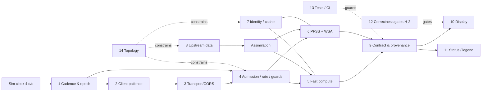
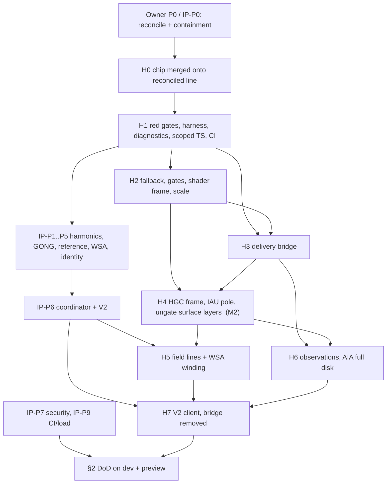

# H-1 remediation plan: getting the backend solar model onto the screen

**Status:** final synthesis, 2026-09-25. Read-only analysis; no code was changed and no servers were started.

**Baseline refs:**
- `main = d834dbe`, which is `bd48a7d` plus docs only.
- `sun-focus = 13ca9ec`.
- Merge base `ec7ad33`.
- Phase 0 chip branch `fix/solar-data-status-notice` = **6 commits, `d637501..7c791dc`**, based on `bd48a7d`, not merged.

**Governing documents** (they outrank the three designs):
- **OP** = `agent-notes/SUNFOCUS_REGRESSION_STATUS_AND_FIX_PLAN_2026-09-25.md`. Committed at `3b2eaf7`; its working copy now points to IP.
- **IP** = `agent-notes/R3R4_PFSS_IMPLEMENTATION_PROMPT_2026-09-25.md`. It is the owner's implementation-ready R3/R4 work order. It was created 2026-09-25 11:09 and is **untracked** at the time of writing.
- All three designs (incremental, architecture, product-truth) were written before both documents. Every step below is re-tagged to OP and IP phases, written as `OP-P#` / `IP-P#`.

**Evidence tags:**
- **(F)** fact read in code or an artifact.
- **(I)** inference.
- **(U)** taken from the dead spike investigator's raw captures; unverified.
- **(N)** a finding a designer made while writing the plans. N items are verified in code where marked.

**Citation keys:**
- `[BR|UP|CD|FE|TC|BP-Fn]` = fact *n* in these areas of `$SP/h1/digest.md`: backend-route, realtime-upstream, config-deploy, frontend-consumers, tests-contracts, backend-profile.
- `M` = that area's Measurements list.
- `[AUD …]` = `agent-notes/CODEBASE_AUDIT_2026-09-24.md`.
- `$SP` = `/tmp/claude-1000/-home-nomad-ai-projects-repositories-solar-system-realistic-sim/3e06ef45-898e-459a-9e2c-307d6a081174/scratchpad`.

**Line anchors** are at `bd48a7d`:
- The reconcile changes `backend/server.py` and `backend/sim/pfss_magnetogram.py`. After OP-P0, find those anchors again by function name.
- The chip moves `sunController.ts` anchors by up to about 30 lines.

**Corrections applied to the designs:**
1. Dropped architecture's "make `has_wsa` false for None". It already is false for None; the fallback is dead code because a WSA result is always passed (`solar_physics.py:910`).
2. The "z-up scene" citation is now `main.ts:308-316` (spin axis built from z) plus `:978-992` (ecliptic xyz written straight to world), not `sceneSetup.ts:166`.
3. `xfwd:false` does **not** strip client X-Forwarded-For [CD-F16].
4. `test_compute_budget.py:47-49` stays unchanged (OP §11 closed finding).
5. Every server-side fuzzy key (activity to 0.01, day bucket, 0.001-d server snap, per-CR key) is rewritten into IP §4.3 form.
6. Ingest-only frame fixes are rejected because the shaders use world normals (N3).
7. A new per-request executor for the fast lane is rejected (IP §4.4).
8. Nearest-with-lag field serving is rejected unless it becomes a named, error-bounded policy (IP §4.4).
9. CI moves to the start (H1).
10. **A judge's claim that sun-focus "rewrote index.html/main.ts/style.css" is wrong.** Since `ec7ad33`, sun-focus changed only `server.py` and `pfss_magnetogram.py` among these files; the 481/470/1419-line deltas are on main's side (`git diff --stat ec7ad33 13ca9ec` vs `ec7ad33 d834dbe`). The chip was written on top of main's side, so it applies without conflict (§3, Phase 0).

---

## 0. Summary for the owner

**What is wrong**
- The Sun you see is drawn entirely by the browser. None of the server's Sun model reaches the screen: activity, sunspot groups, loops, eruptions, coronal holes, the solar-wind spiral, field lines, the SDO image.
- 0 of 39 requests succeed in dev and 0 of 44 in preview.
- One step, tracing magnetic field lines (PFSS), takes 97–99.6% of each 4–10 s answer. The browser gives up at 2.6 s.
- The status chip (Phase 0, built) now says this on screen.

**Why "make it faster" is not enough.** The parts are chained:
- A fast server trips the rate limit within about 30 s.
- Each tab would hammer outside data services.
- The drawing code has never run with real data. The spiral would reach 242 AU, loops would reach past Mars, sunspots would sit near the poles, a 3%-of-disk image would be wrapped round the globe, and field lines would come from wrong mathematics (H-2).
- Today's stand-in Sun has two bugs of its own: activity is stuck at 0, and flares are deleted on their first frame.

**What we will do, in order.** Your governing plan comes first: converge the branches and contain the anonymous CPU-denial path. Then:
1. Make every defect a failing test.
2. Correct the browser's Sun, and add per-layer gates so that nothing wrong can be shown.
3. Deliver the fast part of the model (everything except field lines) over a same-origin connection, at a sustainable rate.
4. Put sunspots, loops, holes and flares in one correct solar frame. Switch each one on only after a test proves it right.
5. After your PFSS work (R3) validates the solver and moves it into its own process, switch on field lines and the spiral's wind-driven winding.
6. Repair the observations: the NOAA feed, a full-disk SDO image placed on the Earth-facing side, and credits.
7. Adopt your V2 contract and retire the interim path.

A legend states each layer's source, epoch and any compression.

**When**
- The first correct, backend-driven Sun (every layer except field lines and the SDO image) needs about **14–19 engineer-days** of H-1 work after the reconciliation. It is faster with two people.
- Field lines follow your R3 phases.
- The full definition of done is about **24–33 days** of H-1 work, plus the R3/R4 scope in your implementation prompt.

**What you need to decide (§5).** The most urgent decisions:
- **D11:** show the backend's non-field layers before R3 closes. Recommended: yes, local profile only.
- **D3:** how structures around the enlarged Sun are drawn.
- **D4:** "Auto" = white light.
- **D2:** use live data only within 1 day of "now".
- **D12:** what counts as "an AIA tile renders".
- **D13:** give the fast layers their own worker capacity.
- **D1:** how the synthetic magnetic map evolves.
- **D6:** the SILSO non-commercial licence.

---

## 1. The system as interconnected parts

### 1.1 Part-by-part chain

| # | Part | Today (evidence) | What breaks | Depends on | Constrains |
|---|---|---|---|---|---|
| 1 | **Client cadence & epoch** | Polls 900 ms after request start. Sends `jd.toFixed(8)` of a 4 d/s clock. Always `hybrid` + `live_data=true` (`sunController.ts:152-160`, `solarPhysicsClient.ts:119`, `constants.ts:12`). No 1× speed (`index.html:84-93`) [FE-F5, F7] | Every poll is a new epoch, 3.6 sim-days later. About 66 req/min once the server is fast [TC M] | Sim clock | 4 rate limit, 7 caches, 8 upstream fan-out, lag of the drawn state |
| 2 | **Client patience** | 2.6 s abort. Clamps timeout ≤ 20 s and poll ≤ 30 s (`solarPhysicsClient.ts:58-59`). Duplicate 6 s gate (`sunController.ts:531`). `inFlight` is checked before `force` (`:498-499`) [FE-F5, F6, F24] | 0/39. An abort frees nothing on the server [BR-F4] | Server latency (5, 6) | Orphan load (4). Raising the timeout alone makes requests back-to-back, and data lands 41.7 sim-days late [SPIKE step1 (U)] |
| 3 | **Transport / CORS** | No `vite.config`. `:8042` hard-coded in 4 places. Allowlist lacks `:4173`; the env var *replaces* it; `*` is ignored (`server.py:91-119`). 500s carry no ACAO. `Retry-After` not exposed [CD-F1–F4, F11] | Preview 0/44. Rejected origins still cost full compute [CD-F8]. Errors unreadable | Topology (14) | A proxy merges rate identities and makes XFF spoofable [CD-F16, F17]. Chip classifier (C17) |
| 4 | **Admission / guards** | 36/60 s rate limit runs before validation, so 503s count. 2-slot guard freed only at worker exit. Shared 2-thread `_heavy_compute_executor` with porkchop and mission (`server.py:168-187, 277-306, 466-503`) [BR-F1–F5] | Slots held 22–29 s after aborts [BP-F19, F20]. Porkchop starves [BR-F5]. Cache hits wait behind cold work | Compute time (5, 6) | Any speed-up hits 36/min (C1). More threads are slower because of the GIL [BP-F21] |
| 5 | **Compute: fast part** | Activity, 540 tube scores, arcs, holes and spiral geometry take about 20–50 ms, plus 25–43 ms of JSON encoding on the event loop [BR-F13–F19, BP-F2, F23] | Nothing, except that it is always bundled with 6 | 7 (deterministic assimilation) | Makes the interim fast lane possible |
| 6 | **Compute: PFSS + WSA** | 97–99.6% of 4–10 s. Scalar Python per point. Seed `int(jd*100) % 99991` changes every 0.01 d (`pfss_magnetogram.py:238`). Wrong Legendre recurrence in **three** copies (`:281, :488, :605`) [BR-F18, F27, BP-F3] | Latency. Flicker at bucket boundaries (endpoints move 3.4 R☉, 20/120 lines flip). Wrong physics | 12 (IP-P3..P5), 8 (GONG) | Field lines and WSA winding (10); any capacity it shares |
| 7 | **Caching / identity** | PFSS LRU of 3, keyed on exact (CR, jd, activity, lines, lmax, gong_timeout) (`:1107, :1117-1173`). Snapshot keyed on exact jd (`solar_realtime_data.py:131`). Activity drifts with `datetime.now()` (`solar_physics.py:391-395`) [BR-F23, BP-F5] | 0 hits while the sim runs. 0 hits even paused in live mode | 1, 8. Owner rule: exact key, reuse only under a declared equivalence [OP §3.3, IP §4.3] | Upstream fan-out, feasibility of reuse |
| 8 | **Upstream data** | SWPC 404 since about 2026-04-30. GONG never found: month dir holds only day dirs. SILSO 2.9 MB per miss, CC BY-NC. AIA `getTile` returns a 3.3% crop. Tile route ignores `image_id`. All-failed snapshot cached 120 s. No stale-on-error. Timeouts are per socket only [UP-F4–F19] | Fast + live would mean about 13 calls and 3.8 MB per poll per tab [BP-F4]. Hangs take 11–46 s [BP-F11]. "Now" data blended into any epoch [FE-F11] | D2 live window, D6 licence | 7 determinism; what "observed" can mean |
| 9 | **Response contract & provenance** | Untyped dict. `schema v1` never read. 4 drifting TS copies (strict errors) [TC-F10, F11]. `gong_synoptic.ok` always true [UP-F9]. `live_data_enabled` echoes the request [BR-F7]. No frame, no per-layer source. 636 KB raw, no gzip [BP-F17] | The UI cannot be honest. Bandwidth | 5, 6, 8 | 10, 11. The chip reads `data_assimilation.{mode,applied,blend_weight,live_data_available}` (C15) |
| 10 | **Frontend display** | Structures drawn at the enlarged display radius (81×): spiral to 242 AU, loops to 1.8 AU. Backend z-up vs local y-up. Loops rotated twice. PFSS on the non-spinning node. **Shaders take latitude from world normals** (`sunVisuals.ts:38, 233, 444, 489-490`; N3). Flares expire on frame 1. Fallback activity 0. Auto switches to 193 Å. AIA wrapped as a globe. State never cleared. Field lines rebuilt on every success [FE-F2, F3, F17, F22, F23, F27–F29; UP-F11] | Every never-run path switches on wrong at the same moment (C4) | 9 (frame), 12 | What "correct on screen" means (D3, D4, D5) |
| 11 | **Status / honesty** | Phase 0 chip (connecting / backend / stale / error + reason). Static "Live simulation" badge (`index.html:40`). No attribution [FE-F19, UP-F25] | "backend" does not say *which* layers | 9, gates | The owner's "can tell where each layer comes from" |
| 12 | **Correctness gates** | H-2: P₂(0.5) = −0.634 vs −0.125; dipole gives g₃₀ = −2.174 [AUD §7.12]. No plausibility gates: 72 concurrent CMEs at 844–2,492 km/s (N6). Observed activity 0.264 vs model 0.757 (`$SP/h1/backend/live_snapshot.json`, BP-F13) | Unblocking ships wrong physics | IP-P3..P5 | Ungating in 10 |
| 13 | **Tests / CI** | No CI. Backend tests use the cheap path and contact gong.nso.edu. 246 strict TS errors. `requirements.txt` lacks httpx. Pinned tests encode today's behaviour [TC-F1–F19] | The SWPC break went unseen for 5 months [UP-F26] | — | How every phase is verified |
| 14 | **Ops / deploy** | `--reload`, single process, no lifespan hook, per-process state, XFF trusted [CD-F17, F20–F22]. Owner topology: embedded coordinator with exactly one API worker locally; external coordinator for network [IP §4.4] | `--workers N` multiplies upstream and compute load | Owner topology | 3, 4, 7, 8 |

### 1.2 How the parts couple

| ID | If you… | …then this happens | Evidence |
|---|---|---|---|
| **C1** | Make the server faster | The client's ~66 req/min exceeds the 36/min limit; 429s within about 30 s | [TC M, FE-F9]; 3×429 after 72 fast hits [SPIKE step4rate (U)] |
| **C2** | Fix CORS alone | CORS errors are swapped for aborts and 12 s 503s | [CD hidden] |
| **C3** | Raise the timeout or concurrency | Requests go back-to-back, orphans pile up, each job runs about 3× slower | [BP-F21] |
| **C4** | Unblock delivery | Every display bug in row 10 appears at once, plus H-2 lines and WSA winding | [BR-F26] |
| **C5** | Quantise jd alone | No cache hits: activity drift and seed-bucket arithmetic defeat it | [BR-F14, BP-F15]; 6/6 misses at 4 d/s with 1-day buckets [SPIKE step3a (U)] |
| **C6** | Fix GONG | Real maps go through H-2 on the wrong grid (sine-latitude vs uniform colatitude) | [BR hidden, IP-P3] |
| **C7** | Make the server fast *and* live | Every tab becomes an upstream amplifier | [UP-F27, F28] |
| **C8** | Add a same-origin proxy | One shared rate identity, and spoofable XFF unless the proxy strips it | [CD-F16, F17] |
| **C9** | Switch to a full-disk AIA image with today's shader | Black sky is wrapped round the globe | [UP hidden] |
| **C10** | Apply the D2 live window | At 4 d/s nearly every request becomes synthetic: cheaper and quieter, but observations show only near "now" (D9) | — |
| **C11** | Fix the shader frame (N3) | The procedural look changes too: poles move to the true axis (D10) | — |
| **C12** | Emit Carrington (HGC) output | Rotation is exact at any display time; a stale payload only lags in slow evolution (≤ 0.53°/day at active latitudes, A4). Inertial output would put a payload 3.6 d old about 51° out of place | — |
| **C13** | Expose provenance | It must return canonical effective inputs, or reuse silently aliases inputs | [OP R3.2, IP §4.3] |
| **C14** | Change behaviour the pinned tests encode | Each pinned test changes in its own commit with a stated reason (list below the table) | — |
| **C15** | Adopt contract V2 | It must keep the fields the chip reads, or update `solarDataStatus.ts` in the same commit | — |
| **C16** | Add backoff or `Retry-After` | Stays ineffective until the duplicate gate `sunController.ts:531` goes | [TC hidden] |
| **C17** | Go through the proxy | A dead backend shows up as a proxy 5xx, not a `TypeError`, so the chip classifier needs a same-origin rule | (I) |
| **C18** | Rely on the chip's `/health` probe | H-3 load pushed `/health` to 17 s, giving false "unreachable" until `/health` is cheap | [AUD H-3, IP §4.4] |

Tests pinned by C14:
- `test_snapshot_cache_isolated_by_requested_julian_date` (`test_solar_realtime_data_cache.py:24`). OP §11 keeps the *full-input identity*, not the exact-JD shape.
- AIA `jd is None` (`test_solar_physics_api.py:131`).
- `test_cme_speed_distribution_covers_slow_and_fast_populations` (`test_solar_physics_model.py:62`), only if D8 changes the CME population.
- `test_pfss_cache_identity_includes_every_output_affecting_input` (`test_pfss_cache.py:44`). IP-P5 owns this one.
- **Never change** `test_timeout_keeps_capacity_owned_until_worker_exit` (`test_compute_budget.py:20`, asserts at `:47-49`).

### 1.3 Layer truth table

| Layer | Today (no data) | If data were simply unblocked | "Correct" means (oracle, measured on *rendered* placement) | Ungated in |
|---|---|---|---|---|
| Activity (brightness, spot count, flare rate) | **0.000** (bug); the model gives 0.754 [FE-F2] | 0.55–0.79, with today's SILSO blended into any date | Frontend/backend parity; observations only in the live window; archival SSN for the past (D2/D6) | H2 fallback, H3 backend |
| Sunspots | 1 synthetic spot | 8 groups, 54% above 40° | Rendered \|lat\| p95 ≤ 35° (backend p95 30.8°); fixed on the rotating surface | H4 |
| Loops / eruptions | 0 loops, 360 random plume points | 144 loops out to 1.8 AU, frame 90° off, rotating twice | Footpoints within 5° of drawn spot groups; heights per D3; drift 14.2 ± 0.6°/d | H4 |
| Flares / CMEs | None (activity 0; lifetime < 0) | Still none (lifetime bug) | Outlive their flash at both scales; origins at feature latitudes; time-lapse cap (D5) | H2 lifetime, H4 source |
| Coronal holes | Generic pattern around the **wrong axis** (N3, I) | 5 synthetic holes, same frame bug | At solar minimum, the polar limbs are darker than the equatorial limbs | H4 |
| Solar-wind spiral | None | 6 arms to 242 AU | Crosses 1 AU at Earth's orbit ± 1%; winding atan(Ωr/v) ± 1° | H4 (empirical wind), H5 (WSA wind) |
| Field lines (toggle) | Analytic dipole, built once at activity 0.5 | 120 H-2-wrong lines, unrelated to the spots (N1), not rotating | IP-P3/P5 gates pass; `validated: true`; in the body frame; co-registration ≥ 70% only under D1 | H5 |
| AIA image | Never requested | 3%-of-disk crop wrapped as a globe; "latest" image for any date | Full disk on the Earth-facing hemisphere; centre within 2% R, north within 2°; only near its epoch; credited | H6 |
| Channel look | Auto = white light | Auto switches to a 193 Å tint | D4 default | H2 |
| Provenance | Chip only | Chip says "backend" for everything | Every visible layer shows source, epoch, compression and lag; credits whenever an observed layer is visible | H3 → H4 → H6 |

### 1.4 Dependency diagram (parts)



---

## 2. Definition of done and the end-to-end acceptance test

**The owner's definition.** With the backend running:
1. the Sun on screen is *visibly driven by the backend model*;
2. *what is shown is correct*;
3. *the user can tell where each visible layer comes from*.

It must also meet the owner's delivery wording in OP R3.4 and IP-P8:
- a scripted five-minute run;
- at least 95% of scheduled physics reads succeed (200/304 after warm-up);
- at least one AIA tile renders;
- staleness stays within the declared TTL;
- the effective source and state are visible;
- zero silent fallbacks;
- zero uncaught console errors;
- on **dev and preview**.

"Silent fallback" is made measurable: **any layer whose source changes without the chip or legend changing within one poll fails the run.**

**Harness.**
- `tests/e2e/solar-delivery.spec.ts` (owner's name, IP-P2/P8), ported from `$SP/pw/h1-tests-acceptance.mjs`.
- `tests/e2e/solar-truth.spec.ts`, ported from `$SP/pw/h1-frontend-inject.mjs`, for the oracles. It reads `window.__solarDiagnostics()`.
- Upstream shim `backend/tests/e2e_shim/` in modes `fixture | offline | hang`, from `$SP/h1/tests/e2e/upstream_shim/sitecustomize.py`.

Command:
```
npx playwright test tests/e2e --project=chromium -- \
  --origin dev,preview --upstream fixture,live,hang \
  --scenarios now-paused,now-1x,4dps,1990-paused,2040-paused,jump-to-now,backend-killed \
  --minutes 5 --tabs 1,3 --gpu real
```

Servers:
- backend `python -m uvicorn server:app --host 127.0.0.1 --port 8042`, with no `--reload`;
- dev: `npm run dev -- --strictPort`;
- preview: `npm run build && npm run preview -- --strictPort`.

Visual oracles run on the real-GPU WSLg recipe. The `live` upstream run is a smoke test, not a release oracle (IP rule 5).

**All of the following must pass on both origins.**

- **A. Delivery (OP R3.4 / IP-P8)**
  - ≥ 95% of scheduled reads after warm-up return 200/304, and the pending/retry path is exercised.
  - 0 CORS errors, 0 uncaught console errors, ≤ 1 abort per scenario.
  - 0 × 429 in 1-tab runs. In 3-tab runs, 429s are allowed only with visible backoff.
  - ≥ 1 AIA image rendered in `now-paused`, under the D12 interpretation (§3a disagreement (b)).
- **B. Visibly backend-driven**
  - For every ungated layer, diagnostics report `source ∈ {backend-model, observed}`, with the payload epoch inside the declared staleness policy.
  - Activity uniform equals the payload `activity_index` ± 0.005.
  - Loop count ≥ 100; sunspot seed ids equal payload region ids; hole count equals the payload's.
  - A/B against a backend-off run at the same `?date&rate=0`: ≥ 10% of Sun-box pixels differ by more than 24 levels. The spike saw about 20%, with a run-to-run noise floor of about 1% [SPIKE imgdiff (U)].
  - The A/B proves influence only; section C proves correctness.
- **C. Correct.** Every §1.3 oracle passes, measured on rendered positions:
  - sunspot \|lat\| p95 ≤ 35°;
  - loop footpoints within 5° of spot groups;
  - inertial drift 14.2 ± 0.6°/d (not about 28°);
  - loops ≤ 1.6 display radii at the default scale;
  - spiral at 1 AU ± 1% and winding ± 1°;
  - limb contrast at solar minimum;
  - pole at ecliptic (345.77°, 82.75°) ± 0.05°; B0 and sub-Earth Carrington-longitude oracles;
  - no field line unless `validated`;
  - AIA centre within 2% R and north within 2°;
  - no live observation applied when \|sim − now\| > the D2 window.
- **D. Honest**
  - The chip plus legend list every visible layer with source, epoch, compression and lag.
  - Credits are visible whenever an observed layer is.
  - `1990-paused` reads "archival SILSO / model", never "live". `2040-paused` reads "model projection".
- **E. Resilient**
  - `hang`: a degraded 200 within the client budget, and the chip says "observations unavailable (upstream slow)".
  - `backend-killed`: stale, then error. The fallback activity equals the cycle model (not 0). The state clears after 5 failures or a jump of more than 30 days. Recovery within 60 s of restart.
- **F. Resources and isolation** (architecture A5 + OP §10 + IP-P9)
  - Upstream calls over 10 min stay within the refresh schedule and differ by ≤ 2 between 1 and 3 tabs.
  - `/health` p95 < 50 ms; a fixed porkchop/mission probe returns 200 throughout.
  - After IP-P6: exactly the configured K worker children.
  - RSS growth ≤ 50 MB.
  - The backend lanes run IP-P9's 40-job deterministic load and 40/40 ready reads under saturation.

---

## 3. Phases

**Conventions (all phases)**
- **Base.** Each branch is cut from the reviewed reconciled line (`fix/sunfocus-reconcile-2026-09-25` after OP-P0 exits), rebased before merge, and merged back into that line. Never from `main@bd48a7d`, never directly onto `main`.
- **Commits.** One commit per numbered step (IP rule 14). A pinned-test change gets its own commit with the reason (C14).
- **Red first.** H1 lands each defect test as a strict expected failure: `pytest.mark.xfail(strict=True, reason="H1:<id>")` or vitest `it.fails`. The fixing commit removes the marker, which is the red-before-green record. Red run output is kept as a CI artifact, not committed (IP rule 2).
- **Working copies.** Work in a scratchpad worktree, because another tool moves `main`. This environment cannot push; the owner pushes.
- **Shared file.** `server.py` is also edited by `fix/trajectory-amplification-defense-in-depth`. Rebase in order and resolve semantically.

### Phase 0 (H0): the status chip lands, plus what H-1 needs from containment

*Owner OP-P0 (after steps 3–8) / IP-P0; satisfies OP R3.4 "explicit loading, stale, unavailable UI states" and the owner's "at the very least an error notification".*

- **Branch:** `fix/solar-data-status-notice` (exists).
- **Effort:** 0.5–1 d. **Risk:** low.

**Commits.**

**0.1 Land the chip.**
- After the reconcile merge commit is reviewed, and **not** in the convergence PR and **not** onto `main` (the owner pins the merge input to `d834dbe`), run `git merge --no-ff fix/solar-data-status-notice` on the reconciled line as its own PR. `git cherry-pick d637501^..7c791dc` is an equivalent fallback.
- **Expected conflicts: none.**
  - A dry run (`git merge-tree ec7ad33 13ca9ec d834dbe`) shows the reconcile's two-sided changes are only in:
    - `server.py`, `pfss_magnetogram.py`;
    - `scripts/verify-moon-frames.mjs`;
    - `src/sim/catalog(.test).ts`, `moonFrameCheck.ts`, `moonFrames.horizons.test.ts`, `orbitMath.ts`.
  - The chip's 9 files (`index.html` +5, `src/main.ts` +13/−?, `src/style.css` +34, `src/sunController.ts` +40, solar client/status/texture plus 2 tests) equal their `bd48a7d` versions on the reconciled tree.
- **Re-verify:**
  - `npx vitest run src/frontend/features/solar/solarDataStatus.test.ts src/frontend/features/solar/solarPhysicsClient.test.ts`;
  - the chip browser check on the reconciled tree.

**0.2 Containment inputs (the owner's commit, OP-P0.9 / IP-P0.8).** H-1 needs these items in it:
- Route parameter `pfss=off|compute`. `compute` is refused for anonymous callers outside the local profile.
- The frontend stops requesting cold PFSS itself. It sends `pfss=off`, landing with H3.6. Otherwise the local UI still starts a 4–10 s solve every poll [BR-F18].
- The sun-focus JD bound (J2000 ± 200 y), checked before admission.
- `force_refresh` / `force_data_refresh` protected.
- Explicit `:4173` origins.
- No API key is ever shipped in browser JS (IP rule 11).

**0.3 Follow-ups C17/C18** (they land in H3 with the proxy).
- **C17.** A same-origin 502/503/504 without a JSON `detail` is classified `unreachable`. Test: `classifies proxy 5xx without detail as unreachable`.
- **C18.** A `/health` probe timeout reads "server slow (health check timed out)", not "unreachable", until `/health` is cheap (IP §4.4; trajectory plan). Test: `health probe timeout is not reported as unreachable`.

**Exit:** chip visible and truthful on the reconciled tree in dev and preview; its tests green.

### Phase 1 (H1): make every H-1 mechanism red, and build the harness

*Owner OP-P1 / IP-P1–P2; OP R4 gaps 6, 9, 10.*

- **Branch:** `fix/solar-h1-red-gates`.
- **Effort:** 3–4 d. **Risk:** the scoped strict project may need more than the 14 known fixes.

**Commits.**

**1.1 Dependencies and offline fixtures.**
- `backend/requirements-dev.txt` (pytest, httpx) [TC-F19], or IP-P1.4's lock split if it has landed. Do not duplicate it.
- `backend/tests/conftest.py`:
  - an offline plugin (port of `$SP/h1/tests/plugins/h1_offline.py`) that fails closed on non-loopback DNS;
  - fixtures that reset the rate deques, guards and snapshot/PFSS caches [TC hidden]. Use IP-P1's `create_app(settings, snapshot_backend=…)` seam when it exists.

**1.2 Scoped strict TypeScript.**
- `tsconfig.solar.json` covers `src/frontend/features/solar/**`, `src/sunController.ts` and new modules; add `npm run typecheck:solar` (IP §8 name).
- New `src/frontend/features/solar/solarPhysicsContract.ts` replaces the 4 partial interfaces [TC-F10].
- Fix the 14 strict errors in `sunController.ts` (heliosphere type drift at `:183, :362, :453`) so the project is zero-error, as IP-P9 requires.

**1.3 Reproducible time.** `?date=<ISO>&rate=<d/s>` runtime parameters in the time controller, following the `readRuntimeNumber` pattern (`sceneSetup.ts:66-107`).

**1.4 Diagnostics hook.** `src/frontend/features/solar/solarDiagnostics.ts` exposes `window.__solarDiagnostics()` in DEV or with `?diagnostics=solar`.
- Per layer it returns `{id, visible, source, gatedReason, payloadEpochJd, count, maxRadiusAu, renderedLatDeg[]}`, plus the activity uniform and request counters.
- **Latitudes come from world positions transformed into the Sun's body frame**, never from seed uniforms. That is the judges' correction to the incremental and architecture acceptance checks.

**1.5 Playwright harness.**
- Specs: `tests/e2e/solar-delivery.spec.ts` and `solar-truth.spec.ts`; shim in `backend/tests/e2e_shim/`; `@playwright/test` as a devDependency.
- The status contract uses the Phase 0 states (connecting/backend/stale/error), not `live/degraded`.
- CORS is never checked through `route.fulfill`, which adds ACAO itself [FE hidden].

**1.6 Red tests** (strict-xfail; node IDs recorded). Drafts: `$SP/h1/tests/vitest/*.h1.test.ts` (8 red / 2 green) and `$SP/h1/tests/pytest/test_solar_physics_h1_contract.py` (12 red / 5 green) [TC M].

Frontend:

| Test | Today (defect) | Evidence |
|---|---|---|
| `fallback activity follows the cycle model` | 0 vs 0.754 | [FE-F2] |
| `event outlives its flash at display radius 0.3755 AU` | expires on the first update | [FE-F3] |
| `parker max radius ≤ 3.1 AU at default scale` | 242 AU | [FE-F27] |
| `loops ≤ 1.6 display radii at default scale` | 1.807 AU | [FE-F27] |
| `rendered sunspot \|lat\| p95 ≤ 35°` | 72° | [FE-F28] |
| `no shader latitude from vWorldNormal` | source contract | N3 |
| `Auto keeps white-light corona with sdo_aia present` | channelMode 3 | [FE-F17] |
| `field signature ignores brightness` | rebuilt on nearly every success | [FE-F22] |
| `state cleared after 30-day jump` | never cleared | [FE-F23] |
| `force pre-empts in-flight` | guard blocks force | [FE-F6] |
| `≤ 24 requests/60 s against a 50 ms server` | 66 | [TC M] |
| `next poll scheduled from completion` | scheduled from start | — |
| `Retry-After honoured` | duplicate gate at `:531` | — |
| `hidden tab issues nothing` | — | — |

Backend:

| Test | Evidence |
|---|---|
| `test_aia_tile_honours_image_id` | [UP-F15] |
| `test_gong_status_not_ok_without_parsed_map` | [UP-F9] |
| `test_live_blend_is_deterministic_for_fixed_inputs` | [BR-F14] |
| `test_historical_epoch_ignores_live_data` | [FE-F11] |
| `test_builder_exception_is_json_500_with_acao` | [BR-F6] |
| `test_preview_origins_get_acao` | [CD-F4] |
| `test_compute_timeout_503_carries_retry_after` | [BR-F2] |
| `test_identity_ignores_client_supplied_xff` | [CD-F17] |
| `test_all_failed_snapshot_not_cached_as_success` | [UP-F16] |
| `test_black_holed_upstreams_yield_degraded_200_within_budget` | [TC-F16] |
| `test_rtsw_parser_picks_newest_active_row` | [UP-F6] |
| `test_hole_detector_uses_metadata_rsun` | [UP-F12] |
| `test_features_emitted_in_hgc` | — |

E2E: `≥ 95% on dev and preview` (red today: 0/28 dev, 0/14 preview [TC M]).

**1.7 CI skeleton.** `.github/workflows/ci.yml` runs `npm ci`, `npm test`, `npm run typecheck:solar`, offline pytest and an offline Playwright lane. IP-P9 owns the final lane set; this is its first slice.

**Exit:** every §1 mechanism has a strict-xfail test driving production code; the harness runs against real servers; diagnostics are present; CI green.

### Phase 2 (H2): truthful fallback, layer gates, shader frame, display scale

*Owner OP-P5 / S12 ("axes, rotation, Hathaway"). Frontend only; runs in parallel with OP-P2 / IP-P3..P5, because it does not touch PFSS.*

- **Branch:** `fix/solar-display-truth`.
- **Effort:** 4–5 d. **Risk:** the look changes for every user (D10). Mitigation: before/after screenshots at a fixed `?date`.

**Commits.**

**2.1 Fallback activity.**
- **Change:** move `hathawayRaw`, `hathawayNormalized` and `fallbackSolarActivityFromJulianDate` (`sunController.ts:63-94`) into `solarActivity.ts`. Add a null-safe `resolveSolarActivity(blend, payload, jd)` in place of the `Number()` chain at `:405-410` (`Number(null) === 0`; `solarFeatureBlending.ts:212-221`). Use it instead of `|| 0.5` at `:233`.
- **Tests** (`solarActivity.test.ts`):
  - 0.754 ± 0.001 at 2026-09-24; 0.410 at 2028-06; 0.193 at 2030-01 (`$SP/h1/frontend/fallback_activity.log`);
  - parity with the backend `_activity_index` (`solar_physics.py:522-528`) at 25 epochs 1990–2040, through the fixture `__fixtures__/activity_parity.json`, regenerated by backend `test_activity_parity_fixture_is_current`.
- **Accept:** backend stopped, `?date=2026-09-24&rate=0`: `__solarDiagnostics().activity.uniform` = 0.754 ± 0.01.

**2.2 Flare/CME lifetime** (`solarFlares.ts:225-228`).
- **Change:** make the CME travel limit relative to the Sun, `cmeMaxDistanceAu = sunRadiusAu + max(0.3, 2·sunRadiusAu)`, and enforce `maxLifeTimeSec ≥ flashDurationSec` at both scales.
- **Tests:** `solarFlares.test.ts`, alive after 1 s at radii 0.3755 and 0.00465 AU.
- **Accept:** `flares.maxLive ≥ 1` in 60 s at the default scale.

**2.3 Layer gates.**
- **Change:** `solarLayerGates.ts`, one table:
  - activity `on`;
  - sunspots, loops, eruptions, model flares and holes gated `frame` until H4;
  - spiral gated `scale+frame` until H4 (empirical) and `wsa` until H5;
  - field lines gated `pfss-validation` until H5;
  - AIA image gated `projection` until H6;
  - Auto tint gated `D4`.
- `sunController.update` (`:411-470`) passes `null` state to gated consumers, and `maybeRefreshObservationTexture` (`:253-287`) is gated.
- **Tests:** `solarLayerGates.test.ts`, `gated layers never receive backend state` (spies on the update functions, trimmed `payload_high_180.json`) and `every layer id has a legend entry`.

**2.4 Shaders use the Sun's own normal (N3; inference until the oracle runs).**
- **Why:** the vertex shader sets `vWorldNormal = mat3(modelMatrix)·normal` and `vLatitude = asin(vWorldNormal.y)` (`sunVisuals.ts:37-38`). The fragment shaders use world `normalDir` for sunspots (`:233, :270-277`) and the corona, streamers and holes (`:444, :477, :489-490, :505`). But the spin axis is world ≈ +Z (`main.ts:308-316`, `BODY_LOCAL_SPIN_AXIS = (0,1,0)` at `:187`), and the mesh spins about local Y (`main.ts:722-735`).
- **Change:**
  - add an object-space `vSunNormal`. Sun mesh and corona shell are spinGroup children (`main.ts:357`, `sunController.ts:319`), so object space co-rotates with the body. Use it at every site above.
  - replace the wall-time drift terms (`:245` `time*0.00012`, `:683` `timeSec*0.000261`) with sim-time differential rotation relative to the body rate, passed as a float64-safe delta uniform computed on the CPU (the audit's M-1 float32 lesson).
- **Tests:**
  - `sunShaderFrame.test.ts`, a source contract: no latitude or longitude computed from `vWorldNormal`;
  - Playwright `solar-frame.visual` at `?date=2019-12-15&rate=0` (solar minimum), ecliptic-plane camera: limb sectors within ± 20° of the projected spin axis are ≥ 15% darker than the east/west sectors. Calibrate on the first real-GPU run, then pin.

**2.5 Display-scale policy (D3).**
- **Change:** `solarDisplayScale.ts`:
  - `coronalToDisplay(r) = R_disp·(1 + (r − 1)·k)`, with k = 0.15 at the enlarged scale, and physical `r·R☉` at realistic scale. Applied at `sunVisuals.ts:1419-1421` (loops) and `solarMagnetics.ts:249-251` (PFSS).
  - `heliosphereToDisplay(r) = r·R☉_AU` (payload `solar_radius_au`, fallback 0.00465047), clipped for r < 1.05·R_disp, at `sunVisuals.ts:1531-1533`.
- **Tests:** `solarDisplayScale.test.ts`: 215 R☉ → 1.000 ± 0.005 AU at both scales; CME extent 4.74 R☉ → ≤ 1.6·R_disp; identity at realistic scale; monotonic.

**2.6 Auto = white light (D4).**
- **Change:** `pickAiaObservationChannel` (`solarObservationTexture.ts:74-118, :207-224`) returns null in Auto unless the user picked a channel.
- **Test:** with the live fixture, `channelMode` stays 0 in Auto.

**2.7 Stale-state policy.**
- **Change:**
  - clear `solarPhysicsState` and the feature sets, fading them out, when \|simJd − epoch_jd\| > 30 d, after 5 minutes without success, or after 5 consecutive failures;
  - drop an arriving payload whose epoch is more than max(2 d, 1.5·\|rate\|·interval) from the current sim epoch;
  - chip text: "procedural fallback (last backend state was for <date>)".
- **Tests:** `sunController.test.ts` (node env, stub TextureLoader, per `$SP/h1/tests/vitest/sunController.h1.test.ts`).

**2.8 Field-line rebuild signature.**
- **Change:** `sunController.ts:194-206` keys on `source:cr:count:solver_version` (the field id later); quantised activity only for the analytic fallback.
- **Test:** a brightness-only change keeps the signature.

**2.9 Blending.**
- **Change:** a fixed 1.5 s blend (`:512-515`), including the first arrival. Also blend activity, observation blend, sunspots and holes (`:411-441`) [FE-F20, F21].
- **Tests:** `first arrival fades in`; `brightness-only change keeps the field signature`.

**2.10 Honest header.**
- **Change:** `index.html:40` "Live simulation" becomes a rate-driven badge ("Simulation · +4 d/s" / "Paused").
- **Test:** DOM e2e.

**Exit:**
- CI green.
- Backend stopped: cycle activity, visible flares, chip "procedural fallback".
- Fixture backend: no gated layer draws backend geometry.
- Limb oracle pinned.

### Phase 3 (H3): the delivery bridge — data reaches the renderer quickly, honestly and sustainably

*Owner OP-P3.4 (R3.4) + S12; IP §4.6 browser contract; IP-P0.8 origins. The fast lane is **disagreement (a)** (§3a).*

- **Branch:** `fix/solar-delivery-bridge`.
- **Effort:** 3.5–5 d.
- **Risk:** the fast lane still shares the 2 heavy threads with porkchop and mission (a bridge limitation, removed in H7). Porkchop orphans could delay solar jobs.

**Commits.**

**3.1 Same-origin proxy.**
- **Change:** new `vite.config.ts`:
  - `server.proxy` keys `'/solar/'` and `'/health'`, anchored; never bare `'/solar'`, which swallows `/solar-systems/` [CD-F15];
  - target `http://127.0.0.1:${BACKEND_PORT ?? 8042}`;
  - a `configure` hook that **deletes inbound `x-forwarded-for`/`forwarded`** (`xfwd:false` does not [CD-F16]);
  - preview inherits it [CD-F12].
- `scripts/dev-full.mjs:52-56, 128-144` forwards `BACKEND_PORT`.

**3.2 `src/frontend/app/runtimeConfig.ts`.**
- **Change:** `backendBaseUrl()` resolves: dev-only `?backend=`, then `VITE_BACKEND_URL`, then `window.location.origin`. **Never `''`**, which nulls the AIA URL (`solarObservationTexture.ts:120-127`) [CD-F14]. Replace `main.ts:188-195`, `trajectory/index.ts:8-9, 70-74` and `simulationClient.ts:113, 129`.
- **Tests:** `runtimeConfig.test.ts`: resolution order; never empty; override dev-only; AIA URL non-null; proxy matcher skips `/solar-systems/manifests/sirius.json`.

**3.3 CORS safety net** (`server.py:91-119`).
- **Change:**
  - explicit `http://localhost:4173` and `http://127.0.0.1:4173`;
  - additive `SOLAR_CORS_EXTRA_ORIGINS`;
  - `'*'` rejected loudly at startup;
  - `expose_headers=["Retry-After","ETag","X-Solar-Error-Code","X-Solar-AIA-Image-Id","X-Solar-AIA-Image-Date","X-Solar-AIA-Channel"]`;
  - `allow_credentials=False`;
  - `WS_SIM_ALLOWED_ORIGINS` (`:151-153`) decoupled from the HTTP list [TC-F8];
  - **no loopback regex** (§3a (c)).
- **Tests** (`test_solar_transport_contract.py`):
  - `{localhost,127.0.0.1}×{5173,4173}` preflight + GET on `/solar/physics` and `/solar/realtime/aia-tile` carry ACAO;
  - `attacker.invalid` gets none;
  - WS origins are not widened.

**3.4 Readable errors.**
- **Change:**
  - non-timeout builder exceptions at `server.py:1049-1066` become a logged JSON 500 through ExceptionMiddleware, which is inside CORS, so it carries ACAO [BR-F6, CD-F11; IP §4.5 "never leak raw 500"];
  - the timeout 503 gets `Retry-After` and `X-Solar-Error-Code: compute_timeout`;
  - saturated responses get `saturated`, and 429s get `rate_limited`;
  - the chip classifier prefers the header;
  - C17 (§0.3) lands here.

**3.5 Bridge identity** (a subset of IP-P7).
- **Change:** `_client_identity` (`server.py:323-330`) uses `request.client.host`, not the first XFF hop. uvicorn runs with explicit proxy-header settings (default trust of 127.0.0.1 plus a client-controlled hop gives two disagreeing identities [CD-F17]). The full trusted-proxy model stays in IP-P7.
- **Test:** `test_identity_ignores_client_supplied_xff`.

**3.6 Fast lane** (the interim path, flagged).
- **Change:** `pfss=off` flows through the route (`server.py:991-999`), then `_build_solar_physics_state` (`:389-418`), then `sample_state` (`solar_physics.py:1015`), skipping the PFSS block (`:1086-1108`):
  - no PFSSCache call and no GONG fetch;
  - `wsa_result=None`, so the spiral takes its existing empirical path, labelled `wind_speed_model="empirical_ch_bimodal"` (`:910, :1008`);
  - **`pfss_field_lines: None`, not `{lines: []}`**, because `solarMagnetics.ts:303` treats any `lines` array as present;
  - `pfss: {status:"omitted", reason:"not_requested", solver_validated:false}`.
- It runs on the **existing** owned path (`_run_owned_thread`), with **no new executor** (IP §4.4), and its own 5 s server budget.
- `test_compute_budget.py` is untouched.
- **Tests** (`test_solar_physics_fast_lane.py`):
  - `never calls PFSS or GONG` (recording stub);
  - `labels empirical spiral`;
  - `makes zero outbound calls` (offline plugin);
  - perf-marked `H1_PERF=1`: `p95 < 300 ms over 20 fresh jds` on an idle host (I).
- **Accept:** a 20-request curl loop with `pfss=off&forcing=synthetic&live_data=false` gives p95 < 0.3 s.

**3.7 Deterministic, epoch-aware assimilation** (OP S12; audit M-8; IP §4.3 "activity/data policy").
- **Change:**
  - `_freshness_weight` (`solar_physics.py:391-395`) uses \|observation time − requested epoch (UTC)\| instead of `datetime.now()`, so identical (epoch, snapshot) inputs give byte-identical output;
  - `_apply_realtime_forcing` (`:398-520`) applies observations only when \|epoch_utc − now\| ≤ `SOLAR_LIVE_WINDOW_DAYS` (D2, default 1). Otherwise it returns `applied:false, reason:"epoch_outside_live_window"`, and the window decision is returned as an effective input;
  - `data_driven` outside the window is an explicit unavailable, not a silent synthetic (IP-P4);
  - TDB→UTC for the lookup (69.184 s) [BR-F28];
  - `server.py:415-417` returns `live_data_applied` and `effective_forcing`, instead of echoing the request.
- **Tests** (`test_solar_assimilation_policy.py`): deterministic 1.5 s apart; 1990 → applied false; TDB→UTC.

**3.8 Observations off the request path** (minimal; H6 completes it).
- **Change:**
  - in-window requests read `latest(jd=None)` (`solar_realtime_data.py:122-123`), keyed `('snapshot','latest', floor(now/300 s))`;
  - background single-flight refresh; the request waits ≤ 50 ms, then answers `observations:"refreshing"` with synthetic forcing, labelled;
  - an all-failed snapshot is cached ≤ 15 s, not 120 s (`:143-164`);
  - an overall wall-clock deadline per fetch [UP-F19].
- Change `test_snapshot_cache_isolated_by_requested_julian_date` in its own commit. The full-input identity is preserved; only the exact-JD shape changes (OP §11).
- **Tests:** `test_request_path_never_blocks_on_upstream` (a 3.8 s sleeper still gives 200 within 0.3 s); `test_all_failed_snapshot_not_cached_as_success`.

**3.9 Client policy** (IP §4.6).
- **Change:** new `solarPhysicsPolicy.ts`:

  | Setting | Value |
  |---|---|
  | fidelity / max_features | `high` / 180 |
  | pfss | `off` |
  | forcing | hybrid + live only inside the window, else synthetic |
  | min interval | 2.5 s |
  | paused heartbeat | 60 s, with ETag |
  | timeout | 8 s (> the 5 s fast budget + proxy hop, so no orphans) |
  | backoff | full-jitter 2 s → 60 s, honouring `Retry-After`/429/503 |
  | hidden tab | paused |
  | jd | **client-side** quantum 0.001 d (owner-compatible: identical effective inputs repeat) |
  | seek debounce | 300 ms |
  | rate | `pollsPerMin ≤ 0.8 × serverRateLimit` |

- `SolarPhysicsClient` schedules from completion, keeps one request in flight, aborts obsolete requests (without assuming the server stops), and fixes the reqId race (`solarPhysicsClient.ts:140, 156-162`) [TC-F22].
- `sunController`: build the client from the policy (`:152-160`), delete the duplicate gate (`:531`), check force before inFlight (`:498-499`), widen the clamps (`:58-59`).
- **Tests:** the ported drafts, plus `pauses when hidden` and `live params only inside window`.

**3.10 Payload.**
- **Change:** `GZipMiddleware(minimum_size=1024, compresslevel=1)` (3.6 ms [BP-F17]); round arc and spiral coordinates to 4 dp in `_build_feature_arc`.
- **Test:** `test_payload_budget`, fast-lane frontend query ≤ 150 KB gzip. With PFSS, 4-dp rounding measured 636 KB → 121 KB gzip.

**3.11 Honest provenance fields** (mapped into V2 in H7).
- **Change:** add `generated_at_utc`, `compute_ms`, `jd_time_scale:"TDB"`, `canonical_inputs{jd}`, `effective_forcing`, `live_data_applied`, `live_window{days,applied,reason}` and `frame{name:"model_inertial_zup"}` (until H4). Carry `fetched_at_utc` through. `gong_synoptic.ok` is true only when a FITS map was parsed (`solar_realtime_data.py:809-823, :901-908`). The fields the chip reads are unchanged (C15).
- **Tests** (`test_solar_provenance_contract.py`): refused upstreams → every source `ok:false` including GONG; synthetic → `live_data_applied:false`.

**3.12 Chip and legend skeleton.**
- **Change:** chip text "Sun: backend solar model (synthetic forcing, no observations)". Layer rows: activity backend; others "procedural — frame validation pending"; field lines "browser analytic — backend PFSS pending validation".

**Acceptance (H3).**
- `npx playwright test tests/e2e/solar-delivery.spec.ts` against real servers: 5 min at 4 d/s plus 2 min paused, fixture upstream, dev and preview. Pass criteria:
  - ≥ 95% of scheduled reads 200/304;
  - 0 CORS errors, 0 × 429 (1 tab), ≤ 1 abort;
  - chip `backend` within 3 s;
  - activity uniform = payload ± 0.005;
  - every gated layer procedural;
  - ≤ 1 snapshot refresh per 5 min with 3 tabs;
  - `/health` p95 < 50 ms (I).
- Killing the backend gives stale, then error with the fallback; a restart returns to `backend` within 60 s.
- **The AIA criterion is deferred** (§3a (b)).
- **Milestone M1:** backend-driven activity on dev and preview.

### Phase 4 (H4): one Sun frame (HGC), IAU orientation; switch on surface and corona layers one by one

*Owner OP-P5 / S12 ("axes, rotation"); IP §4.5 frame/epoch metadata.*

- **Branch:** `fix/solar-frames-hgc`.
- **Effort:** 3.5–4.5 d.
- **Risk:** convention mistakes (IAU W vs Carrington; Meeus gives CR 2316 start JD 2461309.66 vs the code's 2461309.72 [A6]). Mitigation: numeric oracles, plus one offline cross-check against SunPy in IP-P1's oracle environment.

**Commits.**

**4.1 Backend HGC output.**
- **Change:**
  - body-attached layers are emitted in Carrington heliographic Cartesian coordinates (z = solar north, x = Carrington longitude 0, units R☉);
  - region longitudes advance by (ω(lat) − 14.1844°/d)·(jd − J2000), instead of the full Snodgrass rate from J2000 (`solar_physics.py:585`, rates at `:89`);
  - synthetic holes (`:826-882`) and the empirical spiral (in AU) are emitted in HGC;
  - `frame:{name:"HGC", axes:"z_north_x_lon0", units:"R_sun", rate_deg_day:14.1844}`.
- **Test:** `test_features_emitted_in_hgc`, drift ≤ 0.6°/d between 15° and 30° latitude.

**4.2 Frontend `solarFrame.ts`.**
- **Change:**
  - `hgcToSunLocal([x,y,z]) = [x, z, −y]`, a proper rotation (det +1). **Never a y/z swap**, which is a reflection (T9).
  - Applied once at ingest: `solarFeatureBlending.ts` normalize, sunspot seeds (`sunVisuals.ts:635-636`), loops (`:1419-1421`), flare origins (`solarFlares.ts:41-47`); holes feed shader lat/lon in the body frame from 2.4.
  - Shared `bodySpinAngleRad(jd, periodH, offsetRad)` equal to the expression at `main.ts:733-734`, so the two rotation formulas cannot drift apart.
- **Tests** (`solarFrame.test.ts`): det +1; lat 20°, lon 30° maps 70° from +Y; prograde; helper equality at 5 epochs.

**4.3 IAU orientation.**
- **Change:** `sunOrientation(jd)`, with α₀ 286.13°, δ₀ 63.87°, W = 84.176° + 14.1844°·d, replaces the tilt-only quaternion for the Sun (`main.ts:308-316`). `planets.ts:3-12` has no pole longitude, so today's pole points toward ecliptic longitude 0 instead of 345.77° (N4, judge-verified). `rotationOffsetRad` is set from W.
- **Tests:**
  - pole at (345.77°, 82.75°) ± 0.05°;
  - B0 ≈ +7.2° near 2026-09-08 and −7.2° near 2026-03-06 (± 0.2°);
  - sub-Earth Carrington longitude ≈ 0° ± 1.5° at JD 2461309.66.

**4.4 Ungate sunspots.**
- **Change:** seeds from the HGC payload. The synthetic fill takes latitude from cycle phase (Spörer's law), not activity: `maxLat = 0.05 + activity·0.55` (`sunVisuals.ts:683`) inverts the butterfly diagram (N10).
- **Oracles:** rendered \|lat\| p95 ≤ 35°; early-cycle mean \|lat\| exceeds late-cycle by ≥ 10°.

**4.5 Ungate loops and eruptions.**
- **Oracles:** co-location (each drawn spot group has ≥ 1 loop footpoint within 5°, matching region ids); rotation (paused, step 1 d: inertial azimuth advances 14.2 ± 0.6°, not about 28° — N2).

**4.6 Ungate coronal holes.**
- **Tests:** `holes.test.ts` (an HGC centre maps to the same shader lat/lon); the H2.4 visual oracle.

**4.7 Ungate model flares/CMEs.**
- **Change:** origins from HGC `base_dir`. Above 1 h/s of sim rate, spawns are capped proportionally and the layer is labelled "time-lapse" (D5).
- **Oracles:** origin latitude = feature latitude ± 0.5°; spawns ≤ cap at 4 d/s.

**4.8 Ungate the empirical spiral.**
- **Change:** placed in the spinning frame, at true AU, clipped inside the disk, labelled "empirical wind (WSA pending)".
- **Tests:** backend `test_parker_winding_angle_at_1au` (ψ = atan(Ωr/v) ± 1°); frontend: the arm crosses Earth's orbit radius ± 1%.

**4.9 Legend.**
- **Change:** a pure `describeSolarLayers(provenance, gates, diagnostics)` builds one row per layer, e.g. "Loops · 144 · backend model (synthetic) · epoch 2026-09-25 · heights ×0.15". Gated rows show their reason.
- **Test:** `solarLayerLegend.test.ts`.

**Acceptance:** `npx playwright test tests/e2e/solar-truth.spec.ts --grep surface` at `?rate=0` and 4 d/s: every oracle passes, plus the A/B ≥ 10% influence check.

**Milestone M2 — the first correct, backend-driven Sun:** activity, sunspots, loops, eruptions, holes, flares and the empirical spiral, on dev and preview, local profile.

### Phase 5 (H5): field lines and WSA-driven winding on screen

*After IP-P3 (harmonics), IP-P5 (reference/WSA/scientific cache) and IP-P6 (coordinator). Owner OP-P2 R3.1–R3.2 and OP-P3 R3.3. H-1 adds only the display, gating and policy below; the solver work is the owner's, as specified in IP-P3..P6: one Schmidt quasi-normalised core for `:281/:488/:605`, the tangential gate, the GONG `zqs` provider, `sunkit-magex` reference, and the WSA prescription or the `wsa_inspired_v1` label.*

- **Branch:** `feat/solar-field-layers`.
- **Effort:** 2–3 d (+3–4 d if D1 selects the region-built map).
- **Risk:** IP-P3 changes the grid and runtime (not measured).

**Commits.**

**5.1 Validation gate.**
- **Change:** the response exposes `field:{artifact_id, source_mode, harmonic/pfss/wsa versions, validated, canonical_inputs}`. The layer gate opens only when `validated === true` and the versions are at least the required ones. WSA winding is gated separately from the field lines.
- **Test:** `field lines stay hidden for unvalidated payloads`.

**5.2 Synthetic bucket canonicalisation** (owner-compatible; implemented inside IP-P5's "same documented synthetic bucket reuses and exposes equal effective values").
- **Named policy `synthetic_seed_bucket_v1`:**
  - `bucket = int(jd*100)`, using exactly the seed arithmetic at `pfss_magnetogram.py:238`. The boundary trap: `int(2461308.55*100)` = …854 [BP-F15].
  - `canonical_jd = (bucket + 0.5)/100`.
  - PFSS is evaluated at `canonical_jd`, with `activity_used = activity(canonical_jd, snapshot)` and `cr = cr(canonical_jd)`.
  - The mainline exact key then applies literally to these canonical inputs, and the response returns them.
- **Why this is zero-error for jd:** `_compute` depends on jd only through the seed and the CR (`:1238-1302`; `synthetic_magnetogram` uses jd only at `:238`). That was verified by reading the code.
- **Budget test:** `test_synthetic_bucket_policy_error_budget` commits the measured bound versus exact-jd evaluation inside a bucket: endpoints ≤ 0.05 R☉ and 0 topology flips [BR M].
- Activity quantisation is allowed only as a separately named policy, with its own measured budget (footpoint displacement and flips per ±q/2).

**5.3 Display.**
- **Change:**
  - move the PFSS group from `sunVisualNode` (`sunController.ts:250`) into the spinning frame via HGC;
  - apply height compression (H2.5);
  - fix N8: the WSA lookup uses the magnetogram-frame longitude, not the inertial `arm_phase` (`solar_physics.py:945`).

**5.4 Running-clock policy** (interim D1/D5).
- **Change:** backend field lines are requested only when the toggle is on and \|rate\| ≤ 0.01 d per poll (paused or near-paused). While the sim runs, labelled analytic lines are shown instead.
- **No nearest-JD serving** (IP §4.4). Architecture's nearest-with-lag is rejected. At 4 d/s the seed bucket changes about 400 times per wall-second.

**5.5 D1, owner-gated separate model change** (after IP-P5 passes).
- **Change:** `synthetic_magnetogram_from_regions(regions, jd_c, activity, cycle_phase)` on a canonical daily epoch.
- **Why (N1):** today's generator ignores the model's active regions and gives the same leading polarity in both hemispheres (`:245-271`), breaking Hale's law.
- **Oracles:** co-registration (top-10 regions: expected Br sign at footpoints, ≥ 3× quiet rms); Hale's law per hemisphere and cycle; smooth evolution (correlation ≥ 0.9 at 1 d).
- Only after this may a named lag policy (e.g. offset ≤ 0.5 d, disclosed) show field lines while the sim runs.

**Acceptance:**
- Paused with the toggle on: exactly one field resolve (202 → 200), `line_count` lines drawn, versions shown in the legend.
- Running at 4 d/s: 0 UI-triggered PFSS jobs in 5 min.
- Under D1: co-registration ≥ 70%.

### Phase 6 (H6): observations, placed correctly and credited

*Owner OP-P5 / S12 ("AIA/SWPC, provider validation, bounded reads"), S4 licence; IP §4.4 bounded I/O; IP-P8 "AIA delivery independent of PFSS".*

- **Branch:** `fix/solar-observations`.
- **Effort:** 5–7 d.
- **Risk:** Helioviewer has undocumented rate limits (UP open questions). Mitigation: ≤ 12 requests/h per channel, a User-Agent with contact details, and asking the Helioviewer team.

**Commits.**

**6.1 Observation store.**
- **Change:** a lifespan-started refresher (`server.py:84` `FastAPI(lifespan=…)`), off in tests unless enabled (module-level TestClient without `with` [CD-F22]).
  - **Schedules:** RTSW 60–300 s (gzip); AIA `getClosestImage` for the needed channels every 5 min, downloading only when the id changes; SILSO daily with `If-None-Match`; GONG per IP-P4.
  - **Per-source state:** `{value, observed_at, fetched_at, status, error, failures, next_due}`, with an overall deadline per fetch.
  - **Backoff** ≥ 60 s (NWS guidance [UP-F24]).
  - **Maximum staleness:** SWPC 30 min, AIA 3 h, SILSO 45 d. An all-failed refresh is never cached as a success.
  - The request path makes 0 upstream calls. `/solar/realtime` is rate-limited; forced refresh becomes a protected POST (IP §4.5).
- **Tests:** `test_serves_stale_within_max_age`, `test_marks_unavailable_after_max_age`, `test_upstream_calls_per_hour_bounded`, `test_force_refresh_not_public`.

**6.2 SWPC RTSW** (`solar_realtime_data.py:55-60, :358-403`).
- **Change:** parse `rtsw_wind_1m`/`rtsw_mag_1m` newest-first, `active == true` only, with field renames and feeds isolated from each other.
- **Tests** on `$SP/h1/upstream/upstream_raw/swpc_rtsw_*`: `picks newest active row` (SOLAR1 6.85/cc, not ACE 0.17); `mag failure does not block plasma`.

**6.3 SILSO.**
- **Change:** daily fetch with ETag. For past epochs (D2/D6), an optional versioned `backend/data/silso_monthly_smoothed.csv` with source, licence and retrieval date.
- **Test:** 1989-12 uses the archival smoothed SSN (206.2, N).

**6.4 Calibration gate before blending** (D14).
- **The mismatch:** observed = SSN/220 (`solar_realtime_data.py:429`); model = 0.06 + 0.82·H + 0.10·rot (`solar_physics.py:522-528`). On the same date: 0.264 vs 0.757. Weights are 0.45/0.35/0.2 in the provider vs 0.5/0.35/0.15 in the model. The A1 hindcast gives r = 0.688 and a mismatched Cycle 24 amplitude (N).
- **Change:** the AIA brightness-proxy weight is 0 until full-disk images exist.
- **Test:** `test_activity_calibration.py` — the 13-month-smoothed observed proxy, mapped to the model scale, agrees within ± 0.15 over 2019–2026 on a recorded fixture.
- Until the gate passes, the chip reads "SILSO daily sunspot number 58 (2026-08-31), not blended: calibration pending".

**6.5 Full-disk AIA by id, delivered independently.**
- **Change:**
  - `downloadImage?id=&scale=8&type=png` (512 px, about 129 KB, rsun ≈ 199 px) replaces `getTile` (`:443-455`);
  - images are stored by id with their metadata;
  - the tile route (`server.py:935-988`) serves the requested `image_id` or returns 404. Change `test_solar_physics_api.py:131` deliberately;
  - ISO-8601 `Z` dates; stop `Date.parse` on zone-less strings (`solarObservationTexture.ts:66-72`) [UP-F21];
  - an AIA metadata read that does not wait for physics success.
- **Tests:** `test_aia_route_serves_requested_image_id`, `test_aia_dates_iso_utc`, and a frontend freshness test under `TZ=America/Los_Angeles` and `Asia/Tokyo`.

**6.6 Projection instead of wrapping** (`sunVisuals.ts:279-309`).
- **Change:** for a fragment with n·e > 0.1 (e = Earth at image time, from `sunOrientation`), sample orthographically at uv = c + r_uv·(n·ê_west, n·ê_north), with a limb fade and a fade by \|sim − obs\|. Auto stays white light (D4). The D12 interim is a labelled flat inset.
- **Tests:** `aiaProjection.test.ts`; a Playwright centre/north marker image (centre within 2% R, north within 2°).

**6.7 Coronal holes from AIA.**
- **Change:** rsun from the metadata instead of `0.90 × half-width` (`:526-529`); asin inversion instead of the linear mapping (`:615`), which today puts a hole at 0.7 R at 63° instead of 44° (N5); Stonyhurst → HGC with L0.
- **Test:** a synthetic dark patch is recovered within 3°.

**6.8 Credits.**
- **Change:** show NASA/SDO, Helioviewer, "WDC-SILSO, Royal Observatory of Belgium (CC BY-NC 4.0)", NOAA SWPC, and NSO/GONG if used, whenever an observed layer is visible [UP-F24, F25].

**6.9 Canary.**
- **Change:** a scheduled, non-blocking `scripts/canary/upstream_schema_canary.py` that fails on a 404 or schema drift. It would have caught the SWPC break about 5 months earlier [UP-F26].

**Acceptance:**
- `now-paused` shows sources, dates and credits, and a projected AIA image (or the D12 inset).
- `hang` → 200 within budget and "observations unavailable (upstream slow)".
- Upstream call counts are independent of tab count.
- 1990 and 2040 labels are correct.

### Phase 7 (H7): adopt the owner's V2 contract and retire the bridge

*IP-P6, IP-P8, IP-P9; OP-P3 exit, OP-P4.*

- **Branch:** `feat/solar-v2-client`.
- **Effort:** 2.5–3.5 d, excluding IP-P6 itself.

**Commits.**

**7.1 V2 envelope extension** (proposed for the IP §4.5 ADR): add `frame`, `layers[]` `{id, source_mode, inputs, validated, versions, effective_epoch, compressions}`, `observations.sources{}` and `live_window`. Keep the chip's fields (C15).

**7.2 Client.**
- **Change:** 200 / 304 / 202 (`Location`, `Retry-After`) / 429 / 503; ETag; last-known-good preserved; obsolete responses suppressed.
- **Tests:** IP-P8's fake-clock vitest list.

**7.3 Fast artifact built by the coordinator child** (IP §4.4).
- **Change:** D13 — a separate fast-artifact capacity class, so a cold PFSS job (4–10 s) cannot hold the fast layers pending.
- **Test:** `fast artifact ready < 500 ms while field capacity is busy`.

**7.4 Remove the bridge path** (`pfss=off` on `_heavy_compute_executor`). Feature mode `embedded` is the local default, rolled out per IP-P9.

**7.5 CI.** The §2 DoD suite joins CI (offline Playwright lane) and the pinned performance lane.

**Acceptance:** the full §2 test on dev and preview.

### Sequencing (phases)



Hard prerequisites:

| Step | Needs | Why |
|---|---|---|
| H3 | H2 gates | Otherwise the C4 exposure |
| H3.9 | H3.3 | `expose_headers` for `Retry-After` |
| H4 ungating | H2.4 shader fix + H4.1–4.3 | Otherwise spots and holes stay around the wrong axis |
| H5 | IP-P3, P5, P6 + H4 | Solver validated, isolated, and in the body frame |
| H6 blending | H6.4 green | Scale mismatch |
| H6.6 | H4.3 | Needs the observer geometry |
| GONG | IP-P3 before IP-P4 | Real maps must not go through the wrong solver (C6) |

---

## 3a. Alignment with the owner's plan

| Our step | Owner phase / section | Adds / refines / disagrees | Evidence |
|---|---|---|---|
| H0.1 chip lands after the reconcile commit | OP-P0 / IP-P0; OP R3.4 UI states | Adds placement; the chip avoids the convergence PR and `main` | merge-tree dry run; `git diff --stat ec7ad33 13ca9ec` |
| H0.2 containment inputs | OP-P0.9 / IP-P0.8 | **Refines:** the frontend must itself stop requesting cold PFSS (`pfss=off`), or local H-1 stays broken | [BR-F18] |
| H1 red tests, harness, diagnostics | OP-P1 / IP-P1–P2; R4 gaps 6, 9, 10 | Adds display/delivery mechanisms to the red list; strict-xfail as the red-before-green record | [TC M] drafts |
| H2 fallback, gates, shader frame, scale | OP-P5 / S12 | **Adds** N3, display scale, flare lifetime, Auto look, stale clearing — not in OP | `sunVisuals.ts:38/233/444`; [FE-F2, F3, F17, F23, F27] |
| H3.1–3.5 transport and identity | OP R3.4 ("first-party dev/preview origins deliberately"), OP R3.5 / IP-P7 | **Refines (c):** explicit `:4173` + additive env var, no regex, no wildcard; the proxy must strip XFF | [CD-F4, F15, F16, F17] |
| H3.6 fast lane | OP-P3 / IP §4.4 | **Disagrees (a):** delivers the non-PFSS layers before OP-P2/IP-P3..P6. Complies with "no new ThreadPoolExecutor"; removed in H7 | [BR-F26] (features, holes, activity unaffected by H-2); [BP-F2] |
| H3.7 deterministic, epoch-aware assimilation | OP S12; IP §4.3 IntentKey | **Flags (ii):** exact-key reuse misses even identical hybrid requests, so deterministic activity is a *prerequisite* of the owner's reuse model | [BR-F14, BP-F5, TC-F13] |
| H3.8 observations off the request path | OP §11 (full-input identity; exact-JD shape not permanent); IP §4.4 | Refines: key "latest" sources by wall bucket | [UP-F3, BP-F6] |
| H3.9 client policy | OP R3.4 / IP §4.6 | Adds client-side jd quantisation and the payload-epoch check. **Flags (iii):** "cancel obsolete client work" frees nothing without server-side process termination (IP rule 8 agrees) | [BR-F4, BP-F20, FE-F6] |
| H3.10–3.11 payload and provenance | OP R3.2 ("return canonical inputs, source identity, staleness"), IP §4.5 | Adds per-layer and live-window fields; fixes false `gong ok` | [UP-F9, BR-F7, BP-F17] |
| H4 HGC frame, IAU pole, ungating | OP S12 ("axes, rotation") | **Adds** the frame contract and oracles | [FE-F28, F29]; N2, N4 |
| H5.1/5.3 field display and gates | OP-P2 R3.1 / IP-P3–P5 | Refines: body frame, separate WSA gate, N8 | `solar_physics.py:945` |
| H5.2 seed-bucket canonicalisation | OP R3.2; IP §4.3, IP-P5 cache gates | **Complies:** exact key on canonical inputs; zero-error for jd; measured budget; inputs returned | `pfss_magnetogram.py:238, :1238-1302` |
| H5.4 running-clock policy | IP §4.4 (no nearest JD) | Complies; replaces architecture's nearest-with-lag | [BR-F18] |
| H5.5 region-built magnetogram | OP-P5 ("each scientific change with its oracle") | Adds; owner-gated (D1); after IP-P5 | N1 |
| H6.1 observation store | IP §4.4 bounded I/O; OP S12 bounded reads | Refines: per-source maximum staleness, stale-on-error | [UP-F16, F17, F19] |
| H6.2 SWPC RTSW | OP S12 "AIA/SWPC" | Adds concrete parser rules (T16) | [UP-F4–F6] |
| H6.3–6.4 SILSO and calibration | OP S12 "Hathaway"; OP S4 licence | Adds the calibration gate. **Flags (iv):** live data is "now" data; the epoch window plus archival SILSO extends S12 | [BP-F13; `live_snapshot.json`; UP-F24] |
| H6.5–6.6 AIA full disk and projection | OP R3.4, IP-P8 "≥ 1 AIA tile renders" | **Disagrees (b):** today's tile is a 3.3% crop wrapped as a globe; satisfy the gate only with a projected full-disk image (or a D12 labelled inset); until then report the item open | [UP-F10, F11] |
| H6.9 canary | IP-P9 lane 8 ("optional") | Refines: scheduled, still non-blocking | [UP-F26] |
| H7.3 fast/slow capacity classes | IP §4.4 (K = 1 start) | **Refines (v):** with one K, a 4–10 s PFSS job holds the 20–50 ms fast artifact pending (D13) | [BR-F18, BP-F2] |
| Tangential boundary gate | OP R3.1.5, IP-P3 gate 8 | **Flags:** the implementation already satisfies it (Bθ/Br 7.7e-17); only the docstring (`pfss_magnetogram.py:388`) is wrong. This gate cannot be "made red" — it is a guard | [AUD §7.12] |
| GONG timeout in identity | OP R3.2 (mainline key) vs IP §4.3 (attempt metadata) | Resolves the tension by order: keep it until `MagnetogramSnapshot` lands (IP-P4), then drop it | — |
| Rate limit | OP §10 load gate (≥ 100/min for the test) | Refines: keep 36/min for the UI until identity and cache-before-guard land; client ≤ 0.8 × limit; raising it is D16 | [TC M] |

---

## 4. Traps — what not to do

| # | Don't | Evidence |
|---|---|---|
| T1 | Ship the transport fix without layer gates | The 242 AU spiral, loops past Mars, 72° spots, H-2 lines [FE-F27–F29, BR-F26] |
| T2 | Raise the client timeout on its own | Slots held 22–29 s [BP-F19, F20]; data 41.7 sim-days late [SPIKE step1 (U)] |
| T3 | Raise `SOLAR_PHYSICS_CONCURRENT_REQUEST_LIMIT` or `HEAVY_COMPUTE_THREAD_LIMIT` | GIL: 6.97 s alone vs 20.6–24 s each in pairs [BP-F21] |
| T4 | Release a permit on timeout, or edit `test_compute_budget.py:47-49` | OP §11 closed finding; IP rule 8 |
| T5 | Server-side fuzzy keys (activity to 0.01, day bucket, per-CR or activity-bucket key, server jd snap) | OP §3.3; IP §4.3 |
| T6 | Bucket arithmetic that differs from the seed's | `int(2461308.55*100)` = …854 [BP-F15] |
| T7 | Quantise jd alone and expect hits | Activity drift [BR-F14]; 6/6 misses [SPIKE step3a (U)] |
| T8 | Serve the nearest JD or field without a named, error-bounded policy | IP §4.4 |
| T9 | Map z-up to y-up with a y/z swap | det −1: longitudes run backwards (A5) |
| T10 | Frame-convert only at ingest and leave world-normal shaders | N3: `sunVisuals.ts:38/233/444` |
| T11 | Put inertial longitudes under the spinning group | Double rotation: `solar_physics.py:585` + `main.ts:722-735` (N2) |
| T12 | Use `CARRINGTON_PERIOD_DAYS = 27.2753` ("Sidereal") as a rotation rate | It is synodic; the sidereal period is 25.38 d (`pfss_magnetogram.py:31`, N9) |
| T13 | Use a bare `/solar` proxy key, or return `''` from `backendBaseUrl` | [CD-F14, F15] |
| T14 | Believe `xfwd:false` strips XFF | [CD-F16] |
| T15 | Add `:4173` through `SOLAR_CORS_ALLOWED_ORIGINS` (it replaces the list), or use a regex or wildcard | [CD-F4]; OP R3.4 |
| T16 | Treat SWPC RTSW as a URL swap | The newest row comes from an inactive spacecraft [UP-F6] |
| T17 | Fix GONG before the harmonics and the grid | [BR hidden]; IP-P3 before IP-P4 |
| T18 | Switch to a full-disk AIA image with the equirectangular shader | [UP hidden]; `sunVisuals.ts:282-285` |
| T19 | Apply live data at any epoch | [FE-F11]; audit M-8 |
| T20 | Build UI claims on `gong_synoptic.ok` or `live_data_enabled` | [UP-F9, BR-F7] |
| T21 | Return `{lines: []}` for omitted PFSS | `solarMagnetics.ts:303` |
| T22 | Add a per-request executor, or a hidden process pool per API worker | IP §4.4 |
| T23 | Run `uvicorn --workers N` | [CD hidden]; IP embedded mode refuses more than one worker |
| T24 | Fix only `_associated_legendre` | Three copies (`:281/:488/:605`); IP §4.1 |
| T25 | Judge success from backend logs, check CORS with `route.fulfill`, or time repeated jds on a loaded host | [CD-F27, FE hidden, BP fix_implications] |
| T26 | Treat "looks different" as "correct" | The A/B proves influence only |
| T27 | Mutate cached PFSS dicts in place, or add an unbounded response cache | Shallow copy at `solar_physics.py:1124` [BR-F21]; RSS 70 → 112 MB [SPIKE rss (U)] |

---

## 5. Decisions for the owner

| ID | Question | Options | Recommended default | Consequence |
|---|---|---|---|---|
| D1 | How the synthetic magnetic map evolves | (a) keep 0.01-d reseed, field lines only when paused; (b) per-CR seeding; (c) built from the model's active regions on a canonical daily epoch | **(a) now, (c) as the target**, with lag labels | (c) connects field lines to the drawn spots, fixes Hale's law (N1), ends the boundary flicker (3.4 R☉, 20 flips), and allows a named lag policy. It is a model change with its own oracles |
| D2 | Live-data window | ± 1 d / 30 d / always | **± 1 d**; past dates use archival SILSO activity (D6); future dates are "model projection" | Fixes M-8 and cuts upstream load; at 4 d/s observations show only near "now" (C10) |
| D3 | Structures around the enlarged Sun | Hide / true scale / compress | **True-AU spiral clipped inside the disk; corona heights ×0.15; physical at realistic scale; legend says "not to scale"** | Removes 242 AU spirals and 1.8 AU loops |
| D4 | "Auto" look | White light / 193 Å tint | **White light**; EUV only when the user picks a channel | Keeps the familiar look when data arrives [FE-F17] |
| D5 | Fast time-lapse | Hide slow layers / labelled time-lapse | **Field lines per D1; flares and CMEs as a capped, labelled time-lapse** | Honest display at 4 d/s |
| D6 | SILSO CC BY-NC | Non-commercial with attribution / replace | **Non-commercial with attribution**; revisit before any commercial use | Licence exposure (OP S4) |
| D7 | Transport | Same-origin proxy / CORS allowlist | **Proxy in dev/preview, reverse proxy in production; explicit additive allowlist as a safety net** | Removes the CORS failure class |
| D8 | Model realism | Leave / plausibility bands | **Bands as separate commits** (72 CMEs at 844–2,492 km/s, N6) | May change `test_cme_speed_distribution…` |
| D9 | A real-time "Live 1×" speed | Add / don't | **Add**; "Jump to now" pauses at now | Without it, observations are visible only while paused |
| D10 | Accept a visible change to the procedural Sun | Yes / no | **Yes**, with before/after screenshots | Poles move to the true axis (N3/N4) |
| D11 | Show the non-PFSS backend layers before R3 closes | Yes (local profile) / wait for IP-P6 | **Yes, local profile only**; retired in H7 | First correct backend-driven Sun weeks earlier (§3a (a)) |
| D12 | What "≥ 1 AIA tile renders" means | Projected full disk / labelled flat inset / count a decoded 200 while the display stays gated | **Projected full disk; labelled inset meanwhile; report the item open until projection lands** | Avoids "passing" with a wrongly placed image (§3a (b)) |
| D13 | Coordinator capacity | One K for everything / separate fast and field classes | **Separate classes** (K_fast = 1, K_field = 1) under one authority | Fast layers never wait behind a 4–10 s solve |
| D14 | Blending observations into activity | Blend now / after the calibration gate | **After the gate**; AIA proxy weight 0 until full disk | Avoids a 3× scale jump [BP-F13] |
| D15 | Anonymous viewers in a network deployment | Read-only precomputed / session-created work | **First-party UI via same-origin session token (IP §4.6); anonymous read-only** | Keeps IP §4.5 "GET may never create work" |
| D16 | UI rate budget | Keep 36/min / raise after identity and cache-before-guard | **Keep 36; client ≤ 0.8×; revisit after IP-P7** | Several visible tabs back off rather than fail |

Already decided by the owner, listed for completeness:
- process topology (embedded coordinator with one API worker locally, external coordinator for network);
- harmonic convention;
- GONG `zqs` product;
- K = 1 start (IP §4.1–4.4).

---

## 6. Test and CI strategy

**Oracle classes (IP §5), applied to H-1:**

| Class | H-1 use |
|---|---|
| A — exact analytic | Handedness det, IAU pole, B0/L0 constants, winding atan(Ωr/v) |
| B — independent computational | SunPy frame cross-check (offline oracle environment) |
| C — property invariant | Latitude p95, co-location, drift, limb contrast, scale bounds |
| D — contract/golden | V2 schema, payload budget, provenance fields |
| E — behavioural/state machine | Cadence, backoff, gates, stale clearing, fast lane, identity, CORS |
| F — performance/SLO | Fast-lane p95, `/health`, E2E delivery (pinned runner only) |
| G — live-provider smoke | Canary; never blocking |

**Rules** (IP §3):
- Red first, via strict-xfail.
- Offline and order-independent, with fresh-state fixtures.
- No sleeps as proof; use injected clocks and fetch.
- Drive production modules, never copies.
- Never derive an expected value through production code: the activity parity fixture is generated by the backend and compared by the frontend, and neither is its own oracle.
- A missing dependency fails the lane.

**New test files:**
- **Frontend (vitest, node env):**
  - `solarActivity`, `solarFlares`, `solarLayerGates`, `sunShaderFrame`, `solarDisplayScale`, `solarFrame`;
  - `sunspotSeeds`, `holes`, `solarLayerLegend`, `runtimeConfig`, `solarPhysicsPolicy`;
  - extended `solarPhysicsClient`, `sunController`, `aiaProjection`, `solarObservationTexture` (TZ).
- **Backend (pytest):**
  - `test_solar_transport_contract`, `test_solar_physics_fast_lane`, `test_solar_assimilation_policy`, `test_solar_provenance_contract`;
  - `test_solar_observation_store`, `test_swpc_rtsw_parser`, `test_aia_route_by_image_id`, `test_coronal_hole_detector`;
  - `test_activity_calibration`, `test_activity_parity_fixture`, `test_features_emitted_in_hgc`, `test_parker_winding_angle_at_1au`;
  - `test_synthetic_bucket_policy_error_budget`, contributed to IP's `test_solar_identity_policy.py`.
- **E2E:** `tests/e2e/solar-delivery.spec.ts`, `tests/e2e/solar-truth.spec.ts`.

**CI lanes** (IP-P9, with H-1 contributions):
1. Locks and `pip check`.
2. `npm run typecheck:solar` (zero errors) plus a no-new-global-errors ratchet against the 246 baseline (`$SP/h1/tsc_baseline.txt`); the global gate is reported honestly as open (S14).
3. Vitest and build.
4. Backend unit, science and reference lanes, offline.
5. R3 integration lanes.
6. Mutants. H-1 adds three: `Number(null)` fallback, `vWorldNormal` latitude, y/z swap.
7. Offline Playwright, both origins, shim in fixture and hang modes.
8. Pinned performance lane.
9. Scheduled live canary.

Artifacts (JUnit, Playwright traces, diagnostics JSON, screenshots) are uploaded; run logs are not committed.

---

## 7. Risks and open questions

**Effort** (engineer-days; H-1 track only):

| Phase | Days | Parallelisable with |
|---|---|---|
| H0 chip + follow-ups | 0.5–1 | — |
| H1 red gates, harness, CI | 3–4 | — |
| H2 display truth | 4–5 | OP-P2 / IP-P3..P5 |
| H3 delivery bridge | 3.5–5 | H2 (second engineer) |
| H4 frame, ungating | 3.5–4.5 | — |
| H5 field layers | 2–3 (+3–4 for D1) | — |
| H6 observations | 5–7 | H5 |
| H7 V2 client, retire bridge | 2.5–3.5 | — |
| **Total** | **24–33** (+3–4 for D1) | |

- The owner's R3/R4 scope (IP-P1..P9: coordinator, supervisor, V2, security profiles, mutation, rollout) is **not** included. H5 and H7 depend on it. By inference it is 25–40 d, and much of it can run in parallel with H2–H4 and H6.
- **M2 (the first correct, backend-driven Sun) comes about 14–19 dev-days after OP-P0 exits** (H0 through H4). With one frontend and one backend engineer in parallel it is about 2–2.5 weeks.
- The designs' earlier 11–17 d and 15–23.5 d totals predate the owner's R3 scope. The audit's 1–2 d covered only "requests return 200" [AUD H-1].

**Risks:**

| Risk | Likelihood / impact | Mitigation |
|---|---|---|
| Frame or handedness convention errors | M / H | Class-A tests, rendered-position oracles, SunPy cross-check |
| The shader fix changes the familiar look for everyone | H / M | D10; before/after screenshots at a fixed `?date` |
| Bridge fast lane queues behind porkchop orphans on the shared executor | M / M | Local profile only; retired in H7; containment removes UI-triggered PFSS orphans |
| One K in the coordinator stalls fast layers | H / M | D13 |
| IP-P3 grid change alters PFSS visuals and runtime (unmeasured) | M / M | H5 gates on versions; re-baseline oracles |
| `server.py` conflicts with the trajectory branch | H / L | Rebase order; semantic resolution |
| Visual thresholds calibrated under software GL | M / M | Calibrate on real GPU (WSLg), then pin |
| Host load (loadavg 17–53) skewed the investigators' timings | H / L | Re-measure every SLO on the pinned runner |
| `main` or the reconcile line moves under the branches | H / L | Worktrees; safety refs; the owner pushes |
| The Hathaway model is wrong for history (r = 0.688) | M / M | D2/D6 archival SSN; labels |

**Open questions:**
1. Which RTSW rule to use when the active mag feed lags the inactive one by about 1.6 h [UP-F6].
2. Helioviewer production rate limits (unpublished).
3. Whether Vite's proxy answers 500 or 502 when the backend is down, which decides C17 (I).
4. PFSS runtime after IP-P3 (not measured).
5. Whether IAU W matches Carrington longitude closely enough for the ± 1.5° L0 oracle (A6).
6. Whether the IP untracked prompt is final. It was untracked at the time of writing; if it changes, §3a must be re-checked.

---

## 8. Evidence index

**Governing and audit:**
- `agent-notes/SUNFOCUS_REGRESSION_STATUS_AND_FIX_PLAN_2026-09-25.md` (OP)
- `agent-notes/R3R4_PFSS_IMPLEMENTATION_PROMPT_2026-09-25.md` (IP)
- `agent-notes/TRAJECTORY_AMPLIFICATION_DEFENSE_IN_DEPTH_PLAN_2026-09-25.md` (§8: shared heavy-executor admission)
- `agent-notes/CODEBASE_AUDIT_2026-09-24.md` §5.1 H-1/H-2/H-3, §7.12, §11
- `agent-notes/CODEBASE_AUDIT_2026-09-24_EVIDENCE/scripts/pfss_check.py`

**Digest and area artifacts** (under `$SP/h1/`):
- `digest.md` — areas BR, UP, CD, FE, TC, BP.
- `backend/`: `stage_timing.json`, `slot_holding.log`, `cancel_path.log`, `determinism.json`, `followup.json`, `live_snapshot.json`, `h2_quickcheck.log`, `gong_listing_202608.html`.
- `upstream/`: `upstream_raw/swpc_rtsw_*`, `upstream_raw/silso_daily`, `hv_downloadImage_304_scale8.png`, `failure_modes*.json`, `slow_drip.json`.
- `config/`: `cors_probe_default_preview.txt`, `proxy-key-collision.txt`, `proxy-xfwd-origin.txt`, `aia_url_check.txt`, `vite.h1.config.mjs`.
- `frontend/`: `payload_high_180.json`, `fallback_activity.log`, `flare_probe.log`, `frame_probe.log`, `inject_*.json`, `bench.log`, `payload_breakdown.log`, `shots/`.
- `tests/`:
  - `vitest/solarPhysicsClient.h1.test.ts`, `vitest/sunController.h1.test.ts`;
  - `pytest/test_solar_physics_h1_contract.py`;
  - `plugins/h1_offline.py`;
  - `e2e/upstream_shim/sitecustomize.py`;
  - `typecheck.log`, `measure_hanging_upstream_full.json`.
- `profile/`: `p8_threads.log`, `p7_server_run*.log`, `h1prof.py`.
- `tsc_baseline.txt`.

**Harnesses:**
- `$SP/pw/h1-tests-acceptance.mjs`
- `$SP/pw/h1-frontend-inject.mjs`
- `$SP/pw/h1v-browser-run.mjs` (chip check)

**Spike (unverified, U)** under `$SP/h1/spike/`:
- `capture_step1/3a/4rate.*`
- `imgdiff_step1ab.out`
- `rss_step3a.txt`
- `spike.diff`

**Unlabelled:** `$SP/plan/cycle_hindcast.txt`.

**Chip branch:**
- `git -C $SP/wt-notice log --oneline bd48a7d..HEAD` (6 commits, `d637501..7c791dc`)
- `git -C $SP/wt-notice diff bd48a7d..HEAD`

**Reconcile dry run** (read-only):
- `git merge-tree ec7ad33 13ca9ec d834dbe`, output saved to `$SP/mt_reconcile.txt`
- `git diff --stat ec7ad33 13ca9ec` vs `ec7ad33 d834dbe`