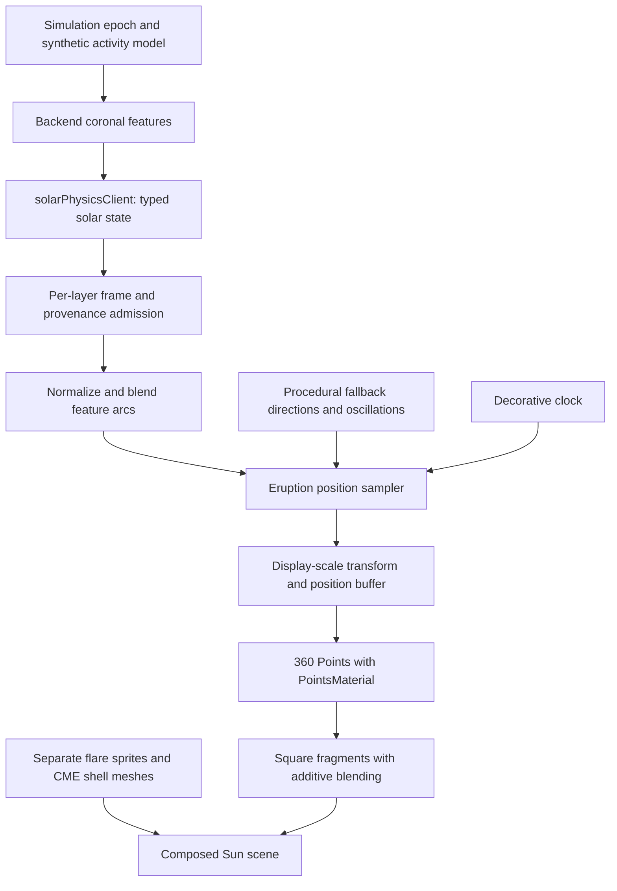

# Solar eruption visualization: architecture, defects and implementation strategy

**Updated: 2026-10-31. Owner issue: SCN-042. Status: square-particle defect repaired; physical modeling and broader SCN-042 acceptance remain open.**

> **Repair (2026-10-31, `fix/solar-eruption-visuals`):** Stage A and the size, density and
> restart-fade parts of Stage B are implemented. `createSoftDiscAlphaMap()` in `sunVisuals.ts`
> (inline, no separate module) generates the 64×64 `(1 - r²)²` mask proposed below; particles
> are 0.07–0.11 display radii instead of 0.28–0.65; 2,400 particles give about ten per admitted
> feature instead of one or two; each particle's vertex-color intensity is
> `sin(π·phase) × (0.3 + 0.7·brightness)` on feature paths and its plume height in the fallback;
> `disposeSolarDelivery` disposes the map. See the
> [rendered before/after evidence](../agent-notes/SOLAR_ERUPTION_VISUALS_2026-10-31_EVIDENCE/README.md)
> and the status table in §6. Sections 1–5 describe the pre-repair checkpoint below.

This is the dedicated writeup for the yellow/orange squares around the Sun. It
documents the current implementation, the screenshot failure, the recommended
repair, and the additional work needed for physically meaningful ejected-plasma
modeling. Creating this document does not implement the proposed renderer.

Source reviewed: application checkpoint `09421c9`, with documentation through
`f35cc25`, on `fix/remediation-completion-20261030`. References below are relative
to this checkout. The user's screenshot has no verified build revision, so its
exact executable cannot be attributed to that checkpoint.

Related records: [current remediation status](../agent-notes/REMEDIATION_STATUS_2026-10-30.md),
[remaining solar rendering acceptance](../agent-notes/REMEDIATION_SOLAR_SCN042_PRODUCTION_2026-10-14.md),
[earlier H1/H2 delivery decisions](../agent-notes/H1_SOLAR_DELIVERY_PLAN_2026-09-25.md),
and [accepted timing/display policies](supported-product-policies.md).

## 1. Reported problem and intended meaning

The screenshot supplied again on 2026-10-31 shows hard-edged translucent squares
moving around the Sun, with dense yellow/white overlap near the limb. Its visible
settings include Sun focus, simulation date 2027-04-26, forward speed +4.0 d/s,
Realistic scale enabled, Solar magnetic field disabled, and observation channel
Auto. The status identifies a backend solar model with synthetic forcing and
observations disabled until validated. The screenshot is conversation evidence;
it is not a new measured frame capture or a GPU calibration result.

The relevant object is `sun-eruptions`: 360 visual markers representing activity
around coronal structures. With admitted backend features, they move along
feature arcs. Without those features, they follow procedural radial/tangential
oscillations. Calling every marker an escaping mass element would overstate the
implementation: the shared feature list includes loops, plumes and CME-like
fronts, and the particle path does not filter by family.

The terminology matters for future modeling. A CME is an expulsion of coronal
plasma and magnetic field; a solar flare is a burst of electromagnetic
radiation. They can accompany one another, but the model needs distinct event
semantics. See NOAA's [CME explanation](https://www.spaceweather.gov/phenomena/coronal-mass-ejections)
and [solar-flare explanation](https://www.spaceweather.gov/phenomena/solar-flares-radio-blackouts).

## 2. Current architecture and data flow



| Responsibility | Current implementation | Contract / limitation |
|---|---|---|
| Backend feature generation | [`SolarCoronaPhysicsModel`](../backend/sim/solar_physics.py) | Deterministic, physically inspired loops/plumes/CME-like geometry; the class explicitly says it is not a full resistive-MHD solver. Feature arcs use solar-radius units and carry speed/brightness fields. |
| Fetch and admission | [`solarPhysicsClient.ts`](../src/frontend/features/solar/solarPhysicsClient.ts), [`validatedSolarLayerFrames`](../src/frontend/features/solar/solarGeometryContract.ts) | Geometry admission requires the supported synthetic, unvalidated frame contract, finite arcs, matching epoch and TDB time scale. Observational eligibility is a separate gate. |
| Scene ownership | [`createSunController`](../src/sunController.ts) | Creates the eruption object under the Sun node, assigns its frame, updates it, rescales it and disposes it. The magnetic-field checkbox controls a separate group. |
| Feature interpolation | [`solarFeatureBlending.ts`](../src/frontend/features/solar/solarFeatureBlending.ts) | Normalizes features by ID and interpolates arcs, including spherical direction interpolation. Converts backend speed into a perceptual `speedFactor`. |
| Marker generation and upload | [`createSunEruptionLayer` / `updateSunEruptionLayerFromBlendView`](../src/frontend/features/solar/sunVisuals.ts) | Allocates 360 markers, selects feature entries by particle index modulo feature count, or uses procedural oscillation. Uploads the shared position array and recomputes culling bounds. |
| Display transform | [`coronalToDisplay`](../src/frontend/features/solar/solarDisplayScale.ts) | Uses physical radius conversion at realistic scale. When the displayed Sun exceeds twice its physical radius, retains 0.15 of feature height above its surface. A further brightness-dependent radial boost is applied by the marker sampler. |
| Appearance | `PointsMaterial` in `createSunEruptionLayer` | Orange `#ffbf74`, transparency, additive blending, depth writes disabled and perspective attenuation. No texture or circular alpha mask. |
| Other eruptive visuals | [`solarFlares.ts`](../src/frontend/features/solar/solarFlares.ts), [`solarProminences.ts`](../src/frontend/features/solar/solarProminences.ts) | Separate flare/CME and prominence implementations. The prominence shader already masks circular points, but that shader is not the material used by `sun-eruptions`. A repair here does not automatically repair those other layers. |

### Time, motion and scale

The controller derives physical state from simulation Julian date. Particle
animation uses an accumulated decorative clock that advances only during forward
motion, caps each increment at 0.1 seconds, and freezes during pause, reverse and
reduced-motion suppression. Thus a marker's screen movement is not an integral
of plasma velocity over simulated days.

For backend-driven markers, the current phase is:

```text
phase = (decorativeSeconds * speedFactor * 0.08
         + particleIndex * 0.013 + randomPhase * 0.17) modulo 1
```

`speedFactor` comes from a nonlinear mapping of 20–3500 km/s into a perceptual
range of 0.02–0.95. Arc sampling is by vertex index, not arc length. These two
choices prevent reading a physically calibrated propagation speed from the
animation. The modulo operation also restarts a marker at the beginning of its
path without an individual birth/death opacity envelope.

The fallback has fixed randomly initialized directions, phases, speeds and
amplitudes. It oscillates; it does not integrate a persistent outward plasma
trajectory. A fresh layer can look different because its constructor uses
`Math.random()`.

Realistic scale calls the controller's scale update. It changes Sun and feature
dimensions and point-size inputs; it does not change the material, source
provenance, decorative clock or activity model. The material's color also has
no wavelength/channel input. The selected observation channel cannot turn these
orange markers into measured spectral emission.

## 3. Defects and modeling gaps

| Finding | Evidence and consequence | Disposition |
|---|---|---|
| Hard square footprint | `PointsMaterial` has neither `map` nor `alphaMap`; each point fills its rasterized square. | Confirmed source defect matching the reported appearance. |
| Prominent particle size | Construction uses `0.65 * sunDisplayRadius`; updates use `max(0.0000024, baseRadius * (0.28 + 0.2 * activity))`. These are material size inputs subject to projection, not measured plasma diameters. | Requires apparent-size review across camera distance, scale and DPR. |
| Bright overlap near the limb | All markers share a global activity-dependent opacity and additive blending. The screenshot shows intense overlap. | Source supports the mechanism; exact saturation and contribution from other layers need controlled rendered captures. |
| Path restart / inconsistent identity | Phase wraps modulo one; particle-to-feature assignment uses list index. Feature membership/order changes can move markers between paths. | Add explicit lifecycle and identity tests before changing behavior. |
| Ambiguous physical meaning | Loop, plume and CME-like features share the same markers; decorative timing and vertex-index sampling do not implement physical transport. | Define family-specific semantics before claiming ejected mass or speed accuracy. |
| Missing per-marker physical state | No per-marker mass, momentum, density, thermal energy, magnetic evolution or calibrated emissivity is carried by this layer. | A physical transport/emission model is further work. |
| Existing geometry defects | Zero blend alpha previously selected the target; copied buffer storage prevented expected uploads; stale bounds could cull moved points. | Repaired on this construction branch and regression-tested. These fixes did not supply an alpha mask. |

The documented [Three.js point material](https://threejs.org/docs/pages/PointsMaterial.html)
supports an alpha map and warns that projected point size is subject to hardware
limits. Its alpha map uses a grayscale color channel (green for RGB/RGBA), not
the texture's alpha channel. That distinction must be respected by the repair.

## 4. Recommended architecture for improvement

### Stage A — repair the square footprint

Retain the existing point object and geometry pipeline. Give its material one
owned, procedurally generated circular alpha texture. This is the recommended
first patch because it directly addresses the confirmed material defect and
keeps the already-tested frame, blending and upload paths easy to compare.

Proposed new module:
`src/frontend/features/solar/sunEruptionSprite.ts`, exporting
`createSunEruptionAlphaMap(): DataTexture`. Generate a 64×64 RGBA texture once per
eruption layer. At each texel center, let `r` be distance from the center in
coordinates spanning -1 to +1 and use:

```text
coverage(r) = max(0, 1 - r*r)^2
R = G = B = round(255 * coverage); A = 255
```

Set `NoColorSpace`, linear minification/magnification filtering, clamped wrapping
and no mipmap generation. Assign it to `PointsMaterial.alphaMap`. The grayscale
RGB values make the mask compatible with the material's green-channel sampling.
This generated data needs no external image asset or redistribution permission.

The owning controller must dispose the texture exactly once along with the
material and geometry. Material disposal alone does not express ownership of
the texture. The resource must be recreated with a new owned layer after the
existing recovery path rebuilds the scene.

This stage has deliberately narrow acceptance: a soft circular footprint with
transparent corners. Particle overlap, size tuning and physical-model fidelity
have separate acceptance below.

### Stage B — coherent visual particles

Use the Stage A rendered results to establish apparent-size and overlap budgets
at fixed cameras. Treat these as explicit visual design targets, not inferred
solar measurements. Record the selected values with before/after captures before
landing size or brightness changes.

Give each marker stable initialization and feature identity, plus an individual
opacity envelope that reaches zero at path restart. Preserve the accepted
decorative-clock policy for illustrative motion. Test disappearing features,
reordered lists and invalidated backend state rather than relying on one static
screenshot. If per-particle size/opacity exceeds `PointsMaterial`'s uniform
interface, introduce a small shader material with explicit position, size and
opacity attributes; keep coordinate admission and display transforms upstream.

The alternatives have different costs:

| Approach | Benefit | Cost / use |
|---|---|---|
| Alpha-textured `PointsMaterial` | Small, direct repair; standard renderer behavior and simple ownership. | Uniform size/opacity and hardware point-size limits remain. Recommended for Stage A. |
| Custom point shader | Analytic circle, per-marker lifecycle and size controls. | Own shader compilation, precision and material-update integration; current `isPointsMaterial` checks must be changed. Suitable if Stage B needs those attributes. |
| Instanced ribbons or volume rendering | Can depict continuous streams or extended emitting structures. | Larger geometry/overdraw and calibration burden. A possible later renderer, not a requirement for removing squares. |

### Stage C — physical eruption and emission modeling

Introduce an explicit event/sample contract before replacing illustrative paths:

- Event identity, family, source/provenance, epoch/time scale, coordinate frame,
  units, valid interval and uncertainty.
- Distinct attached loop flow, open plume/outflow and propagating CME behavior.
  An escaping event should have a documented lifetime and boundary behavior.
- Positions and velocities in physical units evaluated at simulation time.
  Keep optional decorative presentation time separate from those quantities.
- Transport quantities supported by the chosen model, with explicit conservation
  assumptions and tests. Do not populate missing mass/density/temperature with
  invented observations.
- An emission model for the displayed band, exposure and line-of-sight projection,
  supported by appropriate references and independent observations. Orange color
  and additive blending currently supply no such calibration.
- A documented transform from physical coordinates to enlarged display geometry.
  Preserve physical samples before compression and expose synthetic/observed
  provenance consistently with the existing status and admission gates.

Backend event generation, physical transport, observational calibration and
appearance should be independently replaceable. A future MHD solver would be a
separate subsystem with its own boundary/initial conditions, numerical budgets
and validation; this document does not claim that one has been implemented.

## 5. Implementation sequence and verification

All tasks below are **proposed**, except the historical regression repairs in
the final status table. They describe the next implementation, not tests run by
this documentation change.

1. **Capture a reproducible rendering failure.** Add a browser test under
   `tests/browser/solar-eruption-rendering.spec.ts` using the production eruption
   material and one controlled visible point on a dark target. Sample its center
   and square corners independently of the proposed mask generator. The current
   material should fail the transparent-corner requirement. Retain a full-app
   screenshot at the reported date, scale and Auto channel as a composition case.
2. **Implement the owned alpha map.** Add `sunEruptionSprite.ts` and focused tests;
   wire the map in `createSunEruptionLayer`. Verify finite texels, zero corners,
   nonzero center and radial falloff, then require the rendered pixel test to pass.
   Update the eruption disposal path and
   `src/sunController.visualLifecycle.test.ts` to prove texture disposal once and
   clean recreation. A property assertion that an alpha map exists is insufficient.
3. **Verify existing geometry and timing contracts.** Re-run blend endpoints,
   shared-buffer uploads, dynamic bounds, scale transitions, source revocation,
   frame orientation, pause/reverse/reduced motion and disposal regressions.
   Preserve the existing numerical thresholds and the separate scientific gate.
4. **Evaluate size, brightness and lifecycle.** At fixed epoch, feature state,
   camera and exposure, capture isolated particles and the composed Sun in both
   scales, near/default/far views and DPR 1/2. Record alpha coverage and clipped
   bright pixels in an eruption-only diagnostic pass, then assess the actual
   production composition with its normal antialiasing. Establish Stage B values
   from those comparisons before implementing them.
5. **Review and record closure by scope.** Record source revision, browser/GPU,
   shader success, raw captures and regression results. Close the square-footprint
   child only after its actual-render check passes. Keep broader SCN-042 artistic
   and observational acceptance open until its own gates pass.

Existing regression commands, run from this repository with the pinned Node/npm
versions in `package.json`:

```bash
npm test -- src/frontend/features/solar/sunVisuals.blendAlpha.test.ts src/sunController.frameReview.test.ts src/sunController.scaleActivity.test.ts src/sunController.visualLifecycle.test.ts
npm run typecheck
npm run test:types:ui
npm run build
```

After the proposed browser test exists, its focused command is
`npm run test:browser -- tests/browser/solar-eruption-rendering.spec.ts --project=chromium`.
Exercise supported Firefox/WebKit rendering paths where the required WebGL
capabilities are available and report any unsupported lane explicitly.

The existing [`verify_solar_main_frame.py`](../scripts/verify_solar_main_frame.py)
provides an additional frame/geometry regression gate with `--origin`, `--out`,
`--chromium` and `--expect-gpu`. Its passing geometric diagnostics do not replace
the new sprite-coverage and composed-appearance checks.

## 6. Current implementation status

| Work | Status at this writeup |
|---|---|
| Backend synthetic coronal features and current visual marker paths | Implemented; limitations documented above. |
| Zero-alpha blend, shared upload storage and moving-point bounds | Implemented on the construction branch; covered by the [October 30 verification record](../agent-notes/REMEDIATION_COMPLETION_2026-10-30_EVIDENCE/README.md). |
| Circular alpha texture and texture lifecycle regression | Implemented on `fix/solar-eruption-visuals` (d03ecd3, 269e075): texel-level mask tests in `sunVisuals.eruptionAppearance.test.ts`; disposal watched in `sunController.visualLifecycle.test.ts`. |
| Rendered square-corner regression and composed size/brightness acceptance | Composed appearance checked on a real GPU at realistic, enlarged and fallback views ([evidence](../agent-notes/SOLAR_ERUPTION_VISUALS_2026-10-31_EVIDENCE/README.md)). No automated rendered-pixel test yet. At the enlarged scale, compressed features still overlap into bright clumps at the limb. |
| Stable marker identity and individual restart opacity | Restart opacity implemented (per-particle fade, tested). Stable identity across feature reordering not implemented. |
| Physically calibrated plasma transport and emission | Further model/design/calibration work required. |
| SCN-042 complete end-to-end acceptance | Open. |
